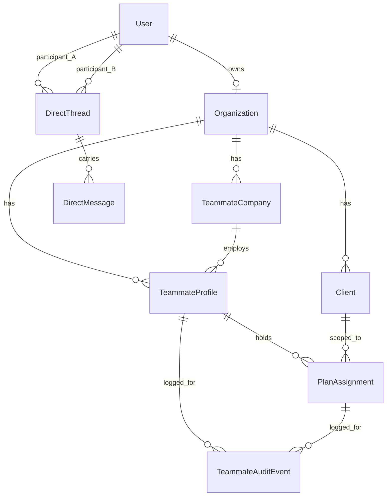
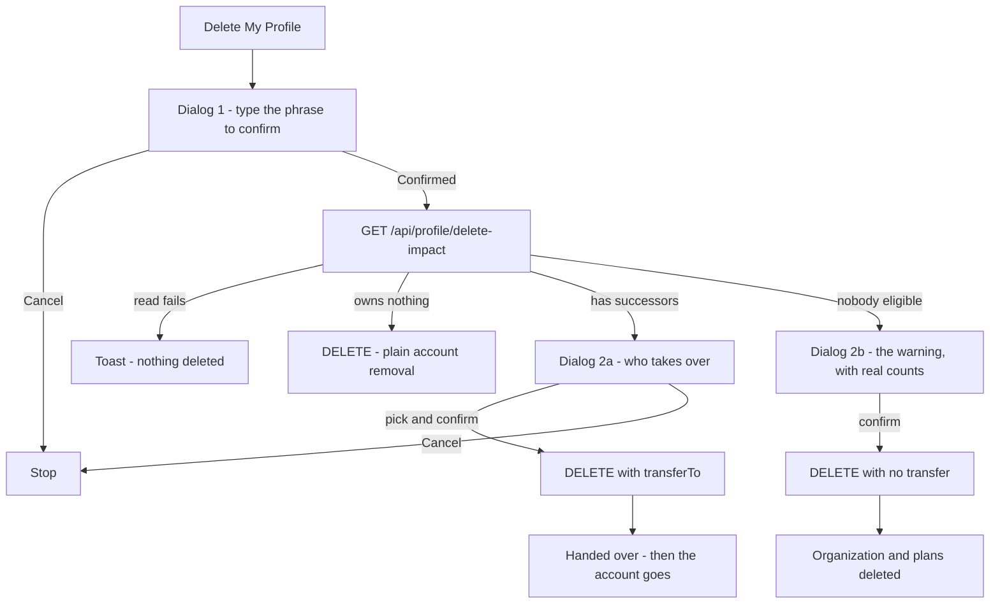

# Teammates Module

Source spec: `Team_Collaborator_Access_Developer_Spec (1).pdf`
T1 design + rationale: [`plans/teammates-t1-data-model.md`](../plans/teammates-t1-data-model.md)

This document covers the data foundation (ticket **T1**) that the rest of the
Team & Collaborator Access feature builds on: T2 (enforcement), T2a (Custom role
grid), T3-T8.

---

## 1. Where things live

| Concern | Location |
|---|---|
| Permission-grid contract (pure) | [`types/teammate.ts`](../types/teammate.ts) |
| Permission rules engine (pure) | [`lib/teammates/permissions.ts`](../lib/teammates/permissions.ts) |
| Role descriptions for the UI (pure, derived from the grids) | [`lib/teammates/role-summary.ts`](../lib/teammates/role-summary.ts) |
| Company-picker scope rule (pure) | [`lib/teammates/company-scope.ts`](../lib/teammates/company-scope.ts) |
| Teammate data access (server) | [`lib/teammates/`](../lib/teammates) |
| Organization helpers (server) | [`lib/organization.ts`](../lib/organization.ts) |
| Session/org resolution | [`lib/organization-session.ts`](../lib/organization-session.ts) |
| Verification + ops scripts | [`scripts/teammates/`](../scripts/teammates) |

The data-access modules are named `*.server.ts` deliberately: they import Prisma
and must never be pulled into a client bundle.

---

## 2. Data model



- **`Organization`** — tenancy root. One per advisor `User` (`ownerUserId`),
  created at signup or by the backfill script.
  Its `name`, `organizationEmail`, `branding` and the **firm profile**
  (`organizationType`, `customOrganization`, `teamSize`) are a **derived mirror** of the
  owner's `User` row, kept current by `syncOrganizationIdentity` in
  [`lib/organization.ts`](../lib/organization.ts), which all three profile write paths call
  (`app/api/profile`, `app/api/profile/update-profile`, and `app/api/onboarding-wizard/user-setup`).
  The `User` stays the single source; if you add another writer of those fields, call the sync
  there too — `verify-organization-sync` asserts the whole mirror
  (`npm run teammates:verify-org`).

  Why it matters, precisely: `Organization.name` is what every invitation email greets the
  recipient with, so a mirror frozen at signup means renamed organizations keep sending the
  old name. The T3 domain guess (via `getOrganizationDomains`) unions this mirror with the
  owner's own row, so it was **never** actually affected by staleness — the email mirror is
  kept true because it is the organization-level copy of that address.

  Settings → Organization writes the firm profile to the **`User` row**, not to
  `wizardSessions[0]`: a wizard session is one advisor's onboarding draft, so an
  organization-level setting saved there was invisible to the organization (and to a second
  admin). That tab is also the reason these three columns exist on `Organization` at all —
  they are the organization-owned copy of data that previously lived only in the owner's
  session.
- **`TeammateCompany`** — Partner Company (spec Part B item 2). Always
  `entityType = partner_provider`. One company serves many profiles.
- **`TeammateProfile`** — the reusable person (spec Part B item 1): identity,
  contact details, specialty, optional partner company, optional global
  `loginUserId`, and the Team-Member-only `allPlans` flag.
- **`PlanAssignment`** — one record per person per plan (spec Part B item 3):
  category scope, role, the full `permissionSet` grid, and the hub-visibility
  toggle.
- **`TeammateAuditEvent`** — who changed what, when, and which soft warnings were
  confirmed.
- **`DirectThread`** — one private conversation between exactly two logins of an
  organization: `userAId`/`userBId` in a canonical order, a per-participant read
  watermark (`aReadAt`/`bReadAt`), a per-participant **typing** timestamp
  (`aTypingAt`/`bTypingAt`, self-expiring — see §9j), and a denormalised
  `lastMessagePreview` so the inbox never reads the message table. See §9j.
- **`DirectMessage`** — one message in a thread: author, body, optional JSON
  attachments, and `deletedAt` for the author-only withdrawal placeholder.

`DirectThread`/`DirectMessage` are the **deliberate exception** to the plain-scalar
rule below: they carry real, cascading `User` foreign keys, because a private
conversation has no meaning once a participant's login is gone and the delete
*should* cascade. The compound unique on the canonical pair and the pair-order
`CHECK` (see §9j) are why the model needs a real relation where the teammate tables
do not.

### Org anchoring is additive by design

`User.id` remains the anchor for every pre-existing query (300+ call sites across
`app/api`). T1 adds `organizationId` *alongside* the legacy `userId` on `User`
and `Client` rather than renaming it:

- `Client.userId` is untouched, so nothing that already works breaks.
- New teammate code scopes exclusively by `organizationId`, obtained via
  [`lib/organization.ts`](../lib/organization.ts) — never from the session
  directly.
- `Client.organizationId` is nullable; helpers that need it tolerate an unstamped
  plan by falling back to the owner comparison (see
  `assertPlanInOrganization` in [`lib/teammates/assignments.server.ts`](../lib/teammates/assignments.server.ts)).

Teammate collections intentionally use plain scalar `organizationId` fields
instead of Prisma `@relation`s: the Mongo connector requires both sides of a
relation to be declared and adds referential-action semantics that an additive
migration does not want.

---

## 3. Permission grid

[`types/teammate.ts`](../types/teammate.ts) is the single source of truth for the
14 grid functions from spec T2a:

`plan_details_branding`, `create_benefits`, `key_contacts`, `documents`,
`meetings`, `marketing`, `video`, `disclaimers_compliance`,
`benefits_hub_preview`, `publish`, `invite`, `delete`, `org_settings`, `billing`.

Levels are `no_access | view | edit` for content rows and
`not_allowed | allowed` for `publish`, `invite`, `delete` (see
`permissionOptionsFor`).

**Preset grids** (`PRESET_PERMISSION_GRIDS`) — Owner (everything), Admin
(everything except Billing), Editor (create/edit, no publish/invite/delete/org/
billing), Contributor (category-scoped edit for collaborators), Viewer and
Reviewer (read-only).

**Collaborator hard blocks** (`COLLABORATOR_LOCKED_FUNCTIONS`) — Publish, Invite,
Delete, Org Settings, Billing. These can never be granted, including by a direct
API call: [`upsertAssignment`](../lib/teammates/assignments.server.ts) finalizes
the grid and then *validates* the caller's raw input, rejecting a request that
tried to smuggle a locked permission through.

Per spec T2a, the full grid is always stored on the assignment, never a reference
to a preset — so editing a preset later cannot alter existing Custom users.

---

## 4. Rules engine

[`lib/teammates/permissions.ts`](../lib/teammates/permissions.ts) exports:

- `resolveAssignmentGrid` / `finalizePermissionSet` — preset lookup plus
  normalization, auto-enforced rules, and hard blocks.
- `applyAutoEnforcedRules` — Edit implies View; Publish requires Disclaimers View;
  Delete requires Edit on at least one content function.
- `applyHardBlocks` / `lockedFunctionViolations` — collaborator hard blocks.
- `validatePermissionSet` — structural violations (including
  `collaborator_all_plans` when a plan scope is supplied).
- `evaluateSoftWarnings` — all ten spec soft warnings, checked per plan.
- `summarizePermissionSet` — the plan-aware line from T2a Step 3,
  e.g. `Custom · Edits Documents on Ayres · Views Precision Optical`.
- `matchPreset` — backs the "This matches [Editor]. Use the preset instead?" warning.

---

## 5. Scripts

| Command | What it does |
|---|---|
| `npm run teammates:check-schema` | Verifies the 5 T1 collections and 15 indexes exist. |
| `npm run teammates:indexes` | Applies the T1 indexes directly (idempotent). |
| `npm run teammates:backfill` | Creates one Organization per existing User and stamps `organizationId` onto User + Client rows. Supports `--dry-run`. |
| `npm run teammates:verify` | Runs the 24-assertion T1 acceptance suite against the real data layer with self-cleaning fixtures. |
| `npm run teammates:verify-t2` | Runs the 65-assertion T2 enforcement suite (the three T2 acceptance criteria, the one-Owner invariant, plan lists, the route guard, the chrome rule that narrows a Collaborator's navigation — including that the Create Benefit wizard is hidden, while the function its editor saves under stays granted — the category scope that narrows a Collaborator's `/benefits` rows to the sections they were given, and the rule behind the role badge the header prints). |
| `npm run teammates:verify-t3` | Runs the 53-assertion T3 suite (seat metering, invite expiry, the upgrade-confirm gate, the owner-first team list, onboarding pre-fill, editing a member, and the roles explainer). |
| `npm run teammates:verify-backfill` | Asserts the post-backfill invariants (every User/Client org'd, legacy `Client.userId` intact). |
| `npm run teammates:verify-t4` | Runs the 79-assertion T4 suite (the invite path, the category merge, the deep link, the Who-is-this presets, the sponsor-domain guess, the search, the audit row, the card payload the Collaborator card renders, the plan lookup — id-or-slug plus the repair of an unstamped `organizationId` — and the resend, including its cooldown and its three refusals). |
| `npm run teammates:verify-t5` | Runs the 38-assertion T5 suite (contact → invited without duplication, the plan-scoped section choice, the Contributor default, the source on the audit row, and the merge on re-invite). |
| `npm run repair:unique-conflicts` | Finds (and with `--apply`, removes) duplicate session rows that block unique-index builds. |
| `npm run repair:partial-indexes` | Re-applies the partial unique index on `Client.slug`. |
| `npm run repair:purge-orphaned-user` | Inventories (dry run) then with `--apply` removes everything left behind by a deleted User account. |
| `npm run teammates:verify-t6` | Runs the 35-assertion T6 suite (the four acceptance criteria, per-assignment role and visibility, the Delete guard, the audit trail, and All Plans staying Team-Member-only). |
| `npm run teammates:verify-t2a` | Runs the 25-assertion T2a suite (per-function Custom enforcement, same-vs-per-plan grids, the locked-row refusal, All Plans, the missing-grid refusal, soft warnings and their audit trail, and the summary line). |
| `npm run teammates:verify-t7` | Runs the 26-assertion T7 suite (the three acceptance criteria, display-vs-access, the mirror's idempotency and removals, hidden categories, and the unmirrorable-contact residue). |
| `npm run teammates:verify-t9` | Runs the 44-assertion T9 suite (the signed token and its refusals, the mailbox guard, the profile guards, the inviter's note, acceptance creating vs reusing a login, the seat conversion, replay, both audit rows, and the tenancy invariant — the login anchored to the inviting organization and owning none of its own). |
| `npm run comments:verify` | Runs the 109-assertion Plan/Benefit comments suite (section + text-range threads, implicit-by-View including a Collaborator, category scope, the refusals, the body limit's exact boundary, the reply/thread/mention notification fan-out, **Owner/Admin-only moderation with the author refused**, **category-scoped mention candidates and attachment reads**, the **per-person `currently typing` signal — named, self-expiring, cleared on reply, and reported for the surface's own composer as well as for threads**, **assigning work from a thread (who may be handed it, the derived offer enumerated into inner tasks, the write and its notification, and the dashboard's one-row-per-unit-of-work side of it)**, **the profile card (the organization gate, the seat-before-login precedence that keeps the Owner's card from being blank, and the messaging standing the button is drawn from)**, **the portal rail (the segment-to-category round trip against `getBenefitPortalSegment`, both Custom-hub addresses, the no-rail paths, and the `?comments=on` flag's URL handling)**, and the plan-delete cascade). See §9i. |
| `npm run messages:verify` | Runs the 59-assertion Direct Messages suite (the directory predicate that doubles as the gate, the refusals — including the organization owner refused a thread between two other people — the canonical pair and the `CHECK` that enforces it, the body limit's boundary, unread and the read watermark, ONE Bell row per conversation, **attachment reads that follow participation and never the org fallback**, the **`load earlier` page boundary and its cursor**, the **self-expiring `currently typing` signal (peer-only, cleared on send, and marked on the conversation list)**, and the login-delete cascade). See §9j. |
| `npm run teammates:backfill-contacts` | Projects every plan's `keyContacts` onto profiles + assignments (T7). Idempotent; `--dry-run` to count without writing. Run it before the hub reader switch and after adding a new contacts writer. |
| `npm run repair:purge-verification-fixtures` | Removes fixtures stranded by an interrupted verify run (dry run; `--apply` to delete). See §7.7. |

Each verify script also **sweeps stranded fixtures before it asserts** and installs a
SIGINT/SIGTERM handler that sweeps before exiting (§7.7), so an interrupted run is
self-healing rather than something you have to notice and repair. Do not run two
verifications concurrently — each sweep removes the other's rows, because a foreign
stamp is indistinguishable from a stranded one.

### Toolchain prerequisites

- **pnpm** is the declared package manager (`packageManager: pnpm@10.22.0`), but
  Node does not bundle it. Install it once with `npm install -g pnpm@10.22.0`
  (or `corepack enable pnpm`). pnpm reads `nodeLinker: hoisted` from
  `pnpm-workspace.yaml` — that setting must not move back into `.npmrc`, where
  npm warns about it on every command.
- **Windows PowerShell** refuses npm's `.ps1` shims under the default
  `Restricted` execution policy, producing
  `pnpm : ... cannot be loaded because running scripts is disabled`.
  `Set-ExecutionPolicy -Scope CurrentUser -ExecutionPolicy RemoteSigned` fixes it
  without admin rights.
- **A network that can route IPv6 to AWS — this one cannot, and it makes the database look down.**
  Both Neon hosts publish **AAAA** records beside their A records, and Prisma's engine picks a
  family per connection, so the symptom is INTERMITTENT rather than constant: the same script
  passes on one run and dies on the next with `P1001 Can't reach database server at …`, while the
  app's own reads, `psql` and `Test-NetConnection -ComputerName <host>` all look fine, because those
  resolve IPv4. One step settles the diagnosis: a TCP test to the host's **A** address succeeds and
  the same test to one of its **AAAA** addresses fails instantly. Retrying genuinely works — it is a
  coin toss per connection — but the durable fix is to restore IPv6 on the router, and the better
  fix for this project is to run Postgres locally, which also removes the intercontinental
  round-trip §9i measures. The pooled and direct hosts behave the same here: `DIRECT_URL` publishes
  AAAA records too, so pointing `DATABASE_URL` at it does **not** avoid the choice.
- **Two users signed in at once, locally: browse `localhost:3000` and `127.0.0.1:3000`.** Those are
  different HOSTS, and cookies carry no `Domain` attribute (`lib/auth-options.ts` leaves it unset on
  purpose), so one browser keeps two separate session jars and each can hold a different login. The
  one thing that broke it was NextAuth's redirect: v4 derives its base URL from `detectOrigin()`,
  which returns `NEXTAUTH_URL` unless `AUTH_TRUST_HOST` (or `VERCEL`) is set — so signing in from
  `127.0.0.1` handed the browser back to `localhost`, i.e. straight into the *other* session.
  `.env.local` now sets `AUTH_TRUST_HOST=true`, which makes the base URL the host the request
  arrived on. Verified end to end: two different users, one signed in per host, leave each host
  answering `/api/auth/session` with its own user and redirecting to its own origin. Two caveats —
  **Google sign-in needs a second redirect URI** registered for the 127.0.0.1 origin
  (`http://127.0.0.1:3000/api/auth/callback/google`) or it fails with `redirect_uri_mismatch`; and
  signing out of one host does not sign you out of the other, which is the point.

`prisma db push` now completes cleanly and reports "already in sync" on a second
run. The `teammates:indexes` script remains as a fallback for the case where a
push aborts part-way and leaves new collections without their indexes.

---

## 6. T1 status

Status: **implemented and verified** (not yet reviewed/accepted).

Acceptance criteria from the spec, all asserted by
[`scripts/teammates/verify-t1.ts`](../scripts/teammates/verify-t1.ts):

| Criterion | Result |
|---|---|
| Jane holds assignments on three plans from one profile | Pass |
| Editing Jane's profile in Org A does not change her profile in Org B | Pass |
| Partner companies never appear in Plan Sponsor search | Pass |
| Two collaborators from ABC Benefits share one company record | Pass |

Extra assertions cover the compound unique (one assignment per person per plan),
full-grid persistence, the collaborator Publish hard block surviving a DB round
trip, reuse-or-create by email, and cross-organization isolation of both profiles
and companies.

### Verifying locally

```bash
npx prisma generate
npm run teammates:check-schema
npm run teammates:verify-backfill
npm run teammates:verify
npm run teammates:verify-t2
```

All of these must pass. As of the last run: schema check OK (5 collections, 15
indexes); backfill verification all assertions passed; T1 acceptance suite 24/24;
T2 enforcement suite 23/23; `npx tsc --noEmit` and `npx next lint` both clean.

---

## 7. Database repairs applied

`npx prisma db push` was blocked by pre-existing data / schema problems unrelated
to T1. Because MongoDB pushes are not transactional, each blocker revealed the
next one. All are now resolved, and a push reports "already in sync".

### 7.1 Duplicate session rows (14 removed)

Several wizard step models declare `sessionId @unique`, but the wizard writes
those rows with a read-then-write pattern (`findFirst` → update or create), so a
retried or concurrent step save leaves a second row for the same session. One such
duplicate aborts the entire push, skipping every index after it.

Removed: 1 `WizardClientProfile`, 5 `WizardTeamSize`, 2 `WizardServices`,
2 `WizardUserSetup`, 4 `NewClientKeyContacts` — the most recently updated row per
session is kept. Backups:

- `scripts/repair/backups/wizard-client-profile-<ts>.json`
- `scripts/repair/backups/unique-conflicts-<ts>.json`

`npm run repair:unique-conflicts` re-checks this (dry run by default). It also
scans `Client.slug`, `PortalSlug.slug`, and `Benefit(clientId, category)` and
**reports** conflicts there without deleting anything — a duplicate in primary
business data is a decision, not a repair. That scan currently reports none.

### 7.2 `Client.slug` — `@unique` removed

`slug String? @unique` is unsatisfiable on MongoDB once two plans have no slug: a
Mongo unique index treats every null as a real key, so the build fails with
`dup key: { slug: null }`. Three plans currently have a null slug.

Resolution:

- `@unique` removed from `Client.slug` in [`prisma/schema.prisma`](../prisma/schema.prisma)
  (the only affected call site, `findUnique` in
  [`app/api/check-portal-url/route.ts`](../app/api/check-portal-url/route.ts), was
  switched to `findFirst`).
- Global slug uniqueness is unaffected: it is guaranteed by `PortalSlug.slug`
  (`@unique`, non-null), which registers every current **and retired** slug.
- A partial unique index (`partialFilterExpression: { slug: { $type: "string" } }`)
  is additionally applied to `Client.slug` so real slugs stay unique at the
  database level. Prisma cannot express this declaratively, so it is managed by
  `npm run repair:partial-indexes` and survives `db push`.

### 7.3 Prisma/MongoDB `null` filter semantics (important)

On this Prisma + MongoDB combination, `{ field: null }` matches **only explicit
nulls — never absent fields**. This silently broke plan stamping in the first
backfill run (`plans stamped: 0`) and the `listTeammateProfiles` deactivation
filter.

Any "not yet set" filter must therefore cover both shapes:

```ts
where: {
  OR: [{ field: null }, { field: { isSet: false } }],
}
```

All occurrences are fixed: [`stampPlansWithOrganization`](../lib/organization.ts),
the backfill script, [`listTeammateProfiles`](../lib/teammates/profiles.server.ts)
and [`listAllPlansTeamMembers`](../lib/teammates/profiles.server.ts).

### 7.5 Duplicate-profile guard at the writer

`TeammateProfile(organizationId, email)` carries no unique constraint, and only
[`findOrCreateProfile`](../lib/teammates/profiles.server.ts) was de-duplicating —
so a caller using [`createTeammateProfile`](../lib/teammates/profiles.server.ts)
directly could create the duplicate the spec forbids. The guard now lives at
`createTeammateProfile`, the only writer: it refuses with
`profile_email_exists` (409), or `profile_email_deactivated` when the existing
row is deactivated and should be reactivated instead. Covered by two assertions
in `verify-t1`.

### 7.4 Orphaned rows from a deleted account — purged

Two plans (`Gloomis`, `Loading LLC`) and their content were owned by
`userId=6a9b1976b81208c857a6922b`, an account deleted during this work. Deleting a
`User` only removes the `User` row, so everything that referenced it survived as
unattributable data — the backfill could not assign it an Organization, and
teammate assignment on those plans would have been refused.

```
npm run repair:purge-orphaned-user            # dry run: inventory only
npm run repair:purge-orphaned-user -- --apply # delete
```

Removed **20 rows across 13 tables**: 2 plans, 4 documents, 2 benefits, 2 meetings,
4 meeting custom types, 2 wizard sessions + their step rows, 1 new-client wizard
session, plus the plan-scoped portal slugs and videos the cascade owns. Full dump
written first to
`scripts/repair/backups/purged-user-6a9b1976b81208c857a6922b-<ts>.json`.

Deletion reuses the app's own cascades
([`deleteClientAndScopedData`](../lib/delete-client-scoped-data.ts) and
[`deletePlansAndScopedDataForUser`](../lib/delete-user-plans-and-scoped-data.ts)),
so plan-scoped children are removed in the order their required relations demand.
The script refuses to run while the `User` still exists, and verifies zero
remaining references afterwards. `verify-backfill` now reports no orphans.

### 7.6 Plan creation now stamps `organizationId` — fixed

Every teammate read filters plans by `organizationId`, and **no** creation path used to
set it. All four wrote `userId` only:

| Route | Was |
|---|---|
| [`POST /api/clients`](../app/api/clients/route.ts) | `{ ...body, userId }` |
| [`POST /api/clients/create`](../app/api/clients/create/route.ts) | explicit field list, no org |
| [`POST /api/new-client-wizard/complete`](../app/api/new-client-wizard/complete/route.ts) | explicit field list, no org |
| [`POST /api/new-client-wizard/save-draft`](../app/api/new-client-wizard/save-draft/route.ts) | `{ ...clientUpdateData, userId }` behind an `as any` |

The consequence was not theoretical: a plan created after the last backfill run was
**invisible to the org-scoped layer** — `listAccessiblePlanIds` would not return it,
`assertPlanInOrganization` would refuse teammate assignment on it, and the T5 invite
raised against a draft id would fail. It surfaced during this work as one unstamped
client, and `verify-backfill` reported it as "every Client whose owner still exists is
stamped with an organizationId".

Each route now calls the existing idempotent
[`getOrCreateOrganizationForUser(actorUserId)`](../lib/organization.ts) and writes the
result, **after** any object spread so a caller-supplied value cannot place a plan in
another organization. In `save-draft` only the create branch stamps — the update branch
leaves the column alone, because re-stamping on every autosave would be pointless work
on a row this route already stamped.

The existing drifted row was fixed with `npm run teammates:backfill` (1 plan stamped).
`verify-backfill` now also prints the offending plan's name and id, plus the remedy for
each of the two causes, because "1 unstamped" alone does not say whether to re-run the
backfill or to sweep a fixture.

### 7.7 Interrupted verify runs no longer strand fixtures — fixed

`verify-t1` … `verify-t9` build isolated fixtures, assert, and delete them unless
`--keep` is passed. A Ctrl-C, a dropped connection or a crash skipped the cleanup, and a
stranded fixture owner has no Organization — which fails the NEXT `verify-backfill` on
two assertions that read like code regressions and are not.

Two mechanisms now make that self-healing, both in
[`scripts/teammates/shared.ts`](../scripts/teammates/shared.ts):

- **`sweepStaleFixtures()` runs at the start of every verify script**, so an interrupted
  run's rows are gone before anything is asserted. `exceptStamps` spares the current
  run.
- **`installFixtureGuards()` sweeps on SIGINT/SIGTERM** before exiting, so Ctrl-C leaves
  the database clean rather than waiting for the next run.

Selection is deliberately narrow. Owners must match
`/^t[a-z0-9]{1,3}-verify-…@<domain>\.test$/i` — the `t<n>-verify-` prefix is asserted on
every fixture account and no real address carries it. Because `verify-t2` deliberately
creates an organization whose `ownerUserId` is a *fabricated* id (it asserts the "owner User
is gone" case) and a plan inside it, rows are also matched by name against
`/^t\d[ -]verify-/i`. The Prisma `contains`/`endsWith` filters are coarse pre-cuts — the
typed API has no `$regex` — and the JS regexes are what decide, so they can only narrow the
set. `npm run repair:purge-verification-fixtures` is the same sweep as a manual command,
dry-run by default.

**Two things that narrow must not:** the ticket tag is any `t`-stamped one (`t1`, `t2a`,
`t9`, …), and the mailbox may sit on any reserved `.test` domain — fixtures also use
`@abbenefits.test`, `@abc.test`, `@other.test` and `@elsewhere.test`. An earlier version
restricted both (`t[1-5]` and `@example\.test`), which is precisely how a stranded T9 login
survived a sweep and broke the next `verify-backfill`.

Two implementation notes worth keeping:

- **No `"__none__"` sentinels.** `id` and `profileId` are ObjectIds and Prisma validates
  every value in an `in` list, so a placeholder string raises `P2023 Malformed ObjectID`.
  An empty `in: []` already matches nothing.
- **"Nothing to purge" must check every count, not just users.** A run can have zero
  stranded users and still leave an organization and its audit rows behind.

Verified end-to-end twice. `npm run teammates:verify-t2 -- --keep` (deliberately stranding
4 users plus the ghost org and plan) followed by `npm run teammates:verify-backfill` printed
`Swept 4 fixture user(s)…` and passed all 7 assertions; before the fix the same sequence
failed 3. Later, a T9 run that left two accepted logins behind — one on `@abbenefits.test` —
was invisible to the old pattern and made `verify-backfill` report `2 missing`; the widened
pattern now finds and removes both.

---

## 8. T2 — Permission enforcement layer

Implemented. The engine is [`lib/teammates/access.server.ts`](../lib/teammates/access.server.ts);
the pure, client-safe half is [`lib/teammates/permission-levels.ts`](../lib/teammates/permission-levels.ts).

### The single decision function

`resolvePlanAccess({ userId, clientIdOrSlug, category?, permission?, level? })`
returns a discriminated result, so the API can map it to a status and the UI can
render the right refusal:

| Outcome | When | API mapping |
|---|---|---|
| `kind: "owner"` | `Client.userId` is the caller, or the plan's Organization is owned by them | allow |
| `kind: "teammate"` | profile for this org + assignment for this plan, category and function all satisfied | allow |
| `not_assigned` | no profile in the org, or no assignment for this plan | 403 |
| `profile_deactivated` | profile exists but is deactivated | 403 |
| `category_not_assigned` | assigned, but not to the requested category | 403 |
| `permission_denied` | assigned, but the grid denies the function/level | 403 |
| `plan_not_found` | plan doesn't resolve | 404 |

Two deliberate design points:

- **Owner detection checks `Client.userId` first.** An owner whose Organization
  row has not been backfilled yet is never locked out of their own plans.
- **Hard blocks are re-applied on top of the stored grid** (`effectivePermissionSet`),
  so a Custom grid that somehow carries Publish/Invite/Delete/Org Settings/Billing
  still cannot be exercised by a collaborator. This is T2's "hard rule, including
  for Custom roles".

### Signed URLs (Part B item 3)

R2 keys are `org/{orgId}/plans/{planId}/{documents|branding|uploads}/…`
([`lib/r2.ts`](../lib/r2.ts)). `parseR2Key` extracts the **plan** segment, so a
signed-URL request is checked against the caller's assignment rather than the bare
`org/{userId}/` prefix match the routes used before. Legacy org-level keys (no
plan segment) still fall back to an ownership check.

### UI (Part A)

- [`components/pages/no-access-notice.tsx`](../components/pages/no-access-notice.tsx)
  — the restricted-page state, using the spec's copy verbatim.
- [`app/api/teammates/plan-access/route.ts`](../app/api/teammates/plan-access/route.ts)
  — returns the same decision the mutating routes enforce, plus the effective
  `permissionSet` so controls can be hidden/disabled.
- [`hooks/usePlanAccess.ts`](../hooks/usePlanAccess.ts) — client hook over that
  endpoint, with a fail-closed `can(fn, level)`.
- Reference wiring: [`app/(dashboard)/edit-benefit/[planId]/[category]/page.tsx`](../app/(dashboard)/edit-benefit/[planId]/[category]/page.tsx)
  renders `NoAccessNotice` instead of the editor when denied.
- **`loading` is not `denied`** — a distinction that had to be made explicit, twice.

  1. A falsy `planId` (exactly what `useParams()` returns on the first client render
     of a dynamic route) was reported as `denied`, so the notice flashed with
     `Reference: unknown` — no server decision had been made at all.
  2. With that fixed it still flashed, because of an **abort race**: the effect's
     cleanup aborts the in-flight request when the inputs change, and they *do* change
     right after mount (the plan arrives, then the category). An aborted fetch still
     runs its `.finally`, which cleared `loading` while `state` was still `null` — so
     the hook fell through to `denied` for as long as the *replacement* request took
     (~1s on a cold route).

  Both are fixed in [`usePlanAccess`](../hooks/usePlanAccess.ts): an `active` flag now
  guards **every** state write from a run, including the `.finally`, so a superseded
  request publishes nothing; and the decision ladder is
  `!planId → loading`, `loading → loading`, `!state → loading`, and only a real
  response body can produce `denied`. The no-reason fallback is `lookup_incomplete`
  rather than `unknown`. The page renders a spinner for the loading state instead of
  `null`, so the wait reads as a wait. Fail-closed is unchanged where it matters:
  `can()` returns false while loading, and a failed lookup is still refused — the hook
  simply never *claims* a refusal that no one issued.

The UI check is presentation only. The API is the enforcement point — a client
that ignores the hook still gets refused by the server.

### Route coverage

Adoption goes through [`lib/teammates/plan-guard.server.ts`](../lib/teammates/plan-guard.server.ts):

- `authorizePlan(...)` — decision only.
- `getAuthorizedClient(...)` — the drop-in for
  `prisma.client.findFirst({ where: { id: clientId, userId } })`, returning the
  full `Client` row when the actor owns the plan **or** holds an assignment for
  it. One query: the row is loaded once and authorized in place.

| Route | Enforced |
|---|---|
| `GET /api/clients` | scoped to `listAccessiblePlanIds` — see "Plan lists" below |
| `GET /api/r2/signed-url` | plan assignment + documents/branding permission |
| `GET /api/r2/object` | same rule (portal path resolves the plan owner) |
| `GET /api/documents/[id]/view` | `documents: view` + category scope (dashboard); anonymous portal path unchanged |
| `GET/POST /api/documents` | `documents: view` per plan; list scoped by accessible plans; uploads need `documents: edit` |
| `PATCH/DELETE /api/documents/[id]` | `documents: edit` on the document's plan |
| `POST /api/documents/reorder` | `documents: edit` per plan (was a `client: { userId }` relation filter) |
| `GET /api/clients/[id]` | assignment required to read the plan |
| `GET/PUT /api/clients/[id]/benefits/[category]` | `create_benefits` at `view` / `edit` + category scope |
| `PUT /api/clients/[id]` | assignment required, then `create_benefits: edit` **or** `plan_details_branding: edit` — the plan-level half of the Benefits save and the Edit Plan save. Was `Client.userId`, which 403'd every teammate |
| `GET/POST /api/clients/[id]/meetings` | `meetings: view` (replaced the local `assertClientOwner`) |
| `PATCH/DELETE /api/clients/[id]/meetings/[meetingId]` | `meetings: view` (replaced the `userId` column filter) |
| `GET/POST /api/marketing/assets` | `marketing: edit` |
| `/api/marketing/flyers/{render,generate-copy,[id],[id]/file}` | `marketing` via `getAuthorizedPlanClient` / `resolvePlanAccess` |
| `GET/POST /api/webinars` | `marketing` at `view` / `edit`; list scoped by accessible plans |
| `/api/dashboard/{stats,active-plans,needs-attention,tasks}` | client reads scoped by `listAccessiblePlanIds` (was `userId`, so a teammate saw zeros) |
| `/api/dashboard/{meetings-this-week,upcoming-meetings,recent-activity}` | meetings matched by `OR [{ userId }, { clientId in accessiblePlanIds }]` |

### Plan lists

"Collaborators never see unassigned plans" is implemented **at the API source,
not per component**: every plan picker in the app reads `GET /api/clients`
(Documents, Marketing, Meetings, Videos, Webinars, Benefits Step 1, the clients
dashboard), and that route now scopes its `where` to
[`listAccessiblePlanIds`](../lib/teammates/access.server.ts) — owned plans plus
assigned teammate plans — instead of `userId` alone. A teammate is therefore
structurally unable to select a plan they have no assignment for, and a
deactivated teammate's plans drop out of the list.

The **dashboard** follows the same rule, because a teammate's `User.id` owns no
`Client` rows, so keying on `userId` made every tile read zero for anyone but the
owner. `stats`, `active-plans`, `needs-attention` and `tasks` now read
`id: { in: accessiblePlanIds }`, and the meeting feeds (`meetings-this-week`,
`upcoming-meetings`, `recent-activity`) match
`OR [{ userId }, { clientId: { in: accessiblePlanIds } }]` — which keeps an
owner's planless meetings visible while letting a teammate see the owner's
meetings on the plans they share (a teammate's own `userId` owns neither the plan
nor its meetings). Recent Activity's marketing assets use the same `OR`. Manual
tasks stay the reader's own to-do list; only their plan-name lookup is resolved
against the accessible set.

### Still owner-scoped

- `/api/webinars/[id]` (PATCH/DELETE) and `/api/webinars/bulk-delete`
- `/api/documents/{batch,expiring,client/[clientId]}`
- `/api/clients/[id]/{slugs,portal-data}`
- `/api/videos/*` and the legacy `/api/plans/*`

The first three are the same mechanical swap to `getAuthorizedClient` /
`resolvePlanAccess`, and remain owner-only until then — so a teammate is refused
rather than over-permitted. The risk is under-access, not leakage.

The last group is **not** mechanical and is deliberately out of T2. Videos and
legacy plans are scoped by the `Plan` model (`plan: { userId }`), which teammate
assignments do not model at all: an assignment is `Client`-scoped. Migrating them
requires deciding whether an assignment should also grant access to a `Plan` row —
a product question, not a refactor.

### Verification

```
npm run teammates:verify-t2     ->  65/65 assertions passed
```

Covers: the Contributor is allowed Ayres → Group Health and denied Ayres →
Retirement (`category_not_assigned`) and Precision Optical (`not_assigned`); the
throwing form returns 403 with the spec copy; the Viewer can read but not save
edits or publish; a signed document URL is refused to an unassigned user, allowed
to an assigned Viewer, and refused across plans because the key's plan segment is
enforced; and the one-Owner invariant refuses removing the last Owner.

It also pins the **chrome rule** (§9b, "What a Collaborator's chrome offers"): every hidden
destination is refused for a Collaborator, including a child of a hidden group (a plan id under
`/clients`, and both `/communications/meetings` and `/communications/marketing`), an Owner is never
narrowed, and the destinations they *were* invited for stay open (`/benefits`, `/edit-benefit/…`,
`/edit-client/…`).

The entries whose grid rows are deliberately left **granted** are asserted as pairings, in both
directions, because a reader who saw only one half would take it for an oversight: `/documents` is
refused while `documents: edit` still stands, `/communications` is refused while `meetings: edit`
still stands, and `/new-benefits` is refused — to a Contributor just as much as to a Viewer, however
the grid reads — while `create_benefits: edit` still stands, because that is the function the BENEFIT
EDITOR saves under. Hiding the wizard removes creation, not the permission.

And it pins the **second half of the same rule** — the category scope, which is what makes `/benefits`
show a Collaborator the *sections* they were given rather than all four of a plan's rows (§9b, "What a
Collaborator's /benefits page offers"): a Contributor scoped to Group Health has exactly one scoped
plan, pinned to that one section, while the plan's other three compare outside it; an all-categories
Viewer produces **no** entry, so their rows are left unnarrowed; an Owner, and a login with no
teammate profile at all, are never narrowed; the alias mapping the filter shares with
`resolvePlanAccessForPlan` holds both ways ("Custom" ≡ "Company / Plan Sponsor", "Health Insurance" ≡
"Group Health", "Wellness Programs" ≡ "Other"); two live profiles on one plan union their lists with
no duplicate section; and deactivating a profile drops the scope along with the plan.

And it pins the **role badge** the header prints (§9b, "What the header badge says about the viewer"):
an Owner reads Owner, a Collaborator seat reads Collaborator whatever preset it holds, an *invited*
login that owns an Organization of its own **still** reads Collaborator — the trap the seat-first
ordering exists for — a Team Member reads the role they hold including the most privileged one across
two plans, and a login holding an Owner seat in a second organization reads Owner.

---

## 9. T3 — Team Member management + seat counter

Implemented. Seat logic lives in [`lib/teammates/seats.server.ts`](../lib/teammates/seats.server.ts);
team management in [`lib/teammates/team.server.ts`](../lib/teammates/team.server.ts);
the onboarding prefill in [`lib/teammates/onboarding-owner.ts`](../lib/teammates/onboarding-owner.ts).

### Seat rules

| Rule | Behaviour |
|---|---|
| Who holds a seat | The owner, Active Team Members, and unexpired pending invites. Contacts and Collaborators never do (spec Part B item 1). |
| Invite hold | A pending invite reserves a seat for 14 days, then stops counting. The meter ignores stale invites immediately, and a sweep moves them back to `Contact` so the stored state is truthful — the profile is kept, never deleted. |
| At the limit | A 409 with code `seat_limit`, not a hard block, so the UI shows an upgrade confirm (Part B item 3). Confirming requires Owner/Admin (`isOwnerOrAdminOfOrganization`), otherwise 403 `seat_limit_owner_only`. |
| Domain guess | A matching email domain defaults to Team Member, anything else to Collaborator (Part B item 4). It is only a default — the API returns it and the UI can override. |

### Two decisions the spec left open

Both are centralised so they are one-line changes:

- **The owner occupies a seat** — `OWNER_CONSUMES_SEAT` in [`seats.server.ts`](../lib/teammates/seats.server.ts).
  The spec says only Team Members use seats and that the owner is the first Team
  Member, so the owner counts. Set it to `false` to give the owner a free seat.
- **A confirmed over-limit add raises `seatsIncluded` by one**, standing in for "they
  moved to a bigger tier" until pricing exists. It keeps the meter honest rather
  than showing "6 of 5 used". `DEFAULT_SEATS_INCLUDED` (5) and
  `PLACEHOLDER_PLAN_TIER` are the other placeholders.

### API

| Route | Purpose |
|---|---|
| `GET /api/teammates/team` | The Settings → Team list (`team`) plus the seat meter. The response also carries a `collaborators` array, which no surface renders now that Settings manages Team Members only. Sweeps expired invites first. |
| `POST /api/teammates/team` | Add a Team Member: seat check, then profile + one assignment per plan. Settings always sends `type: "team_member"`; the endpoint still accepts a `type` for other callers. |
| `GET /api/teammates/seats` | The meter alone. Nothing renders it at present — its only caller was the dashboard meter, which has been removed (see the seats note in §9). |
| `PATCH /api/teammates/team/[profileId]` | Edit a membership (name, role, plan access, benefits access), or `action: "deactivate" \\| "reactivate"` for the spec T6 state transition. |

All three are gated on the `org_settings` permission, which is what produces the
spec's "Owner/Admin only" outcome — a Collaborator can never hold Org Settings
(hard block), so they cannot list or add Team Members at all.

### UI

- Settings gains a **Team Members** tab built around **one card per seat**: an
  occupied card shows the person (headshot, name, email, role, status, plan and
  category access) and opens the **Edit Team Member** modal; an open card opens the
  **Add Team Member** modal. The grid is `max(seatsIncluded, members)` wide, so if
  the organization is over its allowance no member is hidden. Usage and the pending
  invite count sit above the grid, with the upgrade-confirm dialog on a
  seat-limited add.
- **Collaborators are not managed here.** Per the spec's Core Concepts, a Collaborator
  is *"created from: Inside a plan: Create Benefits or Key Contacts"* — Settings → Team
  is a Team-Members surface (T3 Part A item 1). So the tab offers no Collaborators
  accordion and no "Add Collaborator": a Collaborator enters as a plan-scoped **Contact**
  ("Complete Profile Myself") or through an **invite**, from a plan screen. An earlier
  build carried a Settings Collaborators list plus a silent "Add Collaborator" (and even
  a Settings invite); all three were removed to match the spec — see §9d.
- **The Team Members list is plain content, not an accordion.** With Collaborators gone it
  is the tab's only list, so a one-item accordion would be chrome that hides the thing it
  exists to show; the seat grid and its "Add Team Member" header render directly.
- `listCollaborators` / `listOrgPeople` remain in the data layer (each list filters on
  `TeammateProfile.type`, and only `listTeamMembers` synthesizes the owner row), and the
  team endpoint still returns a `collaborators` array. The Settings tab no longer renders
  it; the plan-scoped screens read a plan's assignments directly.
- `AccessFields` keeps its `roles` and `allowAllPlans` props (spec T2a: "All Plans is
  shown for Team Members only"), so it can be reused wherever a teammate is scoped. The
  Settings add/edit pickers now always pass `TEAM_MEMBER_ROLES` and allow All Plans,
  because this surface no longer creates Collaborators.
- `updateTeamMember` was widened from Team-Member-only to **any membership**. The
  old `type !== "team_member"` rejection was redundant rather than protective: the
  permission grid already refuses a role the person's type may not hold, and the
  last-Owner guard lives in the assignment writers. Two rules stayed type-aware —
  `allPlans` is never set on a Collaborator, and a newly created assignment
  defaults to Contributor for one (Editor for a Team Member), matching
  `addTeamMember`.
- **Edit** reconciles rather than replaces: the desired plan set is computed from
  the requested scope, assignments for dropped plans are removed, and the survivors
  are upserted with the new role and category scope. It reuses `upsertAssignment` /
  `removeAssignment`, so the permission grid, the collaborator hard blocks and the
  never-remove-the-last-Owner guard all still apply to an edit.
- A **roles explainer** sits where the decision is made: a "What can this role do?"
  popover beside the Role field describes the *currently selected* role, and a
  "Roles & permissions" dialog lists Team Members and Collaborators as an
  **accordion per role** — the header shows a one-line gist (e.g. "Edits 8 · views
  1 · can publish, invite, delete") so the whole list scans without expanding.
- The dialog's accordions are **controlled and always start collapsed**: opening
  the dialog clears both sections, so a reader never sees a stale expansion. An
  open row tints its own background (`primary/[0.04]`) and the capability detail
  sits on a `bg-muted` panel, so the detail is unambiguously attached to its role.
- Proximity refinements: each row is a bordered card with `space-y-2` gaps (not a
  hairline-divided list); a **per-role left accent colour** reserves a transparent
  2px border so nothing shifts on open and the accent simply fades in; rows are
  grouped under headings that carry a role count; and the two groups are separated
  by a rule. Role colours are literal Tailwind classes in `ROLE_ACCENT_BORDER`, so
  they survive JIT purging.
- The role chip's `Badge` variant is chosen by **section**, not by the role's own
  audience: `variant="default"` under Team Members, `variant="secondary"` under
  Collaborators. Viewer appears in both lists, so deriving the variant from the
  role made the Collaborators > Viewer chip render solid while its two neighbours
  rendered muted — the chip must match the list it sits in.
- The **owner's card** opens the same modal in a read-only state, pointing at the
  Profile tab — their access always covers every plan, so there is nothing to scope.
- **Settings header** — the page sets the organization name as the page-title
  `subtitle`, so the shared header renders `Settings / {Organization Name}` with the
  name in `text-accent-blue`. The precedence mirrors the Branding tab's own
  resolution (wizard branding → `User.organizationName` → `User.organizationType`)
  so the header can never disagree with what that tab displays. The effect is
  declared *after* the `setTitle` effect because `setTitle` clears the subtitle.
- **Fixed a stale-profile snapshot on the Settings page** (found while wiring the
  header). `userProfile` was populated by a `profileSyncedRef` latch that copied
  `cachedProfile` only on the *first* sync, so every `userProfile?.…` fallback
  (branding's `organizationName`/`website`, the organization tab, the header) kept
  reading a pre-save object — a renamed organization, or a logo that had just been
  cleared, could be resurrected from it. Three changes: the latch is now a plain
  mirror (`useEffect(() => { if (cachedProfile) setUserProfile(cachedProfile) })`),
  the page uses SWR's `mutate` through a new `refreshProfile()` helper so a save
  actually re-reads the profile, and the three save handlers call
  `await refreshProfile()` where they used to call `invalidateProfileCache()`.

  Why `mutate` was required: SWR is configured with `dedupingInterval: 60_000` and
  `revalidateOnFocus: false`, so it never refetches on its own — clearing the
  module-level cache in [`lib/fetch-profile.ts`](../lib/fetch-profile.ts) alone did
  **not** reach `cachedProfile`, which is SWR's own store. `refreshProfile()`
  clears the module cache first and only then triggers the revalidation, so the
  fetcher hits the network instead of being served the value just invalidated. The
  mirror is safe to widen because the populate effect still prefers the wizard
  store (`stepData`) for every field the forms edit, so an in-progress edit is not
  overwritten by a refetch.

### The explainer cannot drift from enforcement

[`lib/teammates/role-summary.ts`](../lib/teammates/role-summary.ts) computes each
role's capability lists from `PRESET_PERMISSION_GRIDS` — the same table the API
checks — so changing a preset updates the UI text automatically. Only the
one-line summaries are authored, because no grid can express "and ownership
transfer". `verify-t3` asserts the explainer is complete (every one of the 14
functions lands in exactly one bucket per role), that Owner has no No-Access rows,
that Editor/Viewer get no publish or delete, and that **no collaborator preset is
described as allowed to publish, invite or delete**.
- **Seat cards carry the person's headshot.** `listTeamMembers` returns a `headshot`
  per row: `TeammateProfile.headshot` for teammates, and for the synthesized owner
  the chain `latest session userSetup.headshot` → `User.headshot` →
  `branding.aiAvatar`, mirroring [`/api/profile`](../app/api/profile/route.ts:143)
  and [`/api/profile/header`](../app/api/profile/header/route.ts:59) so the card
  cannot disagree with the header avatar. The value is returned **as stored** — an
  R2 `org/…` key or an absolute/data URL, never a signed URL, which would expire
  inside a list payload. The card renders it through
  [`components/ui/headshot.tsx`](../components/ui/headshot.tsx), which resolves the
  R2 proxy, retries once on error, and falls back to a monogram of the name, so a
  member with no photo still renders something. That also replaced this section's
  local `initialsOf` helper, which is now removed.
- An **ⓘ "How seats work" dialog** sits beside the "N of M seats used" line. It is
  driven by the same `getSeatUsage` payload the meter renders, so its four figures
  (used / active / pending / available) are live rather than restated, and it
  surfaces an amber callout when `atLimit` is true. Each rule it states is one the
  server enforces in [`lib/teammates/seats.server.ts`](../lib/teammates/seats.server.ts):
  only Team Members hold a seat, the owner's seat is always counted
  (`OWNER_CONSUMES_SEAT`), an invite holds a seat for 14 days and then releases
  back to a Contact (`INVITE_SEAT_HOLD_DAYS`, `expireStaleInvites`), deactivating
  frees the seat, and the limit produces an upgrade confirm rather than a block
  (`assertSeatAvailable`).
- The dialog's **reserved-seat rule is viewer-aware**, because the reserved seat
  belongs to the *organization* (`Organization.ownerUserId`), not to the reader —
  an Admin reaches this tab (they hold `org_settings`) without owning the
  organization, so a static "your own seat is counted" would be false for them.
  The row for the owner in the team list supplies both the id and the name: the
  dialog says "Your own seat is counted" only when `ownerRow.userId` matches
  `session.user.id`, otherwise it names the owner ("**{name}** is the organization
  owner and always the first Team Member…"), and falls back to an unnamed version
  while the list or the session is still resolving. All three variants are true —
  only the grammatical person changes.
- The **dashboard no longer shows the seat meter.** Spec T3 Part A item 3 asks for it in
  both places, so this is a deliberate product decision overriding half that sentence, not an
  oversight — the reason is recorded at the top of
  [`components/pages/dashboard/dashboard.tsx`](../components/pages/dashboard/dashboard.tsx:33)
  so the next reader of the spec finds it. Nothing was discarded to achieve it: `SeatMeter` and
  `useSeatUsage` are still in
  [`components/pages/seat-meter.tsx`](../components/pages/seat-meter.tsx:26) (currently
  referenced by nothing else), and the dialog Settings renders is the shared
  [`components/teammates/seats/seat-usage-info-dialog.tsx`](../components/teammates/seats/seat-usage-info-dialog.tsx:40),
  so restoring the zone is a re-wire rather than a rebuild. The seats UI lives only in
  Settings → People & Access.
- **The Add modal's "New Contact" slide collects only what a profile can store.** Create Plan
  → Key Contacts gathers about thirty values; `TeammateProfile` has columns for roughly eight
  of them. Rather than render inputs whose values `POST /api/teammates/team` has nowhere to
  put, the slide asks for first and last name, job title, email, phone and extension,
  headshot, and company — the Key Contact fields with a home — and derives
  `benefitsSpecialty` from the categories the access fields already select, so there is one
  category picker rather than two that could disagree. Deliberately **not** collected yet,
  because no column exists: `contactType` (individual vs team/support),
  `displayName`/`supportIcon`/`departmentLabel`, the **email and phone visibility toggles**,
  the whole CTA group (`enableContactButton`, `ctaType`, `schedulingUrl`, `websiteUrl`),
  `contactFormTopics`, the contact's own **`companyLogo`**, the card colours, and
  `isPrimary`. A contact added here therefore renders a **plainer card** than one authored in
  the wizard. That is a known gap, not a fault: it closes when a profile-to-plan writer and
  a `contactCard` payload (or typed columns) land, which is its own decision.
- **Only the advisor can enter a person's details, and only an admin can correct them.** The
  invite collects a name and a password and nothing else, and every teammate profile writer
  is gated on `org_settings` — there is no `/api/teammates/me`. So the advisor's form is the
  sole source of a job title or phone number. Making it optional is a follow-up ticket, kept
  in `plans/teammates-self-service-profile.md`.
- **Onboarding**: the invite step opens with the owner pre-filled as the first
  member, and the step is skippable.

Two things to know about the onboarding piece:

1. The owner's canonical representation is the Organization's `ownerUserId`. The
   Settings → Team list **synthesizes** the owner's row from it rather than storing
   a TeammateProfile, so there is no second copy to drift, and the owner is
   guaranteed to be the first row.
2. The pre-fill reads the owner's name/email from the wizard store's user-setup
   step, which runs *after* the invite step — so on a first pass the row appears as
   soon as that identity is known, and is immediately present on any revisit.
   `withOwnerPrefill` is reference-stable, so re-running it never loops.

### Acceptance

```
npm run teammates:verify-t3     ->  53/53 assertions passed
```

Covers all three criteria: an invite fills a seat and an aged invite releases it
(both in the meter and via the sweep, with the profile kept); the team list works
with no onboarding team-step data and an empty step passes validation, so
onboarding cannot depend on it; and the owner is the first Team Member with the
Owner role and Active status. Plus the domain guess, that a Collaborator consumes
no seat, the upgrade-confirm gate refusing a non-owner, the onboarding pre-fill
(owner first, idempotent, no-op without an identity), and the edit path narrowing
All Plans to a single plan — removing the dropped assignment, flipping the
`allPlans` flag off, and applying the new role and category scope to the survivor.

---

## 9b. T4 — Invite Collaborator from Create Benefits

Shipped: **A1, A2, A3, A5, A6 + B1, B2, B3, B5.** Two items are deferred on purpose
— see "Deferred" at the end of this section.

### Where it lives

| Piece | File |
|---|---|
| Invite writer, plan-assignment reader, collaborator search | [`lib/teammates/invites.server.ts`](../lib/teammates/invites.server.ts) |
| "Who is this?" table + preset mapping (shared with the dialog) | [`types/teammate.ts`](../types/teammate.ts) |
| Invite email template | [`sendCollaboratorInviteEmail`](../lib/email.ts:745) |
| Dialog | [`invite-collaborator-dialog.tsx`](../components/pages/benefits/invite-collaborator-dialog.tsx) |
| Card button + "Assigned to …" chip | [`benefits-list.tsx`](../components/pages/benefits/benefits-list.tsx) |
| Contacts-step accordion (invite lives here) | [`step-3.tsx`](../components/wizard/benefits-steps/step-3.tsx) |

### Entry points — the Create / Edit benefits workflow

1. **Browse Benefits** (`/benefits`): next to Edit on each created category card, with
   the "Assigned to …" line directly above it.
2. **Contacts step** — the one place that serves **both** the Edit Benefit Contacts tab
   (`<BenefitsStep3 section="contacts" />`) and Create Benefits Step 3
   (`<BenefitsStep3 />`), so a single implementation covers both workflows. It renders
   two **accordion sections**, both open by default:
   - **Support Contacts** — the existing behaviour (the plan's people, capped per
     benefit), now collapsible with a "N of MAX" badge in its header.
   - **Collaborators** — who is assigned to this plan, each row showing headshot, name,
     email, partner company, role, state (or "Deactivated") and a "This section" /
     "Other sections" badge derived from whether that assignment covers the category
     being edited. **Invite Collaborator** lives here, and the invite section is
     disabled until Step 1 has both a plan and a category, because those two things are
     what the invite is scoped by — the dialog never asks for them.

   The invite deliberately moved off the page footers: an earlier pass put it in the
   Edit Benefit bottom action bar and the wizard footer, which made it a page-level
   action competing with Cancel/Save rather than something about *who helps with this
   section*. The `BenefitsWizard.extraActions` slot added for that is gone again.

### API

| Route | Purpose |
|---|---|
| `POST /api/teammates/invite-collaborator` | Resolve/reuse the person, merge the assignment, audit, then email. |
| `GET /api/teammates/invite-collaborator?clientId=&email=` | The domain guess for the address being typed. |
| `GET /api/teammates/plan-assignments?planId=` | Who is assigned to a plan, for the card chips. |
| `GET /api/teammates/collaborators/search?q=` | "Add Existing Collaborator" typeahead. |

`POST` is gated on `org_settings: edit`, which is the Open Decision's "Can Editors
invite Collaborators? **No: Owner/Admin only**" expressed as one rule — a Collaborator
can never hold that row (hard block) and an Editor's grid does not include it. The
two GETs are gated on `org_settings: view`, except `plan-assignments`, which checks
the caller's own access to *that plan* because it is read from a plan screen.

### The rules, and where they come from

1. **Scope is pinned, never asked for.** The dialog receives `planId` and `category`
   from the card it was opened on and shows them as locked chips, so an invite from
   Ayres → Group Health writes exactly one assignment for exactly that plan and
   category (the acceptance criterion).
2. **"Who is this?" → preset lives in `types/teammate.ts`** as data
   (`WHO_IS_THIS_OPTIONS` / `roleForWhoIsThisContext`), so the dialog and the writer
   cannot disagree: Plan Sponsor HR, Outside Advisor/Specialist and Provider Rep →
   Contributor; Reviewer only → Reviewer. An unknown answer is refused rather than
   defaulted.
3. **The domain guess is a pre-selection, not a correction.** An address on the plan
   sponsor's domain pre-selects "Plan Sponsor HR" and explains why; once the advisor
   answers the field themselves the guess stops overwriting them. Sponsor domains are
   the plan's `companyWebsite` plus its key contacts' email domains — deliberately
   *not* `getOrganizationDomains`, which describes the advisor's own firm and drives
   the T3 Team-Member guess.
4. **No seat check.** Only Team Members consume seats, so this path never calls
   `assertSeatAvailable`.
5. **No All Plans.** One plan wide, and `allPlans` is never set on the created
   profile (T2a hides All Plans for Collaborators).
6. **Re-inviting merges.** `upsertAssignment` writes the category list verbatim, so
   the writer unions the new category into the existing list instead of replacing it.
   An existing assignment also keeps its role — a second invite for a different
   category is not a role change — and the response reports `roleApplied: false`.
7. **Team Members are refused** with `already_a_team_member` (409) and a pointer at
   Settings → Team Members: that email already holds a seat, and silently rewriting
   their access from a benefits screen is the wrong surface for it.
8. **Order: person → assignment → state → audit → email.** The email is last and
   non-fatal, so a mail failure can neither leave an unaudited grant behind nor roll
   back a grant the advisor asked for. The dialog reports that case as a warning
   ("the invite was saved, but the email could not be sent") rather than an error.
9. **The missing-field list is shared, not re-derived.** The writer calls the same
   `getBenefitCompleteness` that `/api/benefits` calls, with the same inputs, so the
   email and the card's amber chips cannot disagree; the card's
   "Assigned to Jane · 3 fields missing" reads the count straight off that row. The
   deep link is `/edit-benefit/{planId}/{categorySlug}` — the section the invite is
   scoped to.
10. **Search matches in JS on purpose.** Prisma's MongoDB connector has no
    case-insensitive `contains` (the SQL-only `mode: "insensitive"`), so a filter
    would miss "jane" → "Jane Smith". One organization's external collaborators is a
    small set, so it is loaded and filtered. Deactivated people are excluded —
    reactivating them is a Settings decision, not something an invite should do.

### Data added

`PlanAssignment.inviteNote` and `PlanAssignment.inviteDueDate`, both nullable.
`upsertAssignment` treats `undefined` as "leave it alone", so an ordinary edit from
Settings cannot wipe the invite's note or deadline. The new audit action
`collaborator_invited` records the source (`create_benefits`), the plan, the category,
the "Who is this?" label, whether the profile was reused, and the due date.

**An invite only writes the metadata it was given.** `verify-t4` caught the first
version clearing it: re-inviting the same person for a *different* category on the
same plan passed `inviteNote: null` / `inviteDueDate: null` into `upsertAssignment`,
which overwrote the note and deadline the first invite had set. The writer now
includes the pair only when the advisor actually supplied a note or a date — a plain
"add another category" re-invite leaves the original invite intact, while a
deliberately filled form still writes exactly what it shows.

### The plan the invite was raised on

The wizard hands the invite whatever its entry URL carried, so `loadPlan` — the one plan lookup in
[`invites.server.ts`](lib/teammates/invites.server.ts) — has to be as forgiving as every other plan
check, and it was not. Two things were wrong, and both surfaced as the **same** message:

> **Plan not found in this organization.**

1. **It matched the primary key only.** `resolvePlanAccess` has always accepted an id *or* a slug,
   so the plan opened fine for the advisor already looking at it, while the invite — which asked
   for a key — refused it. The lookup now uses the shared `planIdOrSlug` predicate, and everything
   downstream keys off the **resolved id**: a slug written into `PlanAssignment.clientId` would
   create an assignment no by-id lookup can ever match, so the invite would appear to succeed
   while granting nothing. That covers the assignment, the audit row, and the `edit-benefit` deep
   link in the email.
2. **It required a stamped `organizationId`.** The teammate layer reads plans by that column, so a
   row with no organization is invisible to it — and a row created before the creation paths began
   stamping is exactly that. Comments, the Benefits list and the owner's own plan read all still
   worked, because they fall back to the owner; the invite was the only call that refused the row
   outright. Rather than reject it, the organization is now derived the way `/api/clients/[id]`
   and the save-draft route derive it — from the plan's owner — written back, and then compared.
   The row **heals on first use** and every later org-scoped read finds it, while a plan that
   already names another organization is still refused, because the repair only ever applies to a
   row with no organization at all.

This was found on a real plan whose `organizationId` was null — `comments-llc`, the same plan the
comment-latency logs came from. `npm run teammates:backfill-organizations` (idempotent, `--dry-run`
to count first) repaired it in a single pass, and it is the right remedy for any other row in that
state.

The roster read carries the same correction. `/api/teammates/plan-assignments` authorizes with
`resolvePlanAccess` (id *or* slug) but now queries with `access.clientId`, the real id: passing the
raw parameter through let a slug query match nothing and report "No collaborators yet." for a plan
that has some — an empty roster that reads like an answer rather than like a lookup that missed.

### Resending an invitation

Four surfaces list collaborators, and each card carries a **resend** action: Create Plan → Key
Contacts, Edit Plan, Create Benefits → Contacts (this step) and Edit Benefit → Contacts (the same
step rendered with `section="contacts"`). All four call the same
`PATCH /api/teammates/team/{profileId}` with `action: "resend_invite"`, so there is one
implementation of what a resend means rather than four that could drift.

A resend is a **delivery** retry, not a new grant. The link is minted from `invitedAt`, so an open
invitation goes out again with the same link and the same window — the advisor is chasing an email,
not extending a hold. Two exceptions the server owns:

- a **lapsed** hold is released and reopened, because its old token is already dead and
  redelivering it would send a link that is refused on arrival; that refreshes `invitedAt`, so the
  card's expiry line moves;
- a **Team Member's** refreshed hold re-takes its seat through the same `assertSeatAvailable` check
  the add flow uses — a collaborator holds no seat to re-take, which is why the seat check is
  conditional on the profile type.

Three states cannot mean anything, and each is refused with its own code: deactivated
(`profile_deactivated`), already accepted (`invite_already_accepted` — they can sign in), and a
Contact with no open invitation (`no_open_invitation`, because inviting them is `addTeamMember`).
A resend **cooldown** (the `invite_resent` audit row plus `INVITE_RESEND_COOLDOWN_SECONDS`)
protects the recipient's inbox, and a send that *failed* does not start it — a broken mail server
must not also lock the advisor out of retrying.

**The button is gated identically everywhere**: `canManageTeam && !person.deactivatedAt &&
person.state === "invited"`. The two category-accordion surfaces apply it inside
`CollaboratorCategoryAccordions`; Create/Edit Benefit render `CollaboratorCard` directly and so
state the same three conditions beside it in `step-3.tsx`. A retry is therefore never offered where
the server would refuse it, and the endpoint's own `org_settings` requirement is mirrored by the
Owner/Admin-only check. A mail failure is reported as a warning rather than as a failed action,
because the invitation is still open and what the advisor needs is the reason.

⚠️ **Resending is not re-inviting.** Re-inviting the same person from the same surface does work —
it merges onto their existing profile rather than creating a second one (T5's rule) — but it is a
different act: it re-states the access. A resend re-delivers what was already granted.

### What a Collaborator's chrome offers

The sidebar is not the enforcement point — the API is — but it is where a collaborator's world is
defined, because the first thing they should see is the work they were invited for. One module
decides it: [`nav-access.ts`](lib/teammates/nav-access.ts) exports `NAV_ACCESS_REQUIREMENTS` and
`mayUsePath`, and **two surfaces read it so they cannot disagree** — the sidebar hides a link it may
not reach (`visibleNavItems`), and the dashboard layout refuses a typed URL with `NoAccessNotice`
(`canUseThisPage`). Adding a path there hides it and refuses it in the same stroke, which is why it
is a product decision rather than a CSS one.

| Destination | Rule for a Collaborator |
|---|---|
| `/dashboard` | hidden — the advisor's overview of the plans they own |
| `/clients` (the plans library) | hidden — reachable-by-URL it is still scoped correctly; the library is navigation for someone who owns plans |
| `/documents` (the documents library) | hidden — a hub; see below |
| `/communications` (Meetings · Webinars & Replays · Marketing) | hidden as a GROUP — a hub; see below |
| `/new-client` (Create Plan) | hidden — creating a plan stamps the organization and its owner |
| `/new-benefits` (Create Benefit) | hidden — the four-step CREATION wizard; see below, it is the one entry that hides a real capability |

Everything else is open, with the grid deciding what they may do there: `/benefits`,
`/edit-benefit/…`, `/edit-client/…` (open, with saving gated on the grid) and comments (implicit by
View, §9i). **Settings is deliberately absent from the map**: "a collaborator may see Settings →
Profile" and "a collaborator may not see Settings → Team" are different questions, and
`org_settings` — which a Collaborator can never hold (§3) — already answers the second one.

**The hidden entries are the ADVISOR's workspace, and hiding one is a chrome decision rather than a
capability one.** That distinction is the point of this subsection, because the entries whose
functions the grid still grants are exactly the ones most likely to look like an oversight:

| Hidden destination | What the grid still grants | Where the collaborator actually uses it |
|---|---|---|
| `/documents` | `documents: edit` | the benefit editor, which has its own documents section |
| `/communications` | `meetings: edit` | the plan itself — `PlanMeetingsSection` on the Edit Plan page |
| `/new-benefits` | `create_benefits: edit` | nowhere — the deliberate exception; see below |

The first two are not a collaborator's question: one is the firm's document library, the other the
advisor's cross-plan calendar of what they are running. What a collaborator does with documents or
meetings is per plan, on the page they were invited to work on — so nothing is lost by not linking to
them, and that is what makes `collaboratorHidden` the right tool rather than a grid change. Hiding the
whole Communications group is deliberate for the same reason: its three children are one hub, and
leaving Marketing (view-only for a Contributor) would leave the section's header pointing at a page
they cannot open.

`/new-benefits` is the entry where the capability really is gone, and the grid's own naming is why it
could not be done by revoking a row: `create_benefits: edit` is ALSO the permission the BENEFIT
EDITOR saves under, so taking it away to kill the wizard would stop a Contributor saving the very
sections they were invited for. The hard block therefore belongs on the creation flow itself. A
collaborator works on the sections the advisor created; creating one stays with the advisor.

`verify-t2` asserts all three pairings in both directions — each page is refused **and** each function
is still granted. If the intent is ever to stop granting Documents, Meetings or the benefit editor to
collaborators, that belongs in `PRESET_PERMISSION_GRIDS`; otherwise the chrome and the grid state two
different rules and the next reader cannot tell which is authoritative.

Two consequences worth keeping:

- **A typed URL is refused rather than silently allowed.** Because one map feeds both surfaces,
  "hidden" here means "no access", not "unlinked" — the page renders `NoAccessNotice` with a
  one-click "Back to Benefits". A deep link cannot be used to reach a narrowed page.
- **Owners and Team Members cannot be narrowed by it**, and neither can a failed read:
  `mayUsePath` returns true immediately when `isCollaborator` is false, and `useViewerAccess` fails
  **open**, so a transient error can hide nothing and lock nobody out of the chrome.

### What the header badge says about the viewer

The dashboard header prints a small accent-blue badge above the signed-in user's name. It is **not** a
collaborator-only affordance: it answers "what am I here as?" for everyone. One rule decides it —
[`getViewerRoleLabel`](lib/teammates/viewer-role.server.ts) — resolved by `GET /api/profile/header`
beside the name, title and avatar it already returned, and handed to
[`user-nav`](components/layout/user-nav.tsx) as `roleLabel`.

| Viewer | Badge | Why |
|---|---|---|
| The organization's owner | **Owner** | They hold no seat at all, which is this codebase's signature for ownership |
| A Collaborator seat | **Collaborator** | Whatever preset it holds — the product's word for these people ("Invite Collaborator", the Collaborators section), while the preset name is the invite dialog's internal vocabulary |
| A Team Member seat | **Owner / Admin / Editor / Viewer** | The role they hold, in the words the Settings team list uses, summarised across their plans |
| A login with seats in several organizations | the most privileged | The badge reports what they are anywhere, so an Owner seat in one organization wins over a Collaborator seat in another |
| Any of the above, when the lookup failed | *no badge* | The badge is decoration: `getViewerRoleLabel` returns `null` rather than throwing, so a role failure cannot cost the name, title or avatar |

Two traps are worth keeping, because both were hit while building it:

- **The seat must be read FIRST — never ownership.** An invited login commonly OWNS its own personal
  Organization (`resolveOrganizationId` creates one on demand; the T1 backfill created one per User),
  so asking "does this user own an organization?" reports **every collaborator as an Owner**. It is
  the same trap `/accept-invite` documents for the tenancy anchor, and `verify-t2` builds exactly
  that state — an invited login holding its own Organization — to assert the badge still reads
  Collaborator.
- **A Collaborator is labelled by their TYPE, not their preset.** "Contributor" is a permission-grid
  preset, not something to print beside a person's name: [`collaborator-card.tsx`](components/teammates/collaborator-card.tsx)
  already falls back to their company rather than show it, and a Reviewer is still a Collaborator to
  a reader. The badge follows the same rule, so a collaborator's fine-grained role never reaches the
  chrome.

The name and title step down a size (`text-xs` and `text-[10px]`) to make room for the badge, which
keeps the control at its original height and keeps the name the loudest thing in it. The badge also
restyles itself on hover (`group-hover:bg-white/25`) because the trigger's own hover paints
accent-blue — the badge's resting colour — and would otherwise swallow the pill exactly when the
pointer is on it.

### What a Collaborator's /benefits page offers

`/benefits` is the one destination a Collaborator is *invited for*, so it is the page that most has to
say "your sections" rather than "the organization's plans". The chrome decides where they may **go**
(above); this is what the page itself does differently, and the rule behind all of it is that **the
assignment is the page**.

| Change | Why |
|---|---|
| No plan search | A searchable dropdown over "all plans" is the advisor's control for choosing among plans they own. A Collaborator was invited to specific plans, so the picker becomes a plain list of exactly those — and disappears entirely when there is only one, because the card's header already names it. |
| Their plans, any status | The picker is Active-only for an advisor because a Draft plan's hubs are not live. A Collaborator does not publish, so that filter would hide the very plan they were invited to work on. |
| Only their sections | `GET /api/benefits` narrows each plan's four rows to the assignment's category scope — `listOwnCategoryScopedPlans` + `categoryWithinScope` in [`access.server.ts`](lib/teammates/access.server.ts). |
| No publish control | Publishing is a Collaborator's **hard block**, not a preset default, so the row states Published / Hidden in the owner's own words with nothing to change it. A greyed-out switch would imply the block is a matter of degree. |
| `View`, not `Edit` | A read-only Collaborator (Viewer / Reviewer) cannot save, but `/edit-benefit/…` is open to them and gates saving on the grid — so the label says which of the two this is rather than hiding a page they can still read. Likewise the row's `Add` is omitted when they may not create. |
| `Add` never shown | No Collaborator may open `/new-benefits` at all (above), so the row's `Add` / `Continue` button is not rendered for them however the grid reads. A section with no benefit yet therefore has no action rather than a button into a page the layout would refuse — the grid keeps `create_benefits: edit` because the editor saves under it, but creation is not a collaborator's. |
| `Open Portal`, per benefit | A Collaborator edits pages they would otherwise never see as a participant, and the plan-level "Open Portal" button belongs to the picker they do not get. Each row opens **its own section** (`getBenefitsHubOpenPortalUrl` + `getBenefitPortalSegment`), putting the editor and the page it produces one click apart. Offered for a row that EXISTS — before a benefit is created there is no page to open — and for a Hidden one too, because hiding takes the section out of the hub's own navigation, not out of the site. |
| No "Your organization offers" strip | Those labels are the OWNER's answer (`User.primaryServiceCategories`), and a login created by accepting an invitation owns only its own personal organization — so the strip's fallback finds no other owner and would read "No service categories selected yet." to a guest of a firm that plainly does offer benefits. Wrong, and beside the point. |
| A different empty state | With no plans, an advisor is told to create one. A Collaborator cannot create a plan, so the CTA is replaced by the one action that is theirs: being invited. |

The per-benefit link is built from the plan's **slug** (falling back to its id) plus the category's
own segment. For the Custom hub the segment is the advisor's *name* for the benefit, not the wizard's
intro headline — `Benefit.title` carries both — so the link passes the same `customTitle` the row is
already headlined with, and an unnamed hub falls back to the legacy `/wellness-programs` alias, which
is where the portal's own navigation points too.

**Where the narrowing lives matters.** The section filter is in the API, not in the page: the page
renders what it is handed. That is the T2 rule (§8, "Every read and write is checked at the API
layer"), and it is also what makes the page safe against a stale payload — a row the caller is not
assigned to is never in the response, so no client branch can reveal one.

`GET /api/benefits` already scoped the *plans* through `listAccessiblePlanIds`; `listOwnCategoryScopedPlans`
supplies the second half. An Owner or an All Plans Team Member gets an **empty** map — they hold no
scoped assignment — so their rows are returned exactly as before, which is what confines this change to
the collaborator path.

### Acceptance

```
npm run teammates:verify-t4     ->  79/79 assertions passed
```

Covers the reachable criteria: an invite writes exactly the plan and category it was
raised from; a second invite on another plan adds an assignment and reuses the
profile; re-inviting the same plan merges the category, keeps the role and keeps the
original note and due date; the deep link's pieces resolve; the "Who is this?"
mapping and the sponsor-domain guess behave (including that the advisor's own domain
is not the sponsor); no seat is consumed; All Plans is never set on a collaborator; a
Team Member's email is refused; the card rows are scoped per plan; the
existing-collaborator search matches name, email and company case-insensitively while
hiding deactivated people; and every invite is audited. It also asserts the
**deferral** for criterion 4 — `PlanAssignment` has no review column — so the gap is
recorded rather than implied. No email leaves the machine: every invite in the script
passes `skipEmail: true`.

It pins the lookup too: a plan with **no** `organizationId` accepts an invite addressed by
**slug**, the row is then stamped with its owner's organization, and the assignment is keyed on
the resolved id — while another organization's plan is still refused with the same message and is
**not** repaired onto the caller's organization.

And it covers the **resend**, which had no assertions before it became a button on four surfaces: a
pending collaborator's invitation goes out again with the *same* `invitedAt` (asserted on the stored
value, not on the shape of the result), the reported window is the days actually left, a skipped
send never claims to have sent, and an immediate second attempt is refused by the cooldown — the
cooldown row is written directly, so the assertion does not depend on this machine having a working
SMTP host, which is also what makes "a *failed* send does not start a cooldown" testable. The three
states a resend cannot mean anything in are pinned to their codes: `invite_already_accepted`,
`no_open_invitation`, and `profile_deactivated`.

The **card payload** is pinned as well: the row carries the seat's own `jobTitle`, `phone` and
`phoneExtension`, so a collaborator who filled those in on the acceptance page cannot silently fall
back to "No Title" on the card with no way to reach them.

### Deferred, with the reason

- **A4 "Customize access" → the T2a plan-first grid.** T2a is a separate ticket. The
  affordance is rendered **visible but disabled** with a line explaining that the grid
  arrives with custom roles, rather than being a doorway into a screen that does not
  exist. When T2a lands this becomes a link, and the invite gains a
  `customPermissionSet` argument that `upsertAssignment` already accepts.
- **B4 "Ready for Review" → Approve / Send Back.** Needs a review state
  `PlanAssignment` does not have (it carries only `showOnBenefitsHub`, `invitedBy*`,
  `lastChangedBy*`) plus a notification channel — the header notifications today are
  derived from documents and meetings, there is no inbox. Its own ticket.

---

## 9c. T5 — Key Contacts entry point

Shipped as the **invite path only**, which is the scope decision recorded here:
contacts keep living in `Client.keyContacts` (the array the hub already renders), and
inviting is what creates a profile. Nothing about the hub's data source changed.

### Where it lives

| Piece | File |
|---|---|
| The step (4 slides: prompt → details → categories → preview) | [`step-3-key-contacts.tsx`](../components/wizard/new-client-steps/step-3-key-contacts/step-3-key-contacts.tsx) |
| The two options on the opening prompt | [`first-contact-prompt.tsx`](../components/wizard/new-client-steps/step-3-key-contacts/slides/first-contact-prompt.tsx) |
| Per-contact "Invite" action (Part A item 4) | [`category-explorer.tsx`](../components/wizard/new-client-steps/step-3-key-contacts/slides/category-explorer.tsx) |
| The invite dialog | [`invite-collaborator-dialog.tsx`](../components/teammates/invite-collaborator-dialog.tsx) — shared with the other entry points since §9d |
| The shared invite itself | [`inviteCollaboratorToPlan`](../lib/teammates/invites.server.ts) |

### One invite, two entry points

`inviteCollaboratorToCategory` was widened and renamed to
**`inviteCollaboratorToPlan`**, and `POST /api/teammates/invite-collaborator` now
serves both tickets:

- `category` (one) → the T4 category card that was clicked;
- `categories` (one or more), no `whoIsThis` → the T5 Key Contacts invite, which
  defaults to the Contributor preset because that flow never asks "Who is this?".

Everything downstream is shared: the profile-reuse rule, the Team-Member refusal,
the deactivation guard, the category merge on re-invite, the invite-metadata rule
(only what was supplied is written), the audit row and the email. Adding a second
entry point therefore did not add a second set of rules to keep in step.

Two consequences worth knowing:

- **The audit row now records `categories: string[]`** instead of a single
  `category`, and `source` distinguishes `create_benefits` from `key_contacts`. A T4
  invite is the one-element case of the same field.
- **Two pages deep-link differently**: one category opens its own section
  (`/edit-benefit/{plan}/{slug}`), several open `/benefits`, because there is no
  single section to land on. The email copy says "the Group Health section" or lists
  the sections accordingly.

### The rules this entry point follows

1. **Scope is This Plan** — the invite writes exactly one assignment, for the plan
   the wizard is building, carrying the categories the advisor ticked. A second plan
   in the same organization is never touched (asserted).
2. **The invite needs a saved plan.** Key Contacts runs before the plan is
   completed, so the step persists the wizard draft on demand (`ensurePlanId`) and
   refuses to invite if that fails, rather than inviting into nothing.
3. **No seat, no Team Member, no All Plans** — all inherited from the shared core.
4. **The person is reused, not duplicated.** Picking someone from the
   "Add Existing Contact / Collaborator" search fills their saved profile in, and
   inviting by email reuses whatever profile exists for that address (Part B item 5).

### Acceptance, and one honest caveat

`verify-t5` covers the three criteria: a Contact sends no invite and has no
assignment while still appearing in the plan's own contact data (what the hub
renders); inviting it reuses the same profile and moves it Contact → Invited; and two
collaborators from one firm share a single `TeammateCompany` row.

The caveat: because the approved scope leaves plain contacts in `Client.keyContacts`,
"I invite the contact I already typed in" reuses the *profile that exists for that
email* — and there may be none yet, in which case the invite creates it. What is
guaranteed, and asserted, is that **no second profile is ever created for an email
that already has one**, and that the plan's contact data is left alone. Making every
contact a profile from the moment it is saved is the T6/T7 step that also moves the
hub onto profile + assignment.

---

## 9d. Invite entry points — one dialog, three surfaces

The invite is a single verb ("put this person on this plan's sections and email
them"), so it now has a single UI. Every entry point mounts
[`InviteCollaboratorDialog`](components/teammates/invite-collaborator-dialog.tsx) and
POSTs to `/api/teammates/invite-collaborator`, which lands on
[`inviteCollaboratorToPlan()`](lib/teammates/invites.server.ts). There is no second
rule set to drift.

| Surface | How it opens | Plan resolution | `source` |
|---|---|---|---|
| **Create Plan → Key Contacts** (T5) | second prompt card, or per-contact "Invite" in the Category Explorer | draft persisted on demand (`ensurePlanId`) | `key_contacts` |
| **Edit Client → Key Contacts** | tab header button, or the row action on any contact | the saved plan (`clientId`) | `edit_client` |
| **Add / Edit Benefit → Contacts** | section header button | the plan being edited | `create_benefits` / `edit_benefit` |

Settings → Team Members is deliberately **not** a surface: the spec creates a Collaborator
from inside a plan (Create Benefits / Key Contacts), so the tab's old "Invite Collaborator"
and "Add Collaborator" were removed (see §9). The remaining callers are the three above.

### How the plan is resolved

One prop decides, never a fallback chain that could pick the wrong plan:

1. `planId` — a plan the caller already holds (Edit Client, Add/Edit Benefit);
2. `ensurePlanId()` — the wizard's draft-on-demand resolution.

If none yields a plan the invite is **refused** rather than written against nothing.
`planOptions` (a plan picker) remains on the dialog for a caller with no plan in context,
but the Settings surface that used it is gone, so no current caller passes it.

### Why the source is recorded

`InviteCollaboratorDialog` renders in the Create *and* Edit benefit flows, and there
are three places an invite can come from. `INVITE_SOURCES` is a named union, the
endpoint validates the incoming value with `isInviteSource()` instead of accepting any
string, and the audit row records which surface asked. Without it "where do invites
come from?" is unanswerable, and a Guest-list problem in one surface would be
invisible. (`settings` remains a valid source value for audit rows written before the
Settings surface was removed.)

### Two deliberate distinctions

- **Collaborators are invited from a plan, not created in Settings.** The spec's Core
  Concepts create a Collaborator *inside a plan* (Create Benefits / Key Contacts), as a
  plan-scoped Contact or through an invite, and Settings → Team is a Team-Members surface.
  A Settings "Add/Invite Collaborator" pair was removed for exactly that reason (§9).
- **The dialog's sections are the canonical categories plus the plan's Custom benefits.**
  It shows the canonical categories from
  [`BENEFIT_CONTACT_CATEGORIES`](lib/benefit-contacts.ts) with the `Company / Plan Sponsor`
  hub key dropped, each plan's own Custom benefit titles by name (so the reader recognises
  "Wellness Programs", not the storage label), and any pre-filled category that is not
  among them (a contact filed under "Third Party Contact", say). Filtering the extras out —
  as the T5-only version did — would tick nothing for a contact the advisor explicitly
  asked to invite.

### Files

- Dialog: `components/teammates/invite-collaborator-dialog.tsx`. The old T5 path
  (`components/wizard/new-client-steps/step-3-key-contacts/invite-collaborator-dialog.tsx`)
  is a re-export shim only; nothing imports it.
- Server: `INVITE_SOURCES` / `isInviteSource()` in `lib/teammates/invites.server.ts`;
  `source` accepted on `POST /api/teammates/invite-collaborator`.

---

## 9e. T6 — Assignment Management screen

Spec page 11. The screen exists because access is **per assignment**, not per person:
one person can be an Editor on Ayres and a Viewer on Precision Optical, and a single
form cannot express that.

### Where it lives

| Piece | File |
|---|---|
| The screen | [`person-access-screen.tsx`](../components/teammates/person-access-screen.tsx) |
| Opened from | Settings → Team Members — the seat cards and the Collaborator rows |
| The screen's single read | `GET /api/teammates/team/[profileId]` → `getMembershipDetail()` in `lib/teammates/team.server.ts` |
| The per-assignment controls | `PATCH` / `DELETE` `/api/teammates/assignments/[assignmentId]` → `updateAssignment()` / `removeAssignment()` |
| The set-level access save | `PATCH /api/teammates/team/[profileId]` → `updateTeamMember()` |
| Deactivate / Delete | the same route, `action: "deactivate" \| "reactivate" \| "delete"` |

### What T6 actually added

Most of T6 already existed: `removeAssignment`, `setAssignmentShowOnBenefitsHub`,
`deactivateTeammateProfile` and `deleteTeammateProfile` were written during T1/T3 and
annotated with their T6 item numbers, and `upsertAssignment` already owns the grid, the
collaborator hard blocks, the last-Owner guard and the audit rows. What was missing was
**exposure and a screen**:

- `updateAssignment` — per-assignment role and hub visibility. Built ON TOP of
  `upsertAssignment` rather than beside it, so a per-assignment edit re-runs every
  validation a create does. It preserves the invite metadata and any field the caller
  did not supply, which is what makes a role-only edit safe.
- `getMembershipDetail` — profile + assignments (with plan NAMES) + the plan list + the
  seat meter + `canDeleteProfile`, in one read, so the header, the checklist and the
  rows cannot disagree while the screen is open.
- The three missing HTTP verbs: an assignment can now be patched and deleted, and a
  profile deleted.

### Part A, item by item

1. **Per-person screen, assignments by plan** — profile card on top, one row per plan.
2. **Plan access** — Certain Plans (searchable checklist) or All Plans. All Plans is
   hidden for a Collaborator and the server refuses to set the flag for one, which is
   the spec's own Open Decision ("Can Owners/Admins grant All Plans to a Collaborator,
   with a warning? **No**").
3. **Benefits access** — All / Certain, pre-filled from what the person already holds
   (All only when every assignment already covers everything).
4. **Per-assignment controls** — a role dropdown and a Show on Benefits Hub toggle.
5. **Three separate actions** — Remove Assignment (per row), Deactivate, Delete Profile.

### Two interaction choices

- **A row's add and remove apply immediately; the access block is saved deliberately.**
  A row addresses ONE assignment, so there is nothing to reconcile and instant feedback
  matches T6 Part B item 1 ("access ends immediately"). The Plan/Benefits block changes
  *which* assignments exist — the server reconciles that by removing the ones that drop
  out — so it gets an explicit Save rather than firing as the advisor ticks boxes. (The
  role dropdown and the Show on Benefits Hub toggle are a third thing again: they write
  to a local draft and are committed by that same Save, which is separate from a row
  appearing or going.)
- **Both of those act on the CLICK, not on the round trip.** Ticking a plan appends its row to
  "Assignments by plan" at once — carrying a recognisable temporary id — and the server's row replaces
  it IN PLACE when it lands, so the item neither waits to appear nor jumps to the end of the list when
  it becomes real. Its per-plan controls stay disabled until that replacement, because they address an
  assignment BY ID and there is no id to address yet; that is why the placeholder is marked rather than
  made to look real. Remove takes the row out immediately too, with its plan tick and any pending edit,
  and a refusal puts all three back where they stood instead of leaving the screen claiming an access
  the server still holds. A second click on Remove within the same frame is dropped rather than sent:
  the row is still mounted for that one frame, and a second DELETE would answer 404 and roll back a
  removal that had already succeeded.
- **Unticking a pill hides its row; re-ticking brings it BACK.** An untick is a draft change —
  membership ends when Save access runs — so the row is set aside in `detachedAssignments` rather than
  deleted, and a re-tick restores it exactly: same id, same role, same category scope, same pending
  edit. The alternative (delete, then re-create on a re-tick) asks the server to duplicate an
  assignment that is still in place and throws away whatever the reader had chosen for it. One
  interleaving needs care and is handled explicitly: an "instant add" unticked while its request is
  still in flight — the success handler reads a ref of `planIds` to know, and lands the REAL row in the
  set-aside group rather than putting a row with an id the server has never heard of back on screen.
- **`Custom` is rendered but not selectable.** It needs T2a's plan-first grid. The
  server refuses the role too (`custom_role_unavailable`), so the disabled entry
  documents a real gap instead of opening a dead end.

### The three actions, and their guards

| Action | Ends | Keeps | Guard |
|---|---|---|---|
| Remove Assignment | access to that plan, immediately | everything the person created | the last-Owner guard still applies |
| Deactivate | all access to the organization | the profile | a deactivated person cannot be given a new plan (`profile_deactivated`) |
| Delete Profile | everything | nothing | refused with `profile_has_assignments` while any assignment remains |

The Delete guard lives in `deleteTeammateProfile`, not in the screen, so the client's
disabled button with its explanation is a courtesy rather than the enforcement.

### Verification

`verify-t6` asserts all four acceptance criteria and Part B's five rules: one save adds
Jane to Precision Optical without a second profile (criterion 1); a removed assignment
is denied on the very next `resolvePlanAccess` call and leaves her plan list (criterion
2); a deactivated profile keeps its row while every plan disappears from the login
(criterion 3, see the caveat); and Delete is refused with `profile_has_assignments`
until the last assignment is gone (criterion 4). It also checks the two new functions
directly — a role-only edit leaves the category scope alone, a visibility-only edit
leaves the role alone and audits `assignment_visibility_changed`, and `custom` is
refused — plus that each of the six relevant audit actions is written with the acting
user and a timestamp.

**The one honest caveat:** criterion 3 says "a deactivated user cannot log in to that
organization". What T6 and the enforcement layer guarantee, and what is asserted, is
that every organization-scoped read is refused and every plan disappears from their
list — the authorization half. Refusing the *credential* itself belongs to the auth
layer, which does not yet consult `TeammateProfile.deactivatedAt`.

### Not T6's to build

Per-plan custom permissions remain T2a's (the `custom` role, and the plan-first grid
behind it). T6 stores and displays whatever grid an assignment already holds; it does
not author one.

---

## 9f. T7 — Benefits Hub contact display

Spec page 12. This is the ticket that changes the hub's **source of truth**.

### The scope decision

The spec says plainly: *"The hub renders from profile + assignment. One source of truth;
contact details are never duplicated."* The hub rendered `Client.keyContacts` — an array
read in six surfaces across 168 references, where contacts had no profile and no
assignment. Two ways to satisfy that line were possible: render a deduped union of both
sources (safe, but still two sources), or make profile + assignment genuinely
authoritative. **The user chose the migration**, so contacts are now projected onto the
teammate layer and the hub reads only that.

### Three pieces

| Piece | File | Job |
|---|---|---|
| The mirror (write) | `lib/teammates/contact-mirror.server.ts` | Projects a plan's `keyContacts` onto profiles + assignments |
| The reader (read) | `lib/teammates/hub-contacts.server.ts` | Builds the hub's cards from assignments joined to profiles |
| The backfill (existing data) | `scripts/teammates/backfill-plan-contacts.ts` | Runs the mirror over every plan once |

### One choke point, not six rewrites

The portal's readers all consume the payload from
`GET /api/clients/[id]?forPortal=1`. Rebuilding `keyContacts` **there** — from profile +
assignment — means the six readers, the card layouts and the CSS keep working unchanged,
while the data underneath changes. Nothing was rewritten that did not have to be.

Three details make the swap safe:

- **The card keeps the contact's own id.** `Benefit.supportContacts[].contactId` already
  references the id the advisor's contact carried, so the assignment stores it as
  `PlanAssignment.contactId` (the one schema addition) and the reader emits it as the card
  id. Every existing cross-reference resolves without touching the benefit rows.
- **`showOnPortal` is derived from `showOnBenefitsHub`** (Part B item 2 — display off
  hides a person but keeps their admin access). The readers already filter on
  `showOnPortal`, so they keep working.
- **Category scope is expanded, not invented.** An assignment scoped to `all` reports
  every benefit category, which is what the category-visibility filter (Part B item 3)
  and the per-category readers expect.

### The mirror's five rules

1. **A Contact becomes a profile in the `contact` state with no login.** It holds no seat
   (`getSeatUsage` counts only non-contact Team Members) and grants no access (the
   permission layer resolves people by login, and there is none).
2. **Person type follows the organization's own domain rule** — the same
   `guessPersonTypeForEmail` the invite flow uses.
3. **A `contact`-state profile is synced from the contact; anything else is left alone.**
   Once someone is invited or active, T5 Part B item 2 applies: the collaborator controls
   their own info, the advisor controls assignments and display. Overwriting an active
   person's job title from a stale contact row is exactly the drift this removes.
4. **The mirror writes no audit events and never changes a role.** It is a projection of
   the advisor's own contact data, not an access decision. Access changes stay audited
   where they are made (T4, T6).
5. **The Custom hub's storage key is not a grant.** `Company / Plan Sponsor` is both the
   contact category of the plan sponsor **and** the storage key of a Custom benefit *page*,
   while an assignment's `categories` are pages. Copying it through granted the Custom
   benefit page to whoever the plan-sponsor contact is, which is how the Main Contact came
   to be listed as a Custom Benefits collaborator in Key Contacts (`hasCustomKey` reads that
   key as exactly that). The mirror drops it (`grantableCategoriesOf`) and keeps the
   assignment `selected` with no categories — the scope is decided by what the contact
   *declares*, so a plan-sponsor contact cannot fall through to `all`. A Custom benefit is
   granted by name (the invite and Manage Access pickers both store this key deliberately),
   and `Other Benefits` is untouched because that category is a page of its own. Rows already
   carrying the key are corrected by the next mirror run, since the sync compares scope and
   categories and updates when they differ.

A plan-sponsor contact whose company **is** the client is deliberately left without a
`companyId`: creating a Partner/Provider row for an employer is what T1 forbids, and the
card falls back to the plan's own branding. Only genuinely external firms become
companies.

### The safety net, and why it exists

A `TeammateProfile` requires an email, and **3 of the 8 real plans' contacts had none**.
Rather than let a live hub lose those cards, `buildPortalKeyContacts` passes through any
stored contact whose id is absent from the derived cards. The switch is therefore
non-destructive **by construction** rather than by having migrated everything perfectly.
It is residue, not a second source: nothing is read from it for a contact that did mirror,
and the set shrinks to empty as coverage grows.

### What the tests caught

`verify-t7` found a real bug in the removal logic. It filtered orphaned assignments with
`!seenProfileIds.has(profileId) && !byProfileId.has(profileId)` — but `byProfileId` is
keyed by every existing assignment, so the second clause was **vacuous** and a removed
contact's assignment was never deleted. The profile-state guard below it is what protects
real access, and it now has to be the only thing that does.

Two further failures were the test's own fault and are worth recording: the sponsor check
mirrored into the wrong plan (where that company legitimately *is* a different firm), and
the hidden-category check hid a category the contact was not in, so it could never have
filtered anything.

### Verification

`verify-t7` asserts the three acceptance criteria — she appears on the Ayres hub in both
places (the team array and, through `resolveCategoryContacts`, the category page) and on
no other hub; display off removes her while a logged-in person with display off can still
edit; and a phone-number change on the profile reaches **both** hubs she is on — plus the
mirror's idempotency, its non-destruction of an invited person's assignment, the
sponsor-company rule, hidden categories, and the residue guarantee.

```
npm run teammates:backfill-contacts   -> 5 profiles, 7 assignments created
npm run teammates:backfill-contacts   -> 0 created, 0 removed (idempotent)
```

### What is not done

The **authoring** surfaces still write `keyContacts` and rely on the mirror being called;
a new writer that forgets it will drift until the backfill runs. Those choke points are
listed in §10.8. Making the mirror a Prisma extension on `Client` writes would remove the
obligation, but it changes the shared client's type and was judged riskier than explicit
calls plus a documented remedy.

---

## 9g. T2a — Custom role (plan-first grid)

Spec pages 5-8. The ticket that makes the `custom` role real.

### What was already there

Almost all of T2a's **Part B** existed before this ticket, because T1 built it and T2a
"needs no schema change":

| Already implemented | Where |
|---|---|
| The 14-function grid, its labels, options and binary rows | `types/teammate.ts` |
| Auto-enforced rules (Edit ⇒ View; Delete requires Edit; Publish requires Disclaimers View) | `applyAutoEnforcedRules` |
| Collaborator hard blocks, with a locked value per function | `finalizePermissionSet` / `lockedFunctionViolations` |
| `validatePermissionSet` — the 400 a direct API call gets | `permissions.ts` |
| **All ten soft warnings**, checked per plan | `evaluateSoftWarnings` |
| The plan-aware summary line ("Custom · …") | `summarizePermissionSet` |
| "All Plans is Team-Member-only" as a rule | `isPlanScopeAllowed` |
| `custom_access_set` audit with `warningsConfirmed` | `upsertAssignment` |

So the work was the **write path and the UI** — not the rules.

### What T2a added

- [`updateAssignment`](../lib/teammates/assignments.server.ts) now accepts
  `customPermissionSet` and `warningsConfirmed`. The one guard that replaced T6's old
  refusal: **`custom` without a grid is refused** (`custom_permission_set_required`),
  because the fallback would be an all-denied grid — silently stripping access the
  advisor never meant to remove.
- The assignments API carries both fields through.
- [`custom-role-screen.tsx`](../components/teammates/custom-role-screen.tsx) — the
  three-step screen.
- [`getMembershipDetail`](../lib/teammates/team.server.ts) now returns each assignment's
  stored grid, so the screen can start from what the person actually has.
- T6's `Custom…` entry is enabled and opens the grid instead of writing a role.

### Part A, item by item

1. **Three steps, top to bottom:** Plans → Benefits categories → Functions, with a step
   indicator that also doubles as navigation. It starts from
   `finalizePermissionSet(presetPermissionSet(currentRole))`, so the grid is **never
   blank** as the spec requires.
2. **Plans** — This Plan / Certain Plans (searchable checklist) / All Plans. All Plans is
   **hidden for a Collaborator**, with a line saying why, and the server refuses the flag
   for one anyway. Choosing it shows "Includes plans created in the future."
3. **Benefits categories** — "Same categories on all plans" is on by default; off gives
   each plan its own picker.
4. **Functions** — "Same permissions on all selected plans" is on by default; off shows
   per-plan tabs. Each row is a radio group (`No Access / View / Edit`, or
   `Not Allowed / Allowed`). Locked rows render with a **lock icon** and
   "Not available for external collaborators." rather than being hidden.
5. **The summary line** is rendered live above the steps.
6. **Warnings appear inline** as selections are made, and again on Save as one confirm
   listing everything flagged; the confirmed codes are sent with the save.

### How the save works, without a bespoke endpoint

Two passes over the routes that already exist, rather than a new bulk endpoint:

1. `PATCH /api/teammates/team/[profileId]` materialises the plan set — that is what
   creates and removes assignments.
2. Read the person back, then `PATCH /api/teammates/assignments/[id]` **per plan** with
   that plan's grid, category scope and confirmed warnings.

That is what makes "same permissions on" write two identical grids and "off" write two
independent ones, and it means the hard blocks, the auto-enforced rules and the
last-Owner guard all apply on every write — the screen cannot bypass them, and neither
can a direct API call.

### Verification

`verify-t2a` asserts the acceptance criteria that live at the enforcement layer: a
Documents-Edit/everything-else-View user **can** edit documents and **cannot** edit any
other module (and the denial names the permission, not the plan); "same permissions on"
produces two identical assignments while "off" enforces Edit on one plan and View on the
other; a locked permission supplied directly is **refused** with
`collaborator_locked_function` rather than silently dropped; a Collaborator never carries
All Plans; `custom` with no grid is refused; a soft warning fires on its condition (and
one that is not true does not), and the confirmed codes land on the audit row — which is
how an Owner sees them; and the stored grid is a full grid, not a reference to a preset.

### Deferred, with the reason

- **T4's "Customize access" link** is still disabled. It is not a wiring gap: the invite
  dialog may be inviting someone who has **no profile yet**, and a Custom grid has to be
  written onto an assignment that does not exist until the invite is accepted. Granting
  Custom access at invite time therefore needs a decision the spec does not make — create
  the profile and assignment first and then open the grid, or configure Custom from
  Settings → Team Members after the invite. The grid itself is now reachable from T6.
- **"Save as role template"** is marked Optional (Low) in the spec.
- **Auto-assignment for a new plan** when a Team Member holds All Plans (T1 Part B item 4)
  remains unwired — it is listed in §10.
- **No test covers the screen's own rendering.** The suite tests the rules and the write
  path it uses; there is no component test for the three steps.

---

## 9h. T9 — Invite acceptance

Not a spec ticket: the missing second half of T4/T5. T4 and T5 send an invitation email, but
nothing turned it into access — and access is resolved **by login**, because
`resolvePlanAccess` finds the `TeammateProfile` whose `loginUserId` equals the session's
`userId`. Every verify suite before T9 created that link by hand. T9 is the caller
`activateProfile` never had.

### The flow

1. `inviteCollaboratorToPlan` mints a signed token from the profile's own `invitedAt` and
   puts it in the email's primary CTA.
2. `GET /accept-invite/[token]` renders `loadInvitation(token)`: who invited you, which plan
   and section it is about, the note the inviter wrote, and the invited mailbox as a locked,
   read-only field.
3. `POST /api/teammates/accept-invite` runs `acceptInvitation`, which re-validates from
   scratch (a link can be replayed or edited between render and submit), creates or reuses
   the login, and activates the profile.

### Three landmines it had to clear

- **The onboarding gate.** `middleware.ts` sends any signed-in user without an
  `onboardingComplete` latch to `/onboarding`. A collaborator never has a `wizardSession`, so
  the old gate would have dropped them into the advisor wizard. The `jwt` callback now also
  latches a user who holds an active teammate profile — including the
  `{ deactivatedAt: null }`-vs-absent trap, which needs the explicit two-branch `OR`.
- **`signIn` gives every new User an Organization — but an accepted invitation must not mint a
  second firm.** Acceptance creates a User *outside* `signIn`, so the T1 invariant (every User
  carries an `organizationId`) still has to hold, or the accepted login is the one User in the
  database without one — exactly what `verify-backfill` asserts against. The first fix called
  `getOrCreateOrganizationForUser`, which satisfies the invariant by creating an Organization
  **owned by the invitee**: every accepted invitation produced a brand-new empty workspace, and
  `getOrgSession()` then scoped that person's whole session to it. The invited teammate ended up
  with a workspace of their own instead of the seat they had been given, and the firm that invited
  them never saw them arrive. Acceptance now **anchors** the account to the INVITING organization
  (`anchorTeammateUserToInvitingOrganization`), keeping the old helper only as the fallback for the
  one case where there is nothing to anchor to (a profile deleted between the two calls). Access is
  unaffected either way — it comes from the profile's assignments, never from the account's
  organization — so this is a question of which workspace the person lands in, and the answer is
  the firm's. `verify-t9` asserts both halves: the login's `organizationId` equals the inviting
  firm's, and it owns **no** personal Organization. (The QA checklist's "non-bug" note described the
  older behaviour, which is why it looked surprising in the database.)
- **No token existed.** Nothing on the profile can prove "this link is ours" — `profileId` is
  an ObjectId, not a secret. T9 signs `{ profileId, organizationId, email, invitedAt }` with
  `NEXTAUTH_SECRET` and lets it expire with the 14-day invite hold, so revocation needs no
  bookkeeping: deactivate the person, remove the assignment, or let the hold lapse, and the
  link stops working.

### The governing rule: never trust the token, trust the profile

The token proves the link was minted by us and has not expired. Everything else — still
invited, not deactivated, not already accepted, right mailbox — is decided by re-reading the
profile. Two consequences worth keeping:

- An **already-accepted** invite reports `already_accepted` and points at sign-in. Collapsing
  that into "revoked" would tell a returning invitee their invitation was withdrawn when in
  fact it worked.
- A **forwarded** link is refused unless the mailbox matches, because the mailbox is the
  identity here.

### A collaborator's screen has no card

The same form serves both roles, but they are invited for different reasons. Three groups —
**Card Type** (Individual vs Team / Support Line), **Show on contact card**, and the
**call-to-action** button — describe how a person appears to EMPLOYEES on a portal contact card.
That is a Team Member's setup: a collaborator is invited to help finish one section and is not one
of the people employees contact, so none of the three is rendered for them (`isCollaborator` in
[`invite-accept-form.tsx`](components/teammates/invite-accept-form.tsx:1)).

Four details make the omission correct rather than merely smaller:

- **The card keys are left OUT of the payload, not zeroed.** An absent key already means "leave
  what the seat holds" to the accept route, and `displayEmail` / `displayPhone` /
  `enableContactButton` are deliberately **tri-state** (`Boolean?`) where NULL is "never
  configured" and the portal resolves it as *show* (`prisma/schema.prisma` says why that default
  was chosen). Zeroing them from a screen that no longer offers the choice would quietly configure
  "hide" for every collaborator.
- **The CTA validation is skipped for them.** A seat seeded from a Key Contact can arrive with
  `enableContactButton` and a *schedule* type already set, and the form refuses a schedule button
  with no scheduling URL — a rule that would otherwise block acceptance over a field that is no
  longer on the page.
- **Email and phone stay.** They are still collected, because the organization still needs a way to
  reach the person, and the number is stored on the profile exactly as before. What they stop being
  is a statement about a card, and the form says so where the card section used to be, so the phone
  field does not read as going nowhere.
- **The Portal Preview goes with them, and the form collapses to one column.** A preview previews
  something, and a collaborator has no card to preview — so the right-hand `SmallVerticalCard` is
  not rendered at all, and the two-column grid becomes the same single centred `max-w-lg` column the
  loading, invalid, accepted and non-redeemable states already use. That also removes a real
  inconsistency rather than merely tidying: the preview drew the seat's SEEDED values, which are
  exactly the values the form no longer offers a way to change, so it could have shown a card the
  invitee had no control over.

**The tri-state asymmetry is invisible here, deliberately.** `displayEmail` / `displayPhone` /
`enableContactButton` are `Boolean?`, and `loadInvitation` collapses NULL to `undefined` — the client
cannot tell "never configured" from "hidden". Rather than guess which one the reader means, this
screen neither reads nor writes those columns for a collaborator: whatever the organization
configured stays configured, and with no toggle and no preview there is nothing on the page that
could state it wrongly. A Team Member's screen is unaffected and still shows both.

### Failure vocabulary

One status union, shared by the page and the API: `ok`, `invalid`, `expired`,
`already_accepted`, `deactivated`, `revoked`, mapped to 200 / 400 / 409 / 410.

### Files

| File | Role |
|---|---|
| `lib/teammates/invite-token.server.ts` | `signInviteToken` / `verifyInviteToken`, the accept URL, and a constant-time compare over `TextEncoder` bytes (avoids `crypto.timingSafeEqual`'s Buffer typing). |
| `lib/teammates/invite-acceptance.server.ts` | `loadInvitation` (read-only, safe to call on render) and `acceptInvitation` (the write). |
| `app/api/teammates/accept-invite/route.ts` | Public GET/POST, status→HTTP mapping, and a best-effort per-IP throttle that is documented as non-durable. |
| `app/accept-invite/[token]/page.tsx` + `components/teammates/invite-accept-form.tsx` | The summary-then-credentials screen, reusing the existing credentials form. |
| `lib/email.ts` | "Accept the invitation" as the primary CTA; the section link demoted to a secondary line so an already-active person still has a way in. |
| `lib/auth-options.ts` | The onboarding latch also accepts an active, non-deactivated teammate profile. |

The route is intentionally public: `middleware.ts` gates only the paths on its `APP_ROUTES`
allow-list, and `/accept-invite/...` is not on it — which is required, since redeeming the
invite is how the login comes to exist.

### Verification

`npm run teammates:verify-t9` — 44 assertions: the token round-trip and its three refusals
(tampered, malformed, past the hold), the mailbox guard, the four profile guards
(missing/Contact/deactivated/never-invited), acceptance creating *and* reusing a login without
overwriting an existing password or name, the seat conversion (`seatsUsed` unchanged), replay,
the weak-password refusal, both audit rows, and the tenancy invariant in both of its halves —
every login the flow creates carries an `organizationId`, that id is the **inviting** firm's, and
the login owns no Organization of its own.

No mail leaves the machine: the invite is raised with `skipEmail: true` and the token is minted
exactly as `invites.server.ts` mints it.

**Retrospective.** T9 shipped its own version of the stranded-fixture bug: the logins it
creates are made *inside* `acceptInvitation`, so `verify-t9`'s cleanup list did not include
them, and the fixture sweep could not see them either (its pattern stopped at `t5` and
`@example.test`). The fix has two halves — the service now puts the login in an Organization (the
inviting firm's, per the anchor above), and the suite tracks and removes every login the flow
creates — plus the widened sweep in §7.7. That is the case that made `verify-backfill` fail on
`2 missing`, and it is why the tenancy invariant is now an assertion rather than an assumption.

---

## 9i. Comments on Plans & Benefits

Figma-style comment threads on a Plan or a Benefit, read in a right-hand rail. Source spec:
[`plans/plan-benefit-comments.md`](../plans/plan-benefit-comments.md). It is not a numbered
teammate ticket, but it belongs in this document for the same reason T4 and T5 do: **its
rules are access rules**, and they must not drift from the permission grid.

### Where it lives

| Piece | File | Job |
|---|---|---|
| Shared contract (pure) | [`lib/comments/types.ts`](../lib/comments/types.ts) | Thread/message/attachment shapes, limits, the anchor input, notification types |
| Server: access, validation, reads, writes | [`lib/comments/comments.server.ts`](../lib/comments/comments.server.ts) | The one authorization gate, body/anchor/attachment validation, the notification fan-out |
| Routes | `app/api/clients/[id]/comments`, `.../comments/attachments`, `app/api/comments/threads/[threadId]`, `.../threads/[threadId]/messages`, `.../messages/[messageId]` | HTTP only — they translate, they never decide |
| Client data | [`hooks/useCommentThreads.ts`](../hooks/useCommentThreads.ts) | The SWR poll and the optimistic writes with rollback |
| Surface + state | [`comment-mode-provider.tsx`](../components/comments/comment-mode-provider.tsx), [`comments-toggle.tsx`](../components/comments/comments-toggle.tsx) | Registers the page as a surface, owns on/off, exposes `canModerate` |
| The rail | [`comments-rail.tsx`](../components/comments/comments-rail.tsx) | The thread list, each thread's own view, both composers, the attachment viewer |
| Composer, emoji + viewer | [`comment-composer.tsx`](../components/comments/comment-composer.tsx), [`emoji-picker.tsx`](../components/comments/emoji-picker.tsx), [`comment-attachment-modal.tsx`](../components/comments/comment-attachment-modal.tsx) | The shared composer (rail + every reply box), the curated emoji popover, and the file modal |

### The four decisions the spec left open

1. **Persisted rows only, including Drafts.** A thread needs a `CommentThread` row, so
   Create Plan/Benefit unlocks commenting as soon as the draft exists.
2. **Section + free text-range anchors.** `anchorKind: "section"`, or `"text"` carrying a
   `fieldKey`, a `rangeStart`/`rangeEnd` and the selected `quote`.
3. **Implicit by View.** Anyone who can open the plan may comment, including a
   Collaborator — `resolveCommentAccess` is `resolvePlanAccess({ level: "view" })`.
4. **~10s polling, header notifications, @mentions.** SWR `refreshInterval: 10_000` with
   `refreshWhenHidden: false`; three notification types; mentions resolve against
   `listMentionableUsers`.

### Who may do what

This is the part that belongs in this document. Commenting is deliberately **not** a grid
function: it is implied by View, because a Viewer who cannot ask a question makes the
feature useless.

| Action | Who | Enforced in |
|---|---|---|
| Read threads | anyone with View, including Collaborators | `resolveCommentAccess` |
| Start a thread / reply | anyone with View | `resolveCommentAccess` |
| **Resolve / reopen** | **Owner or Admin only** | `assertCanModerate` |
| **Delete a thread or a message** | **Owner or Admin only** | `assertCanModerate` |
| See the Resolve/Delete controls at all | Owner or Admin only | `canModerate` on the list payload |
| Be offered in @mention suggestions | only people who can open that surface | `listMentionableUsers` → `resolvePlanAccess` |
| Read an attachment | only people who can open the thread's scope | `resolveCommentAttachmentAccess` |

**Authorship is deliberately NOT part of the allow-list.** The first version let a thread's
author moderate their own thread and let a message's author withdraw their own message.
That reads as "anyone can tidy up after themselves", and it is a privilege escalation: a
Viewer *can* start a thread (correct), so author-as-moderator would let that Viewer destroy
a thread and its history (not correct). The rule is now identity/role based, exactly like
the seat-limit confirmation in §9:

- `isPlanOwner` — the caller owns the plan (`Client.userId`) or its Organization, which
  `resolveCommentAccess` has already computed, so the common owner case costs no extra query.
- `isOwnerOrAdminOfOrganization` — a teammate holding the Owner or Admin preset.

**The client is told, rather than left to guess.** `listCommentThreads` returns
`canModerate`, computed where access is already resolved and passed through the hook →
provider → rail, so the rail hides the controls instead of offering buttons the API
refuses. It is per-viewer data inside the list payload, so every optimistic write in
`useCommentThreads` must carry it forward — drop it and the controls blink out of the rail
for the duration of each mutation. The UI is presentation only; the API is the enforcement
point.

An unassigned user is refused by the **access layer** (`not_assigned`) before the
moderation rule is consulted at all; asserting that ordering is part of the point.

### Which surfaces carry a thread

A page declares itself with `useCommentSurface`, and the panel is global — one surface per page —
so the header toggle appears only where a thread makes sense.

| Surface | `targetType` | The thread is keyed by |
|---|---|---|
| Edit Plan / Create Plan | `plan` | that plan |
| Edit Benefit | `benefit` | (plan, category), from its route |
| Create Benefits wizard | `benefit` | (plan, category), from the wizard's own Step 1 selection |

Two things are what make the benefit surfaces **per benefit** rather than per plan:

- **The wizard reads its own state, not just its entry URL.** The URL params are the initial
  values, not the authority: the category picker is hidden only when the URL already carries a
  category, so an advisor who arrives without one picks it on Step 1 — and the surface has to
  re-scope when they do. Reading the URL alone would file every benefit from that session into
  the entry category, or into the empty one. The live store value wins (the plan itself can be
  changed in the wizard even when the URL named one), with the param as the pre-load fallback.
- **The category is canonicalised before it becomes a key**, because threads are bucketed by that
  *string*. `Custom` is the legacy deep-link alias for the hub whose stored label is
  `Company / Plan Sponsor`, and the Edit Benefit route resolves its slug back to the label.
  Registering the alias would give one benefit two threads that never see each other.

Both parts are required before the surface exists at all: a surface with no category would file
into the empty bucket, which becomes unreachable the moment a category is chosen — an orphaned
thread by construction. And the rail labels its header with that category, because the panel is
global: on a benefit page the reader would otherwise have to infer which benefit's thread is on
screen from the page behind the panel.

The layout side follows the widened-overlay rule below: the Create Benefits step-2 bar and
preview, and the Edit Benefit preview's toolbar and preview area, all reserve `--comments-inset`
instead of letting the rail cover them. The step-2 bar matters most — it is `z-[45]` to the rail's
`z-40`, so at `right: 0` it painted its Mobile/Desktop toggle over the rail's own header.

One thing had to be fixed for the pushed preview to look right at all. The Create Benefits step-2
preview rendered its content at the **container's** width and then scaled it by
`availableWidth / 1400`, so the rendered box came out `availableWidth² / 1400` wide — narrower
than its container, leaving background down both sides, whenever the container was under the
1400px reference. That is precisely the case with the Editing Panel *closed*, since that is when
the container is widest. It now renders at a reference width and scales by
`availableWidth / referenceWidth`, which spans the container in every case, with the reference as
`max(availableWidth, 1400)` so a wider window renders 1:1 rather than being magnified. The portal
header above it takes that same reference, so the two are never at different scales.

### What a comment may contain

A body of up to **10,000 characters** (`MAX_COMMENT_LENGTH` in `lib/comments/types.ts`) — or no
body at all, if it carries a file. 10,000 is deliberately below Slack's ~12,000 and is roughly
1,500 words: long enough for a walkthrough of what is wrong, a pasted block of copy, or a
summary of a call, without inviting essay-length back-and-forth inside a side panel.

Two things worth keeping straight:

- **The limit is a server rule; the textarea is only being helpful.** `assertBody` refuses an
  oversized body (`comment_too_long`, 400) and `maxLength` stops the keystroke. A client that
  ignores the attribute still gets refused.
- **The composer shows a counter only in the last stretch** — from 80% of the limit, turning
  red at the cap. A permanent "0 / 10,000" is noise on a limit nobody reaches, but an
  invisible wall that silently swallows keystrokes is worse. It carries no `aria-live`: the
  value changes on every keystroke, and announcing it each time would bury the text being
  typed.

`verify-comments` pins both ends of the boundary — exactly the limit is accepted (on `planB`,
so the thread counts the other sections assert for `planA` stay put) and one character over is
refused — so the number cannot drift unnoticed.

### The Collaborator, seen through the comments lens

The two features meet at one question. A Collaborator is deliberately the **narrowest** role —
read-only on the plans they are assigned, and on the categories they were given — while commenting
is deliberately **not** a grid function. The intersection is narrow, and it is enforced in three
places rather than one.

**Reading and writing is the grid, not a comment-specific rule.** `resolveCommentAccess` is
`resolvePlanAccess({ level: "view" })`, so a Collaborator who holds a category can read the threads
on it, start one and reply — and is refused, by that same call, on a category or a plan they do not
hold. Comments are not checked a second time against a permission grid because no part of commenting
*is* a grid function.

**Moderation is closed to them entirely.** `assertCanModerate` is Owner/Admin only and a Collaborator
holds neither, so `canModerate` is `false` on their payload and the rail never renders Resolve or
Delete. They contribute; they do not curate.

Three consequences leaked past the role's scope and are now closed:

- **A mention could notify someone who cannot open the plan.** A mention notification carries the
  comment's text, so the candidate list is filtered through `resolvePlanAccess` — the same call the
  thread list uses, not a second copy of the category rule that could drift from it. Mentioning a
  Collaborator who does not hold the surface notifies nobody, because the mention is not recognised
  at all; the leak closes at the source rather than at the notification.
- **An attachment could be read past the category scope.** Comment keys go through the generic R2
  proxy, which authorizes a plan-shaped key at *plan* level — coarser than the comments API, so a
  Collaborator scoped to one category could fetch an attachment on a thread in a category they do not
  hold, given the key. `resolveCommentAttachmentAccess` looks up the message that owns the key and
  re-checks with the thread's own scope, on both read paths (`/api/r2/object` and
  `/api/r2/signed-url`). A key no message claims — an upload still in flight, which is exactly what
  the composer's optimistic thumbnail needs — returns `null` and keeps the plan-level check, so
  nothing visible breaks and the bytes follow the thread they belong to.
- **Losing access mid-session read as a network failure.** A Collaborator whose assignment is removed
  while the panel is open used to be offered "Try again" on a 403 — a retry that cannot possibly
  succeed. The status now rides out of `fetchThreads` (`errorStatus`), and the rail shows a locked
  no-access notice whose only action is turning comments off, which also stops the ten-second poll.

One product question is left open on purpose: a **Reviewer** (the read-only preset) cannot resolve or
delete either, because moderation is Owner/Admin only. Whether a Reviewer should be able to close a
thread is a product call, not an oversight — the rule lives in one function (`assertCanModerate`), so
changing it is a one-line decision.

### Attachments

A comment may carry images and arbitrary files: up to **5 per message**, **15 MB** each,
with the limits shared from `lib/comments/types.ts` and re-checked server-side.

The upload is two steps, and neither of them trusts the client with a location:

1. `POST /api/clients/[id]/comments/attachments` (authorized like commenting itself)
   validates the name and size and mints the key **server-side**:
   `org/{ownerUserId}/plans/{clientId}/comments/{ts}-{safeName}`.
2. The client PUTs straight to the presigned URL and then sends only the descriptor
   (`key`, `name`, `type`, `size`) with the comment.

`sanitizeAttachments` re-validates on write — the count, the size, and that every key sits
under **this plan's** `comments/` prefix, so a key cannot be attached to another plan's
thread. Reads go through the existing `/api/r2/object` proxy, whose authorization already
covers this shape: `parseR2Key` extracts `comments` as the folder,
`permissionForR2Folder` returns `undefined` for it, and `resolvePlanAccess` therefore falls
back to plain **view** — the same implicit-by-View rule the comments API uses. Downloads go
through `/api/r2/signed-url` with a sanitized `filename` parameter, so a file saves as
`report.pdf` rather than as its timestamped storage key.

Two consequences worth knowing:

- **A message needs a body OR an attachment.** "Look at this" is a complete comment when it
  carries a file, so `assertBody` takes a `hasAttachments` flag.
- **Soft-deleting a message clears its attachments** along with its text, so a withdrawn
  message cannot leak its files.

### Deliberate UI decisions

Recorded because each of these was reached by removing something, and the removal *is* the
decision:

- **The rail is the only place threads appear.** The on-page "+" pins, the numbered
  counters, the section highlights and the drag-to-select text ranges were all removed. A
  comment is posted from the rail's composer; nothing on the page is clickable to target it.
- **The composer is pinned to the BOTTOM of the panel**, chat-style, so the thread list
  scrolls above it — and the same [`CommentComposer`](../components/comments/comment-composer.tsx)
  serves both that composer and every thread's reply box, so attachments behave identically
  in both.
- **One toolbar per thread**, top-right: `[Resolve/Reopen] [Delete thread]`. It is a single
  `ThreadModerationControls`, rendered in **both** the list card and the thread header, so a
  moderator has the same two controls wherever they happen to be looking. The per-message
  trash and the old bottom delete button are gone. A non-moderator gets no toolbar at all
  rather than an empty row, but everyone still sees the Resolved badge — the thread's state is
  information, moderating it is not.
- **Replies live in their own view, Slack-style.** A list card is one thread: the parent
  comment, then a "N replies" line carrying the last-reply time and a face pile of up to three
  distinct reply authors — or "Reply in thread" when there are none. Opening it swaps the
  panel's body for that thread's own surface: the parent set apart with a left accent, a count
  divider, the replies, and a composer pinned to the bottom. Replies are therefore never in
  the list, which is what keeps it scannable — a thread with twenty replies is one card, not
  twenty rows, so the next thread is still findable.
  Three details worth keeping: the split needed **no server change**, because
  `CommentThreadView.messages` already carries the parent plus its replies, so the parent is
  `messages[0]` and the count is `length - 1`; the entry point is its **own control** rather
  than a click on the card, so the moderation buttons can never end up nested inside a click
  target; and the open thread is the provider's existing **`activeThreadId`**, so a
  notification's `?comment=` deep link opens the thread view directly instead of merely
  highlighting a card, and Back is just clearing it. The filter chips and the empty state
  describe the list, so they do not appear while inside a thread.
- **The swap is animated, in the direction of travel.** Forward slides the thread in from the
  panel's own edge (`slide-in-from-right-4`); Back brings the list in from the left
  (`slide-in-from-left-4`) — both `animate-in fade-in-0 duration-200 ease-out` via
  `tailwindcss-animate`, which is already this project's plugin, so no new dependency and no
  new CSS. Each view is wrapped in one element so the panel's own header ("Comments", Widen,
  Close) stays put and the motion reads as the *body* changing rather than the panel moving.
  The animation is deliberately **not state-driven**: it lives on the element React creates
  when the branch swaps (a real unmount and remount), so it plays on the navigation and cannot
  replay when a polled reply lands three seconds later. There is no animation state to keep in
  sync and nothing to clean up.
- **The panel scrolls on its own**, with a native `.comment-scroll` container instead of a
  Radix `ScrollArea`. Two causes, both worth remembering: Radix defaults to `type="hover"`
  (the bar appears only while hovering), and the list was a `flex-1` child without
  `min-h-0`, so it grew past the rail instead of scrolling inside it.
- **Thumbnails are never cropped.** An image attachment is sized by its own aspect ratio
  (`max-h-24 w-auto max-w-full`), not forced into a square with `object-cover`.
- **The emoji button sits beside the paperclip, and inserts at the caret.** No emoji
  dependency: [`emoji-picker.tsx`](../components/comments/emoji-picker.tsx) is a Radix
  popover over ~60 curated glyphs in three groups (People / Work / Reactions), which is
  what a work surface actually reaches for and keeps the picker instant. The glyph is
  spliced in through `MentionTextarea`'s new `insert()` handle
  (`forwardRef` + `useImperativeHandle`), so it lands where the writer is typing rather
  than at the end of the message — and the mention autocomplete and the picker share one
  `insertAtCaret` rule rather than each implementing splicing. The insert reads the DOM
  value, not the `value` prop, so two inserts in one tick cannot overwrite each other, and
  the caret is restored in a `requestAnimationFrame` after the controlled re-render. An
  emoji alone is a valid comment, so the button stays enabled on an empty box and only
  stops while the comment is being submitted.
- **Enter submits; Shift+Enter is a newline.** The composer is a one-comment-at-a-time
  surface with the button right beside it, so requiring Cmd/Ctrl+Enter just sent people to
  the mouse. Three details make plain-Enter safe, and each is a bug it would otherwise
  cause: an open **mention list still owns Enter first**, so picking a teammate can never
  submit the half-typed comment; **Shift+Enter is exempt**, so a comment can still be
  multi-line; and **`nativeEvent.isComposing` is checked**, so confirming an IME
  composition (Japanese, Korean, Chinese…) cannot post a half-converted comment. The
  composer's Enter path shares the button's exact guard (`canSubmit`, `busy`, and
  `uploading`), so Enter cannot post something the button would have refused.
- **Widening overlays the page; it never reflows it.** The header's ⤢ button swaps the rail
  between 22rem and 44rem. What makes that an overlay rather than a push is what it does
  *not* do: `--comments-inset` — set by `useCommentsLayout` and subtracted by the wizard
  footer, the dashboard's `padding-right` and the edit pages' Save bars — is left untouched.
  The panel is `position: fixed`, so the extra 22rem simply paints over the page and the plan
  being commented on does not move, which is what makes the two readable side by side. The
  one z-index consequence is deliberate: while wide the panel is `z-50` rather than `z-40`,
  because those page action bars are themselves `z-50` and sit exactly where it grows — at
  `z-40` they would paint over its composer. At `z-50` the panel wins by DOM order (it is
  mounted after the page content), while dialogs and popovers, which portal into
  `document.body` after it, still paint above it.
- **On the Create Plan Step 2 both tool columns may be open, and the preview absorbs them.**
  Step 2 is the one surface with three fixed columns: the Editing Panel (36rem) to the left of
  the preview and the Comments rail (22rem) to its right. The preview pays for both — its
  container subtracts `--editor-inset` *and* `--comments-inset`, the same terms the wizard footer
  already used — and because it is a scaled render rather than reflowing content, absorbing them
  means getting smaller rather than being covered. Nothing is hidden and nothing is suppressed;
  an earlier pass made the two panels mutually exclusive, and that was dropped for exactly this
  reason, since the panels are what the advisor is working with.
  The cost is worth stating plainly: with both columns open the preview is a working overview,
  not a legible one — ≈0.66 at 1920px and ≈0.32 at 1440px, and ≈96px if the rail is *also*
  widened to 44rem on a 1440px screen. So close a column when you want to read the copy. The
  trade is deliberate and reversible, not accidental.
  Two details outlived the reversal. All the editor openers (the toolbar, the
  scroll-and-highlight entry points, the preview's click targets, the validation scroll and the
  stepper) still route through one `openEditor()` helper, because opening is a **pair** —
  `isEditorOpen` plus the 10ms `setIsEditorAnimating(true)` that actually slides it in — and
  pairing those by hand at eight call sites is how one of them ends up flagging a panel open
  that never slides into view. And subtracting the inset from the step's toolbar and preview
  fixed a live collision: the toolbar is `z-[45]` to the rail's `z-40`, so its right-hand
  Mobile/Desktop toggle was painting over the rail's own header and close button, and the
  toolbar disagreed with its own footer by exactly the rail's width.
  **Applied to this step only**: [`benefits-steps/step-2.tsx`](components/wizard/benefits-steps/step-2.tsx)
  has the same three-column shape and the same toolbar-over-rail collision, and is deliberately
  left as-is for now.

### Posting latency: round-trips, not route logic

A comment POST measured at ~9.7s and looked like a bug in the write path. It is not. Measured
directly, with raw un-retried clients: a bare `SELECT 1` against this database costs **~320ms**,
a bare TCP connect to the Neon host **~840ms**, and the **pooled and direct endpoints are equally
slow** — so that is the environment's cost per round-trip, and the route multiplies it. The three
comment endpoints fit the same model exactly: ≈3 round-trips → 2s, ≈6 → 3s, ≈18 → 9.7s. The
levers are therefore (a) how many round-trips a route makes, and (b) whether the advisor is made
to wait on them.

**The root cause is distance, not misconfiguration.** Development happens from Tanzania and the
database is Neon in `us-east-2` (Ohio). An intercontinental round-trip on that path is ~300ms,
which is precisely what a single `SELECT 1` costs; a fresh connection then pays the DNS lookup and
the handshake on top of it, which is the ~840ms. Nothing is broken, and there is nothing to go
hunting for on the local network — eighteen round-trips to Ohio is ~6s of physics before any of
the fixed costs are even counted.

Two remedies, for two different situations:

- **Local development** — point `DATABASE_URL` at a Postgres running on the same machine (Docker)
  and keep Neon for the deployed environments. Sub-millisecond queries turn the same
  eighteen-round-trip write into ~20ms, and that fixes *every* screen, not just comments.
  `lib/prisma.ts` already rebuilds the client when the connection URL changes, so it is a `.env`
  edit plus a container.
- **Production** — match the region to the *users*, not to the developer. If the advisors are
  US-based then `us-east-2` is already the right choice and this is purely a development-experience
  cost. If East Africa is a real user base, a nearer region (Neon's `eu-central-1`) roughly halves
  the round-trip from Dar es Salaam — worth measuring before paying for it, since the win is a
  factor of two rather than an order of magnitude.

**Decision: neither remedy was taken.** The client-side changes mean the wait no longer *blocks* —
the comment appears and the composer empties immediately — so the remaining server time is accepted
as the cost of this development setup, having cut the round-trips that were free to cut. This is a
deliberate acceptance, not an open item. Revisit when the app has non-US users, because at that
point which region to serve stops being a developer-convenience question and becomes a product one.

Round-trips removed from the write path, in [`comments.server.ts`](lib/comments/comments.server.ts):

- **Mention candidates are only loaded when the body actually contains `@`.** That lookup is three
  round-trips (organization → active profiles → users) and the great majority of comments mention
  nobody, so it was the most wasteful thing the write did.
- **`actorName()` is gone.** The author's own row is already loaded for the message's byline, so
  the notification titles read the name out of that map instead of spending a second query.
- **The plan read and the author load now go out together** (`Promise.all`) instead of one after
  the other.

Plus two client-side changes so the wait is not *felt*, whatever the connection is doing:

- **The composer clears before the write resolves**
  ([`comment-composer.tsx`](components/comments/comment-composer.tsx)). The comment is already on
  screen optimistically, so holding the text in the box until the response arrived made a slow
  round-trip read as a broken one — the advisor watched their comment appear while still staring
  at the text they had just sent. On failure the optimistic message rolls back and the text and
  the staged attachments come back with it, so nothing is silently lost.
- **The optimistic message carries the author's identity** (`optimisticAuthor` in
  [`useCommentThreads`](hooks/useCommentThreads.ts)), instead of rendering as a nameless monogram
  until the server answered — on a slow connection that is the part that looks broken. The
  identity comes from the mentionable list the rail already fetches, so it costs no request, and
  the placeholder falls back to "You" until that list arrives.
- **The send button never spins, and nothing locks.** A spinner on Send is an admission that the UI
  is waiting, when the comment is already on screen and the box is already clear — so it would
  *invent* latency the optimistic write had just removed. For the same reason the composer is not
  disabled while a write is in flight: attach, emoji and the box itself all stay usable, so the next
  comment can be started while the last is still travelling. The only guard is a `sendingRef` — a ref
  and not state, so a second Enter in the same tick cannot double-post — and it is invisible.

Neither is a substitute for fixing the connection: at ~500ms per round-trip, a write of ~10
round-trips is still seconds of server time. It just no longer holds the UI hostage.

### Currently typing

Both rails share ONE visual language for "typing" — the `typing-dot` keyframe, defined once in
[`globals.css`](app/globals.css) and used by the DM bubble, the DM list row and the comments line
alike — but the comments implementation differs from a DM's in the three places a comment thread's
shape forces it to.

**A row per (scope, person), not a column on the thread.** `CommentTyping` is its own table keyed by
`(scopeKey, userId)` with a `pingedAt` timestamp. A DM fits `aTypingAt`/`bTypingAt` on its row because
it has exactly two participants; a comment thread has no fixed pair at all — anyone who can comment on
the surface can take part — so the set of people who might be typing at once is unbounded and cannot
be laid out as two columns.

**Two scopes in one key.** `scopeKey` is `thread:{threadId}` for a reply, or
`surface:{clientId}:{targetType}:{category}` for the rail's persistent composer. That second scope is
the fix for a real miss: the composer at the bottom of the panel composes a NEW thread, so a
thread-scoped signal has nothing to hang on — and the first version, which only supported the thread
scope, therefore showed nothing in the one box a reader actually types in. `threadId` survives
nullable, purely to carry the cascade.

One always-present `scopeKey` rather than two nullable columns buys a single unique index covering
both cases. The two-column version would have needed two uniques and would have leaned on PostgreSQL
treating NULLs as distinct inside a unique index — a footnote rather than a guarantee, and precisely
the kind of thing that quietly stops being true one migration later. The suite asserts the invariant it
exists for: pinging twice keeps ONE row per person per scope.

**It names whoever is typing.** `commentTypingLabel` renders "Dana is typing", "Dana and Carl are
typing", or "3 people are typing". A bare "typing…" would be ambiguous on a card that several people
share, which is the one thing a DM's indicator never had to solve. Past two names it stops listing
them: a card two lines tall to say "typing" is worse than the ambiguity.

**One poll for the whole surface, answering both scopes.** `GET /api/clients/[id]/comments/typing`
returns `{ byThread, composers }` — the per-thread map for every thread the reader can see, plus the
people composing a new comment — so the rail's cards, its open thread and its header line all read out
of a single response. It is deliberately separate from the thread-list read (scoped, and at 10s far too
slow for a typing indicator) and from the DM's endpoint (which is inherently one conversation). The
surface scope is queried even when the surface has no threads yet, which is exactly the moment someone
is composing the first comment. Together they feed three places — a thread's card, the foot of an open
thread, and the composer — from one response. [`useCommentTyping`](hooks/useCommentTyping.ts) polls it
at 2.5s, enabled only while the panel is open and the viewer may comment, and it `POST`s to that same
URL for the composer ping — so the read and the write cannot disagree about which surface the signal
is for.

Expiry, the self-clearing write and the participation rule are the DM's, unchanged.
`markCommentTyping` resolves the thread's own plan and category, and `markSurfaceTyping` resolves the
surface itself — both through the same `resolveCommentAccess` a reply or a new thread uses. The reader
applies `COMMENT_TYPING_TTL_MS` (6s) so nothing ever sends a "stopped typing" event. Posting a comment
clears BOTH of the author's rows, because the author may have been composing either box and a stale row
in the other scope is invisible to the person who created it but visible to everyone else. And the read
prunes stale rows as it goes, so the table tracks who is typing now rather than everyone who ever did.

**A landed comment retires the typing mark it makes a lie, and that is settled at RENDER time.** The
first version cleared the author's rows only on the reply path: `createCommentThread` posted the comment
and left the SURFACE row standing, which produced the contradiction a reader actually saw — the
"N new messages" pill (it counts across the whole surface, so a new thread raises it) sitting above a
composer line still naming its author as typing for the rest of the 6s TTL. Neither half was wrong on its
own; it was the pair that lied. The clear now runs on both paths, before the notifications, and the suite
asserts it: *creating a thread clears the composer's typing signal*.

That clear is necessary but not sufficient, because the message and the mark arrive on DIFFERENT polls —
messages at 10s, typing at 2.5s. A reader can therefore hold a message that landed after the snapshot
which still shows its author typing, and no amount of care at the write end fixes a client holding two
stale reads. So the rule lives where the two snapshots meet: in the render. It is a comparison of two
server timestamps, `typingMarkStands(mark, newestMessageAt(messages, author))` — a person whose own
message is newer than their mark is not typing, because whatever they were writing, they have sent it —
and [`liveTypingPeople`](lib/comments/types.ts) drops exactly those people before the rail draws a line.
The rail is the only place holding both halves, which is why the rule is applied there rather than in
the hook that fetches one of them.

It is an ADDITIONAL reason to stop drawing dots, never the only one: the server's own verdict still
applies the TTL, so a mark that merely expired is caught exactly where it always was, and the two are
combined with `&&`. Retirement only ever follows the typer's OWN messages — somebody else's comment
cannot silence you — and someone who sends and carries on typing gets their dots back, because their
next ping is newer than the message it followed.

Two UI decisions worth naming. A thread's line is a LINE, not a bubble: it has to fit inside a compact
card as well as at the bottom of an open thread, and a bubble would be a second message-shaped thing on
a card already showing one. The composer's is worded differently on purpose — "Dana is typing a
comment" against a thread's "Dana is typing" — and sits at the very BOTTOM of the panel, immediately
above the box it is about, where the reader's eye already is and where the comment they are about to
watch arrive will land. It was first drawn under the header; the bottom is where it belongs, because it
annotates the composer rather than the panel. Since that composer only exists in the list view, the
line does too — in an open thread the panel shows that thread's own line instead.

### Whose face is that? — ONE identity rule

Every author rendered anywhere in this panel arrives through `loadAuthors`, and `loadAuthors` now
delegates to [`loadPersonIdentities`](lib/teammates/identity.server.ts) in the teammates module. It did
not, and the result was a bug a reader could see: a Collaborator's comment drew as a monogram while the
same person's face appeared in the DM rail.

**A person exists twice.** As a LOGIN (`User`) and, when they hold a seat, as a PROFILE
(`TeammateProfile`). Both carry a name and a picture, and the seat is the one the teammate actually
edits — the self-service profile is what the organization sees. The comments resolvers read the login
alone (`user.headshot ?? null`), so every member with a seat fell back to nothing. The organization's
OWNER was the exception that hid it: the owner holds no seat and keeps their picture on the login, so
the one person most likely to be looking at the panel was the one person it rendered correctly. The DM
rail already had the fallback (`user.headshot ?? seat?.headshot`) and so looked fine.

**One rule, one implementation.** The precedence now lives in `loadPersonIdentities`: the seat's
first/last name else the login's own name, and the login's picture else the seat's. That picture order is
deliberately the one the DM rail already shipped with, which is what makes this a fix for the comments
panel rather than a change of behaviour in the DM one. A surface still keeps its own WORDING for an
absent name — a DM prefers an email to nothing, a comment says "Unknown user" — but it no longer keeps
its own precedence, which is exactly how the two drifted apart in the first place. Three callers use it:
`loadAuthors` (thread cards, replies, the typing line, the open thread), the @mention candidate list —
which already loaded the profile rows and then threw the picture away — and the DM rail's participant
view, whose `kind`/label logic it also feeds. The DM directory in
[`directory.server.ts`](lib/messages/directory.server.ts) keeps its own seat-centric read, because it
must also describe people who are invited and hold no login at all.

The regression test is the suite's §16: a picture and a name are written to the profile directly and must
come back on that author's comment, with the owner still rendering from their login.

### Assigning work from a thread

An Owner or Admin can hand a piece of dashboard work to somebody from inside a comment, and the whole
feature exists because of one structural fact about the dashboard: **automated tasks are derived on every
read and never stored** (`listSystemTasks`, from plan state, for whoever can reach the plan), while
**manual tasks are stored rows** in `Task`, read per user. So handing work to *somebody else* has to
materialise a row on THEIR dashboard — there is no other mechanism that reaches another person's list —
and the plan for it is [`plans/comment-task-assignment.md`](../plans/comment-task-assignment.md).

**Who may assign, and to whom.** Assignment is gated on `assertCanAssign`, which reads the same
`isModerator` predicate moderation does and refuses with the same code — so the thread payload's
existing `canModerate` is also what shows the Assign control, and no second capability is sent to the
rail. The assignee must appear in the surface's own candidate list, which is the `@mention` list filtered
by standing:

| Surface | Who may be assigned |
| --- | --- |
| A **plan** thread | Only the Owner, an Admin or a Team Member. **Never a Collaborator** — a plan-wide thread is internal work, and they are absent from its candidate list. |
| A **benefit-category** thread | The same, plus Collaborators **who hold that category** — the exact set the mentionable list resolved, so the picker and the write cannot disagree. |

The assigner is excluded (handing yourself work you already own is a no-op with steps).

**What may be delegated.** Either one of the plan's automated tasks, or a typed title. A derived id is
accepted only as the picker's opaque id, looked up in a freshly derived list, so nothing can be smuggled
in by naming it — and **`ready-to-publish` is never offered**, because publishing is a capability
(Owner/Admin, with its own attestation dialog) rather than work somebody can do with the access they
have. That test — *can the assignee actually do this* — is what decides delegability.

**One row per unit of work.** A stored assignment that came from an automated task carries
`(clientId, derivedKind, benefitCategory)`, which is exactly the identity of a derived row. While the
assignee holds it, that derived row is **suppressed for them** (`suppressedDerivedRows` feeding
`listSystemTasks`) and the assigned row takes its place carrying the same icon and the same destination
link, so nothing is lost. Everybody else keeps their derived row, because for them it is not work they
were given. `derivedTaskKey` is the one definition of that identity, so the writer that stores the parts
and the reader that suppresses on them cannot drift.

**The comment side.** A message carries `kind` (`"comment" | "task_assignment"`), which is what lets the
rail render an assignment as a **card** — title, "Assigned by Dana to Carl", a state chip read LIVE from
the task, and a derived-task chip — instead of a sentence anything would have to pattern-match out of
English. The message body still carries plain text ("Assigned a task to Carl: …") for the notification
and for the one case with nothing left to describe. Withdrawal deletes the **task** and keeps the
**message**: the request is history the conversation is entitled to, and the work is not. That is also
why a withdrawn card needs no stored flag — there is simply no task left to report on.

| Event | The card | The stored task |
| --- | --- | --- |
| Plan deleted | cascades with its thread | **deleted** — an assignment exists only to point at that plan's work. A self-authored task merely *linked* to the plan survives: it is the advisor's own note. |
| Thread deleted | cascades | **kept** — work is not owned by the discussion about it. |
| Login deleted | kept (author ids are scalars) | **deleted**, before the `User` row, because `Task.userId` is a real relation with no cascade and would block it. Tasks the login ASSIGNED to others stay; their byline degrades to "a teammate". |
| Task completed | reads "Completed" | the row stays, ticked |
| Assignment withdrawn | reads "Withdrawn" | deleted; the derived row returns |

**Entry points.** `GET /api/clients/[id]/comments/assignable` (what the dialog may offer — a read of
the permission question as much as of the data), `POST /api/clients/[id]/comments/assignments`, and
`DELETE /api/comments/assignments/[messageId]`.

Assignment is keyed by the SURFACE rather than by a thread, because it does not need one. The Assign
button sits on the **main panel**, not inside a thread, and the work is what is being handed over
rather than the conversation — so with nothing open the assignment **creates the thread it will live
in**, with the card as that thread's opening message, anchored to the same `GENERAL_SECTION_KEY` the
panel's persistent composer uses. When a thread *is* named it travels in the request body, and the
server still reads the surface from that thread's ROW; the query values are only the fallback for the
case where the assignment is itself what creates the thread.

**The dialog offers three sources of work**, because the dashboard is where the reader already knows
what needs doing:

- **Needs Attention**, read through `listPlansNeedingAttention` — the panel's own read, so the dialog
  shows what that panel shows rather than a second derivation of it. Each issue is then **enumerated
  into its inner tasks**: "Incomplete benefit: Group Life" is a HEADING, and the work somebody can
  actually be handed is the field underneath it ("No support contact assigned", "Plan documents
  missing"). One radio per inner task, grouped under the heading. A Draft plan is NOT "needing
  attention" — the panel is about live plans — so a draft offers none of this, which is the first thing
  a reader may wonder about. `ready-to-publish` is never offered: publishing is a capability, not work
  to hand over. And the list is narrowed by the person picked, so nobody is offered a plan they cannot
  open — which is why the dialog re-asks the moment the assignee changes.
- **Your To-Do list**, straight from `listManualTasks` — the dashboard's own manual read, across every
  plan rather than this one, filtered to rows you wrote yourself (one assigned *to* you is somebody
  else's request already). Picking one **mirrors** it: the assignee gets their own row on the thread and
  yours stays exactly where it is, because handing work to somebody must never silently empty the list
  of whoever asked. Nothing is stored to link the two: the assignee's row is theirs, and there is
  nothing to keep in sync. A task that is not yours is refused (`source_task_not_yours`), so one can
  never be mirrored out from under its owner.
- **A title typed fresh.**

A derived assignment is filed against the plan its ISSUE is on, and a mirrored one against the plan its
source was filed against — either may differ from the thread's own plan now that the offer spans the
organisation, and the wrong plan would mean the dashboard's de-duplication matched nothing.

**Written in order, not in a transaction.** The thread (if there is none), then the task, then the card
LAST. An interactive transaction looked tidier but is worse than useless against a pooled connection
with this project's retry-on-transient layer: a retried statement returns to a transaction the pooler has
already closed (`P2028`), so a momentary blip fails the whole assignment. Ordered writes fail softly, and
the order is chosen so every partial state is survivable — an empty thread renders as nothing, unannounced
work is still completable, and nothing is ever announced that somebody cannot do.

**Deleting a thread asks first.** The confirmation lives beside the only control that can delete one, so
no future caller can bypass it; it says what actually goes (every reply, and any task assigned from it),
because "Delete" alone does not warn that somebody else's work disappears with it.

**Both halves of the work travel to the card.** An offer is an INNER task — "No support contact
assigned" — and the heading it belongs to ("Incomplete benefit: Group Life") is what tells a reader
which problem it is part of, so `Task.derivedGroupLabel` carries it to the card and the dashboard row.
It cannot be rebuilt from `derivedKind` and `benefitCategory`: a heading carries the category, a count,
or a different phrase per kind — "No disclaimers configured" is a heading, "Missing disclaimers" is the
kind. The card therefore reads as two lines: the heading above, the specific work below.

The suite covers it in §17 (who and where, including that each offer is one INNER task and that the
offer is narrowed by the assignee's reach), §18 (the write and its traces), §19 (the draft/Needs-Attention
interaction — asserted rather than assumed, since it is the behaviour a reader notices first), §20 (the
login lifecycle) and §21 (the panel path, the mirror, and the profile card's own rules: the organization
gate that refuses a login holding no seat here, the seat-before-login precedence that keeps the OWNER's
card from being blank, the self card with no Message button, and the collaborator standing that decides
whether that button is drawn at all).

### Clicking a name — the profile card

A reader who wants to know who they are talking to clicks the name. That opens ONE dialog, shared by
every name in the panel — a message's author and an assignment's assignee today, anything else that
draws a person tomorrow — because a per-surface dialog would be a second answer to "who is this?"

**Its own state, not a prop.** [`user-profile-context.tsx`](components/comments/user-profile-context.tsx)
owns the one "whose card is open" value and renders the dialog; any name can call
`useUserProfile().open(userId)`. Threading an `onOpenProfile` callback down through the card, the thread
view and every reply would put a new required prop on three unrelated components, and the next place a
name is drawn would have to remember to add it again. `CommentsRail` is now a two-line wrapper around
`CommentsPanel` for exactly that reason: the provider wraps the tree without re-indenting four hundred
lines of JSX around it.

**Three rules about what is clickable.** Your own name is not (there is nothing to look up); a
`"pending"` author or assignee is not (an optimistic placeholder with no account behind it yet); and an
author whose login was deleted is not (it resolves no `author`, so the row already reads "Removed user").
Each condition is decided where the fact is known and handed to the card as
`onOpenAssignee: (() => void) | null`, so a name that looks clickable always is.

**It shows what Settings → Profile shows.** Title, role, their email, the organization's shared email,
phone and extension, and designations — in that screen's order, and only when they are actually set. The
seat fields follow Settings' own precedence, SEAT first and the login's row second, because the seat is
the record the organization keeps while the login's copy is what signup captured. Reading the seat alone
left the OWNER — who holds no seat — with no title, no phone and no credentials at all, which is the gap
this closed. The picture is the one deliberate exception: it stays the identity resolver's login-first
rule, so the face on the card is the face the rail is already drawing beside the name that was clicked.

The phone goes through `formatPhoneWithExtension` — the project's ONE phone formatter — so the card cannot
print a number differently from the Profile, the portal or a contact card, and the extension rides along
as "Ext. 412"; a number the formatter cannot recognise is passed through as stored rather than dropped.
The facts are a LABELLED grid rather than a sentence, because an unlabelled address cannot say whether it
belongs to the person or to the firm they work for. And the card closes: `DialogClose` at its foot beside
the corner X, because its facts can run past the fold and Escape / overlay-click already mean the same
thing everywhere else.

**The read answers only what it may answer.**
[`person-card.server.ts`](lib/teammates/person-card.server.ts) returns null for anyone the viewer's own
directory does not list — which is BOTH the membership test and the leak guard, since
`loadPersonIdentities` will happily resolve a `User` id belonging to another company. It is also why the
card reads the seat scoped by organization rather than through `findTeammateProfileForUser`, which takes
a login's earliest seat across every organization it has ever held.

**The Message button cannot be refused.** `card.canMessage` is the `selectable` flag off that same
directory entry — the exact value `canMessageUser` derives and `POST /api/messages/threads` enforces. A
card offering a conversation the API then declines is the failure mode this module has closed twice
already, and the standing is stated in words when it is absent, so a missing button reads as a rule
rather than as a bug. Pressing it opens the thread and hands off to the Messages rail, which owns the
conversation, its typing signals and its composer — the two panels share one column, so taking Messages
is what closes Comments.

### Scrolling to what you just wrote

`scrollToBottom` in [`lib/scroll-to-bottom.ts`](lib/scroll-to-bottom.ts) is shared by both rails so the
gesture is identical in the two — two slightly different glides on two panels of one app reads as a
bug. Three scroll behaviours, and the distinction between them is the point:

- **The open thread starts at its end** — the newest reply, where a conversation is read from and
  where the next one will land. Keyed on the thread id, so switching threads re-anchors and a re-render
  does not. This one JUMPS: arriving on a panel that animates itself downward reads as a glitch rather
  than as feedback.
- **A reply ANIMATES the thread to the bottom.** The reader posted, so the message travelling into
  view is what confirms where it went. Driven by a flag set at submit time and consumed on the next
  render, once the optimistic reply is in the DOM and counted in `scrollHeight`.
- **Posting a new comment ANIMATES the list to the bottom.** A new thread card appends at the end
  (threads are oldest-first), so the card gliding up is what tells the reader where their comment went.

Only the reader's own send animates, and only the reader's own send scrolls at all. Both surfaces have
a 10s poll, and animating for an incoming message would drag the reader out of the middle of what they
were reading — that asymmetry is why this is a flag rather than "scroll whenever the list grows". The
gap between a DM's send and a comments send is zero in both cases, so the animation is imperceptible
there and only really plays when the reader had scrolled away.

`prefers-reduced-motion: reduce` short-circuits to the jump. That setting asks for movement to be
avoided, and animating a whole message viewport is about as much movement as a page can make — which
is why this lives in one helper rather than as a `behavior: "smooth"` at each call site, where one of
them would eventually forget.

### "N new messages" — the Discord pill

A clickable pill appears at the top of the panel — "1 new message", or "N new messages" — whenever a
comment arrives that the reader has not acknowledged. Clicking it dismisses the count and takes the
view to the newest content.

The count is a MARKER, not a scroll position — [`useNewMessages`](hooks/useNewMessages.ts) seeds it at
the newest message the first time data arrives, and everything newer than that from the OTHER side
counts. That is what makes it per-session: opening a panel produces no count for the history already on
screen, because the marker starts at today's newest message rather than at zero. Own messages never
count, including the optimistic placeholder (`pending`) — a "new messages" affordance is a "there is
something for you" affordance.

**In the comments rail the marker only moves when the pill is clicked**, because that rail numbers
across EVERY thread on the surface and so has no single "bottom" to be at. An open conversation does
have one, and passes `atBottom` so the marker also advances while the reader is level with the newest —
which is what stops the pill appearing for a message they can already see. One hook, two behaviours,
chosen by the caller.

**This was first built the other way round, and it did not work.** The original version hung the pill
off the OPEN THREAD's scroller and derived "is the reader scrolled up?" from that element's scroll
events. That made the feature depend on one element behaving: if that container did not actually
scroll — a short thread in a tall panel — no scroll event ever fired, `atBottom` stayed stuck at its
initial `true`, every arrival was treated as already seen, and the pill could never appear. It also
meant the pill only existed in a thread, while the box the reader actually types in is the rail's
persistent composer. The current design reports what ARRIVED, which the panel can know for certain
without inferring anything about the viewport, and renders at the top of the panel in both views.

**One constraint the rebuild had to respect:** `CommentsRail` returns `null` while comments mode is
off, so the count's hooks (`useMemo` for the flattened comments, `useNewMessages`, the `scrollSignal`
counter) must be declared ABOVE that early return, with the rail's other hooks. Adding them beside the
code that uses them — the natural place to write them — puts them below the return, and a hook that
only runs while the panel is open is a hook that runs a different number of times per render: React
throws *"Rendered more hooks than during the previous render"* the first time the panel toggles. The
handlers derived from those hooks (`jumpToNewComments`, which needs the open thread) stay below it,
since only the hook CALLS have to be unconditional.

**The marker inside [`useNewMessages`](hooks/useNewMessages.ts:36) is state, not a ref**, and that was
learned the hard way too. Held in a ref it could be moved by `clear()` without ever invalidating the
memoised count, so clicking the comments rail's pill scrolled the list — proving the handler ran — and
left the pill sitting there: a ref is not a dependency, so nothing recomputed. It never
self-corrected either, because SWR's deep-compare keeps the same `data` for an unchanged poll payload,
so no later render arrived to recompute the memo. The DM thread hid the same bug — its click happens to
set `atBottom`, which IS a dependency, so its count collapsed for an unrelated reason. With the marker
as state the dismissal is a genuine re-render in both callers.

It lives in [`components/new-messages-pill.tsx`](components/new-messages-pill.tsx), shared by both rails
for the same reason the dot animation and the scroll helper are — one gesture, so it cannot drift into
two. The component owns only its appearance; positioning is supplied by the call site, because the DM
floats it over a scrolling list while the comments rail renders it in normal flow as a band under its
header (in flow deliberately — a floated pill would collide with the filter row beneath it).

**This section previously said the persistent composer was deliberately not wired**, on the grounds
that creating a thread just to say "typing" would litter the list with empty threads. The reasoning
about not creating a thread was right; the conclusion was wrong, and only surfaced when the feature was
used and nothing appeared. The surface scope gives the signal somewhere to live without inventing a
thread — which is what the scope key exists for.

### Verification

```
npm run comments:verify   ->  109/109 assertions passed
```

Runs against the real data layer with self-cleaning `tcm-verify-*` fixtures. It covers the
four decisions, the refusals, and specifically the rule above: the owner resolves/reopens,
an **Admin resolves someone else's thread**, an author who is neither **cannot resolve their
own thread**, an author cannot delete their own message or their own thread, a Viewer is
told `canModerate: false` while the owner is told `true`, and an unassigned user is stopped
by the access layer first. Plus the notification fan-out (reply, new thread, mention, and
the mention's deep link), the category scoping, and the plan-delete cascade. It pins the
body limit at both ends — exactly the 10,000 limit accepted, one character over refused — so
the number cannot drift silently. And it pins the typing signal from every side that matters:
another participant is told *who* is typing, the typer is never shown their own, a stale row
reads as "not typing", posting a reply clears the author's row, and someone outside the plan
can neither ping a thread nor be told who is typing on it. The surface scope gets its own
assertions too — a new comment being typed is reported as a composer typer rather than against a
thread, pinging twice keeps ONE row per person (the invariant the single `scopeKey` unique
exists for), posting clears the surface row as well as the thread's, and a non-member cannot
ping the surface either.

The Collaborator's scope is asserted the same way the API enforces it: the collaborator is
mentionable on the category they hold and **not** on one they do not, nor on a plan they are not
assigned to, and mentioning them where they cannot open the plan notifies nobody. On the read side,
`resolveCommentAttachmentAccess` allows an attachment on their category, refuses the same key on
another category, allows the owner either, and returns `null` for both an unclaimed `comments/` key
and a non-comments key — the two cases the generic proxy must still handle. `npx tsc --noEmit` and
`eslint` are clean.

**Known residue.** A file uploaded but never submitted leaves an unreferenced object under
`plans/{id}/comments/`; nothing reads it, so it is harmless, but sweeping that prefix is the
way to reclaim the space. And per-message delete still exists in the API and the hook while
having no UI surface since the card refactor.

---

### Staging an attachment — the picture appears first, the upload follows

Picking a file used to do nothing visible until its bytes had reached R2, and an `uploading` flag
disabled **Send** for the whole composer meanwhile — so an unrelated upload could block a comment that
carried no attachment at all. Both composers now stage through one shared hook
([`useStagedAttachments`](../components/comments/staged-attachments.tsx)), which changes three things:

- **The chip exists before the upload does.** It appears the instant the file is picked and shows that
  file's own state: a thumbnail while it moves, a spinner until the key lands, and an explicit
  "failed" — with the entry KEPT rather than quietly dropped, so a failure is something the reader can
  see and act on. The paperclip is no longer disabled during an upload either: each upload is
  independent, and the chip is where its progress now lives.
- **The preview is an Object URL, NOT a Data URL.** `URL.createObjectURL(file)` is a handle on bytes
  already in memory, while a Data URL is base64 that inflates the image by a third and materialises it
  as a multi-megabyte string. A Data URL earns that cost only when the value must cross a serialization
  boundary — a reload, a stored draft, a service worker — and none of that is in play here: the picture
  is on screen for a few seconds and is then an R2 key. It must also never reach the database: the
  attachment column stores `{ key, name, type, size }` and those rows come back on a 10-second poll, so
  base64 there would be paid for on every poll forever — and `MAX_COMMENT_LENGTH` is 10,000
  characters, so it could not ride in the body either. Every handle is handed back with
  `revokeObjectURL` on removal, on a send, and on unmount, because a preview left behind is a leak.
- **`collect()` waits for THIS message's files and nothing else.** The global `uploading` gate is gone;
  sending awaits the files the reader actually staged. The chip list deliberately stays on screen
  through that wait — it is the only thing showing an upload is still running — while the TEXT clears
  immediately, as before. If any file will never arrive the send is REFUSED and says so, rather than
  posting a message the reader believes carries a picture it does not.

The staging is one module for both panels, for the reason `lib/scroll-to-bottom.ts` and
`components/new-messages-pill.tsx` are shared: two copies of one gesture is how the two drift apart.

**The other half is the POSTED image.** Once a comment is sent, its picture streams from R2 through
`/api/r2/object`, and an `` has no intrinsic size until those bytes arrive — so the bubble used to
grow an image out of nothing a moment later, which on a slow connection reads as a message that was sent
without it. [`AttachmentThumbnail`](../components/comments/attachment-thumbnail.tsx) reserves the space
with a pulsing skeleton and a spinner, fades the image in when it lands, and says "Preview unavailable"
if it never does, because a skeleton that never resolves is a lie. Two details are load-bearing: it is
mounted from the start rather than rendered on demand (an `` that is not in the DOM never starts
fetching) and collapsed with `max-h-0` rather than hidden (`display: none` is not reliably fetched
across browsers). And the cache guard is the non-obvious one — a browser-cached image can be COMPLETE
before React attaches `onLoad`, so the event never fires and the thumbnail would sit behind its skeleton
forever, hence the single `complete` check after mount. The DM rail renders the same component, for the
same reason the staging is shared.

### The Portal Comments UI

**"The Portal Comments UI" is the Comments panel as it appears on the participant portal** — the same
rail the dashboard shows, mounted along the right of a portal page. It shares every component, every
route and every permission rule with the dashboard's; what differs is how it is turned on and the
chrome around it. That is the name this document uses for it.

The five "Open Portal" buttons used to open a portal with no way to comment on what was being looked
at. They now append `?comments=on`, and the portal mounts the Portal Comments UI on the right.

**The URL carries a preference; the session carries the authority.** A signed token was considered and
rejected. The portal is already same-origin with the dashboard — `https://plantel.pro/{slug}` in
production, `https://dev.plantel.pro/{slug}` in dev, `window.location.origin/{slug}` locally — so the
session cookie is already sent and the portal layout already reads it. A token would have been a SECOND
authorization path running beside `resolveCommentAccess`, the one gate every comment read and write
passes through; a token good for one plan could be replayed at another plan's URL with nothing to stop
it. So the flag decides only WHETHER the panel is offered, and the existing gate decides what anyone may
see and do inside it. `on` rather than an id, because `?comment=<threadId>` is already a THREAD deep
link and two parameters a letter apart meaning different things is a trap.

**Three gates, all of which must open**
([`portal-comments-rail.tsx`](../components/comments/portal-comments-rail.tsx)): the flag, an
`authenticated` session, and a desktop viewport. The portal is public — `middleware.ts` deliberately
leaves it ungated — so a participant, and anyone opening a plain portal link, gets exactly the portal
that existed before. The desktop gate exists because the portal is what employees open on a phone:
below the breakpoint the flag is ignored and no column is reserved.

**Which surface a page is.** The portal addresses a benefit page by its own route segment, which is not
the dashboard's category key — `/health-insurance` is "Group Health" — so
[`portalCommentsSurface`](../lib/comments/portal-surface.ts) is the inverse of `getBenefitPortalSegment`,
and the suite asserts the ROUND TRIP between them so a renamed segment cannot silently show one
category's conversation under another category's page. The plan's landing page is the PLAN surface; an
unrecognised path — or one belonging to a different plan — gets NO rail rather than the nearest page's
comments.

**Permissions are untouched**, which is the point: the Portal Comments UI registers the SAME surface the
dashboard would, addressed by the plan's slug (which `resolveCommentAccess` resolves), so a Collaborator
scoped to one category still reads the plan landing page and their own categories and is refused outside
them — exactly as on the dashboard, with no second rule to keep in step.

**Chrome, three details.** The Portal Comments UI is desktop-only. The portal's fixed header, its page
content and its footer clear the rail's column with `--comments-inset`, because a fixed panel over a
fixed header is a collision rather than a layout. And the rail's own top offset became a CSS variable
(`--comments-rail-top`, defaulting to the dashboard's `4rem`), because the portal docks it at the full
window height — there the header clears the rail's column instead of sitting above it.

**A floating toggle, bottom-right.** The portal has no header action cluster, so a reader who closes the
panel would have no way back: the flag MOUNTED it and closing it is not a navigation, so nothing
re-reads the query string. The button uses the same `MessageSquare` and the same active treatment as the
header's `CommentsToggle`, and it sits at the panel's LEFT edge (`inset + 1.5rem`) while the panel is
open — parked in the corner it would be underneath the thing it is meant to close, and with the panel
closed the variable is absent so it returns to the corner.

**It animates both ways**, which needed the panel to outlive its mode for one transition
(`RAIL_TRANSITION_MS`, matching the aside's `duration-200`): unmounted immediately, there is nothing
left for the browser to interpolate away. `translate-x-full` is 100% of the panel's OWN width, so it
parks exactly off-screen at each of its three widths, and a departing panel takes `pointer-events-none`
so it cannot swallow a click aimed at the page underneath. The state that drives it sits ABOVE the
early return with the other hooks, for the reason this document records twice already.

**Attaching a file, and the one bug that only showed here.** The composer's upload was a `try`/`finally`
with **no `catch`** around a presign POST and a direct browser→R2 PUT. The PUT is a CROSS-ORIGIN request,
so it depends on the bucket's CORS policy naming the origin the page is served from — and the Portal
Comments UI is served at the environment ROOT while the dashboard may be on another host. A blocked PUT
throws, and with nothing catching it the spinner simply stopped: no chip, no message, no clue. Two
things changed. The route now accepts **both** shapes — JSON presigns as before, `multipart/form-data`
relays the bytes through our own origin and stores them server-side — and the composer tries the direct
PUT first, then falls back to the relay, reporting any failure it cannot recover from. Both shapes
authorize with the same `resolveCommentAccess` call and mint the key in the same place
(`org/{owner}/plans/{id}/comments/…`), so the relay adds no rule and cannot land an object the presigning
route would not have. That key scheme is deliberately unchanged: `resolveCommentAttachmentAccess` reads
it back, keyed on `comments/`. Every other upload in this app already carried this fallback
(`/api/r2/upload-direct`); comments were the last hand-rolled direct PUT.

One consequence of the panel reaching the portal: the profile card's Message button now requires a
mounted Messages rail as well as `canMessage`. The portal has no messaging, so without that guard the
card would have offered a button whose handoff goes nowhere.

## 9j. Direct Messages

Private one-to-one messages between the logins of an organization, delivered in a right-hand
rail that mirrors the comments rail. Plan, the four decisions and the phase log live in
[`plans/direct-messages.md`](../plans/direct-messages.md).

### Where it lives

| Layer | File |
|---|---|
| Contract (no Prisma, no React) | [`lib/messages/types.ts`](../lib/messages/types.ts) |
| Directory predicate | [`lib/messages/directory.server.ts`](../lib/messages/directory.server.ts) |
| Server module — every rule | [`lib/messages/messages.server.ts`](../lib/messages/messages.server.ts) |
| Routes | `app/api/messages/{threads,directory,attachments}` and `messages/[messageId]`, plus the nested `threads/[threadId]/{,read,messages}` |
| Hooks | [`hooks/useDirectThreads.ts`](../hooks/useDirectThreads.ts), [`useDirectThread.ts`](../hooks/useDirectThread.ts), [`useDirectDirectory.ts`](../hooks/useDirectDirectory.ts) |
| UI | `components/messages/{messages-mode-provider,messages-toggle,messages-rail,messages-composer,directory-picker}.tsx` |
| The right column | [`lib/right-panel.ts`](../lib/right-panel.ts), [`lib/messages/messages-layout.ts`](../lib/messages/messages-layout.ts) |

### The three decisions the spec left open

1. **A rail, not a route.** A Messages icon in the header cluster (numeric unread badge,
   capped `9+`) opens a fixed right panel at `24rem`, mirroring the comments rail's
   `--comments-inset` with its own `--messages-inset`. It is global on every dashboard page
   and needs no nav entry. Opening it CLOSES Comments, and vice versa. Two of its details are
   contracts rather than styling, and both now match the comments rail:
   - **The same WIDTH** (`COMMENTS_RAIL_WIDTH` = `MESSAGES_RAIL_WIDTH` = `24rem`). The dashboard takes
     the max of the two insets, so a difference would shift the whole page every time the reader
     swapped rails. The panel's class and the constant are two spellings of one number and move
     together.
   - **`z-50`, not `z-40`.** A page's own fixed bottom action bar (Edit Benefit / Edit Client) is
     `z-50` and used to paint over the composer. At EQUAL z this panel wins on DOM order, being
     mounted after the page content, while dialogs and popovers still win by portaling in after both
     — which is what the profile card and the attachment viewer rely on. A bar that must stay
     reachable BESIDE the rail clears its column itself, with
     `max(var(--comments-inset, 0px), var(--messages-inset, 0px))` — the same expression
     `layout-client` gives the page content. Raising the panel's z without that second half would
     have put Cancel and Save Changes behind it, which is why the two were changed together.
2. **The directory is the organization.** Who you may message is the organization: the owner,
   every live Team Member, and every Collaborator who shares at least one plan with you — so
   collaborator↔collaborator is allowed. It mirrors the @mention candidate set minus the
   category filter.
3. **Match Comments, then tighten.** 10s SWR polls for both the inbox and the open thread,
   attachments, the shared viewer and the comments emoji picker reused, no edit, author-only
   withdrawal with no admin
   moderation, unread from a per-participant read watermark, and ONE coalesced Bell row per
   conversation.

### The directory predicate and the gate are the same function

`GET /api/messages/directory` and the open-thread gate both consult
`listDirectDirectory`/`canMessageUser`, so a row the picker offers is a row the API accepts —
the offer and the refusal cannot disagree. A seat with **no login yet** (invited but not
accepted) is *listed* with `selectable: false` rather than hidden, so an advisor can see the
person exists and why they cannot be messaged. A profile still in the `contact` state is not
listed at all: it is a mirrored key contact, not a person who can hold a conversation.

### One conversation per pair, whichever order the ids arrive in

`userAId`/`userBId` are stored canonically (`a < b`), and a compound unique on
`(organizationId, userAId, userBId)` stops a second row for the same pair. A single column
cannot enforce the *ordering*, though — Prisma expresses no `CHECK`, and the first probe proved
a swapped duplicate was accepted — so the pair order is a real Postgres `CHECK`
(`"userAId" COLLATE "C" < "userBId" COLLATE "C"`, in its own migration). `openDirectThread`
sorts before it writes; the constraint is what makes the sort an invariant rather than a
convention, and the suite asserts the refusal **by the constraint's own name**.

### Unread, and the one-row Bell

`aReadAt`/`bReadAt` are per-participant watermarks, not per-message read rows: an unread count
is "messages after my watermark, excluding my own". The rail marks read ONCE per (conversation,
newest message), so a background poll cannot clear a badge on the reader's behalf. Notifications
**coalesce**: `coalesceDirectNotification` updates the existing unread row for the thread rather
than inserting a second, so a chatty conversation cannot bury the plan notifications. The row
deep-links to `/?messages=<threadId>`, which the provider opens.

### Deleting one notification — a write, not a browser dismissal

The Bell holds three kinds of row and only two of them can be closed. Meeting reminders and expiring
documents are **DERIVED** from plan state on every fetch, so a delete would be undone by the very next
poll — which is exactly why `useDismissedNotifications` keeps those in `localStorage`, and why the
control is labelled "Close". A `Notification` row is stored and addressed to one `User`, so removing it
is a real write every device agrees with, and that row's control says "Delete".

`DELETE /api/notifications/[id]` → `deleteNotification({ id, userId })`, a `deleteMany` scoped by the
session `userId` so somebody else's id removes nothing and answers 404 rather than 403 — "that exists
but is not yours" would confirm a row the caller may not know about. `useNotifications().remove` is
optimistic (the row leaves at once, and only an UNREAD row moves the badge, because only unread rows
were counted) and RELOADS the feed if the server refuses, rather than leaving the list missing
something the feed still holds.

The row and its button are SIBLINGS, not nested: a `button` inside a `DropdownMenuItem` also fires the
item's `onSelect`, so a nested Delete would open the notification on its way out. The meeting and
document rows already had that shape; the Team rows were given it rather than reinventing a second one.

### Attachments answer to participation, never the org fallback

A DM key is `org/{organizationId}/messages/{threadId}/…` (`directAttachmentPrefix`). The THREAD
id is in the key — not a message id — so the read guard can answer from participation alone, with
no window in which an uploaded-but-unattached file needs a coarser rule. That guard matters
because `parseR2Key` does not recognise this shape and would fall into its org-level fallback,
authorizing the ORGANIZATION OWNER — the one third party expressly not allowed to read a private
conversation's files. `resolveDirectAttachmentAccess` therefore answers for every DM key
(refusing one that names no thread) and returns `null` only when the key is not a DM key, so
[`app/api/r2/object/route.ts`](../app/api/r2/object/route.ts) can never defer a DM read to the
generic check. The presign route (`POST /api/messages/attachments`) checks participation BEFORE
minting a key, because a presigned URL is a capability.

### Paging, and the panel's keyboard contract

**"Load earlier".** `getDirectThread` returns the newest `THREAD_PAGE_SIZE` (50) with `hasEarlier`
and accepts a `?before=<ISO>` cursor. The client keeps the older pages in state SEPARATE from the
polled newest page ([`hooks/useDirectThread.ts`](../hooks/useDirectThread.ts)) — merged into the SWR
value instead, the 10s poll would wipe the history the reader had paged back to — and stitches them
at read time, de-duplicating against the newest page because a message that arrives between the two
reads can legitimately appear in both. The scroll pin is keyed on the NEWEST MESSAGE ID rather than
the list length, so paging older messages in does not yank the view to the bottom.

**The panel's contract.** Escape closes the rail, guarded so a focused `input`/`textarea` does not
lose a half-written message (the composer's draft is local state and the rail unmounts on close);
focus moves into the panel when it opens, fired on the transition only so a poll cannot steal focus
back; the open thread is an `aria-live="polite"` region and the conversation list is not, so a
background poll for a thread the reader is not looking at stays silent; and a run of messages from
one author draws the avatar once, with a spacer keeping the run aligned beneath it.

**Whose face is that?** The peer's name and picture come from the same identity resolver the comments
panel uses — [`loadPersonIdentities`](lib/teammates/identity.server.ts), which reads the seat as well as
the login. It is one function because the two panels had two answers: this rail fell back to the seat and
drew pictures, while the comments rail read the login alone and drew monograms for every teammate who is
not the Owner. §9i's *"Whose face is that?"* has the whole story.

When something lands while the reader has scrolled up, a **"N new messages"** pill appears at the top
of the thread and takes them to it. It is the shared
[`NewMessagesPill`](components/new-messages-pill.tsx), explained alongside the comments rail in §9i's
*"N new messages"*.

**Composer parity.** The DM composer reuses the comments
[`EmojiPicker`](../components/comments/emoji-picker.tsx) and splices the glyph in at the CARET — a
plain textarea and a direct splice, since a DM carries no mentions and does not need
`MentionTextarea`'s machinery. A splice bypasses the textarea's `maxLength`, so the length cap is
re-applied in the handler: the server must never be the one to refuse an over-long body. The
thread's error state carries the same Try again / no-retry-on-403 rule the conversation list applies,
so the two views answer a missing conversation the same way.

### Sending feels instant

The Instagram contract, in both features: the message is on screen before the request leaves, and
nothing in the UI admits to waiting.

- **Optimistic writes.** [`useDirectThread`](../hooks/useDirectThread.ts) and
  [`useCommentThreads`](../hooks/useCommentThreads.ts) both mutate through SWR's optimistic path, so
  the bubble, the inbox preview, the ordering and the unread counts all move on the same tick as the
  click. `rollbackOnError` undoes it if the write is refused.
- **The composer clears before the await, and restores on failure**
  ([`messages-composer.tsx`](../components/messages/messages-composer.tsx)). Clearing in a `then`
  meant watching your own message appear while still staring at the words that produced it, for as
  long as the write took — and the natural response to a box that looks stuck is to press Send again,
  which is the one thing that makes it worse. Restoring unconditionally matches the comments
  composer, so the two behave identically.
- **No spinner on Send, and nothing disabled while sending.** The only loading indicator left in
  either composer is the paperclip's, and that one is honest: a file genuinely is not staged until
  its upload returns, so the send button legitimately stays disabled on `uploading`. A send in
  flight disables nothing — a comment is not a form submission.
- **The in-flight bubble says "sending" quietly** — dimmed slightly, with its withdraw control
  withheld until a real id exists — rather than with a progress affordance.
- **Sending re-pins the view, with a glide.** The thread follows new messages only while the reader is
  already at the bottom, so an incoming message cannot yank them out of the history they are reading —
  but that gate also meant sending while scrolled up left your OWN message off-screen. The send path
  re-arms the pin and marks that scroll as the one worth animating, so the list travels down to your
  message instead of teleporting. The list stays pinned afterwards, which is where the reader now is by
  definition. Shared with Comments: [`lib/scroll-to-bottom.ts`](lib/scroll-to-bottom.ts).

### Why the right column needs an owner

Comments and Messages are two panels that want the same box. The first attempt used a derived
boolean, which is stale on the commit that claims the column — the losing panel read the old
value and stayed open. [`lib/right-panel.ts`](../lib/right-panel.ts) is therefore EVENT-DRIVEN:
`requestRightPanel` evicts the current owner, `releaseRightPanel` acts only if the caller still
owns it, and `useRightPanel` hands each provider an `onEvicted` callback so the evicted side sets
its own mode to `"off"`. The dashboard takes the MAX of the two insets
(`--comments-inset`, `--messages-inset`) because the rails are mutually exclusive.

### Currently typing

A "currently typing" indicator in the Instagram idiom: three dots in the peer's lane, each rising in
sequence. The stagger is the whole trick — synchronised dots read as a spinner, staggered ones read
as a person.

**A timestamp, not a boolean.** `DirectThread` carries `aTypingAt`/`bTypingAt`, mirroring the read
watermarks. The reader treats anything older than `TYPING_TTL_MS` (6s) as "not typing", so the signal
decays on its own: there is no "stopped typing" event to lose, a closed laptop cannot leave the dots
running, and a dropped request self-heals. It lives in the **database rather than process memory**
because the app runs across processes — an in-memory map would be per-instance, so two participants
routed to different instances would simply never see each other type.

**The peer's side only.** `markDirectTyping` writes the CALLER's own column and returns no state;
`getDirectTyping` reads the side OPPOSITE the caller. The rail can therefore render the indicator
unconditionally, and a mistake there cannot make you appear to be typing to yourself. Both go through
the same participation gate as the thread — no admin override — so the signal can be neither pushed
into nor read out of a conversation the caller is not in. Both reads also carry the MARK — `peerTypingAt`
from the thread read, `typingAt` from the fast poll — because the bit alone cannot answer the one question
that matters at render time: whether a message of the peer's has already overtaken it. `getDirectThread`
carries `peerTyping` as well, so the slower read can light the dots before the fast poll answers, and the
rail combines whichever answer is freshest with `typingMarkStands` — the same rule the comments rail
applies, from the same module. See §9i's *"A landed comment retires the typing mark"* for the case that
proved it: the pill and the dots can otherwise be on screen at once, each from a read that was true when
it was taken.

**Three cadences, and the two typing ones never overlap.** The open conversation polls typing every
2.5s; the conversation list polls its own typing endpoint every 2.5s; messages stay at 10s. Moving a
whole conversation or a fifty-row inbox on every tick to answer a one-bit question would be the wrong
trade, which is why the typing reads are separate and small. Only ONE of the two typing polls is live
at a time: the list poll runs while the list is on screen, and opening a conversation hands the job to
that thread's poll (`useDirectTypingThreads(enabled)`), so neither pays for the other's answer. The
ping is throttled to one per 2s in the hook — not at the call site, so no caller can flood the
endpoint by forgetting to — and it is fire-and-forget, because a dropped ping is worthless by
definition and the next keystroke sends another. Sending a message **clears** the sender's signal: the
message is what the dots promised, and leaving them up for the rest of the TTL would show the peer a
second, phantom arrival.

**The bubble, and the list row.** In an open conversation, `TypingBubble` sits in the peer's lane with
the same avatar gutter, exactly where their next message will land, so the message replaces it instead
of shifting the list. The dots are decorative and animate from a `dm-typing-dot` keyframe with a
per-dot `animation-delay`; the accessible content is an `sr-only` line, announced once for free by the
conversation's existing polite live region — there is no second live region to say it twice. The
keyframe switches off under `prefers-reduced-motion: reduce`.

In the conversation LIST, the typing state **replaces** the preview rather than sitting beside it —
"typing" and "their last message" answer the same question, and showing both is noise — using the same
dots at list scale so the two read as one idea. This is served by
[`listTypingThreadIds`](../lib/messages/messages.server.ts), **one** query returning the ids of the
caller's conversations whose PEER is typing, rather than folding a flag into the inbox read: the inbox
returns up to fifty conversations with per-thread unread counts, far too much work to repeat every
2.5s. It is per-side like everything else here, so a ping you sent yourself can never paint a row in
your own list. **The earlier draft of this section said the list was deliberately omitted** because
the 10s inbox cadence would have made it stale against a 6s TTL; that reasoning was right about
reusing the inbox poll and wrong about the feature — a dedicated 2.5s poll makes the list correct
rather than lagging, so it was built.

### Verification

```
npm run messages:verify   ->  59/59 assertions passed
```

Runs against the real data layer with self-cleaning fixtures: the directory (who the owner may
reach, a login-less seat listed-but-not-selectable, a deactivated seat absent, and the mutual
block for a Collaborator on a plan they cannot see); the gate's refusals (self-thread,
non-member, and the organization owner refused a thread between two other people); the canonical
pair and the by-name `CHECK` refusal; the body-limit boundary; unread and the watermark; the
one-row Bell; the attachment guard (a participant allowed, **the owner refused**, an unthreaded
key refused, and a comment key left alone for the generic check); the `load earlier` boundary (a
55-message conversation returns exactly 50 with more to come, the cursor returns the remainder
exhausted, the two pages are disjoint and together complete, and a cursor older than the whole
conversation is an empty page); the typing signal (a ping lights the PEER's indicator and not the
sender's own, a stale timestamp reads as not typing, sending clears the sender's signal, and a
non-participant can neither write nor read it); the LIST's typing poll (the conversation whose peer
is typing is marked, the one the reader is typing in is **not**, an expired ping drops out, and a
non-member is refused); and the login-delete cascade. `npx tsc --noEmit` and `eslint` are clean.

---

## 9k. Self-service deletion — the person leaves, the Owner confirms

### The rule

A login holder may delete their own account. That must not let them empty an organization's roster
on the way out, so `DELETE /api/profile/delete` does **not** remove teammate rows. For every
organization the person holds access in — and does not own — it:

1. flags each `TeammateProfile` bound to that login with `selfDeletedAt`,
2. records a `profile_self_deleted` audit event, and
3. leaves the seat, the profile and **every** plan assignment exactly where they were.

Nothing is released until an Owner or Admin confirms. The confirmation is the audited action; the
flag is only the request for one.

### Both kinds are flagged — this was the bug

`markProfilesSelfDeletedByLogin` used to flag `type: "team_member"` only, and the comment above it
said why: the marker existed to put a "seat still held" notice in front of an Owner, and a
Collaborator holds no seat. That reasoning left a real hole. A Collaborator's access is a set of
plan assignments rather than a seat, and it is **just as invisible** once their login is gone: they
could delete their account and remain a fully working Collaborator — still listed on every plan,
still in the comments directory, still DM-able, still mentionable — with nothing on any screen to
say they had gone and nobody able to release it.

The marker therefore now means *"this person deleted their own login and their access needs
reviewing"*, which is true of both kinds, and each surface words the review for the kind it is
showing: a seat for a Team Member, plain access for a Collaborator. The audit detail follows suit —
`personType` records which, and `seatRetained` reports `profile.type === "team_member"` rather than
a flat `true`, because claiming a seat for a Collaborator would send an admin looking for something
that never existed.

`deactivated` and `contact` profiles are still **not** flagged: a deactivated person's access has
already ended and a Contact holds none, so marking either would raise a confirmation for nothing.

### The Owner and Admin are told

Nothing notified on self-deletion before — the action left an audit row and nothing else, on a
surface nobody has a reason to open.

`notifySelfDeletedProfile` writes one notification per flagged profile to the organization's Owner
(`Organization.ownerUserId`) **plus** every live Team Member holding an assignment whose role is the
`owner` or `admin` preset — the same rule `isOwnerOrAdminOfOrganization` applies, read in one pass
over the roster instead of asked per person. Editors and Viewers are deliberately left out: the
confirmation is an `org_settings` action, so pointing them at a screen they cannot act on would be
noise.

The two kinds deep-link differently, because the person is confirmed where they are managed:

| Kind | `href` | Body |
| --- | --- | --- |
| Collaborator | `BENEFITS_DEEP_LINK` (`/benefits`) | "Their access is still in place. Confirm the deletion to remove them as a Collaborator." |
| Team Member | `MEMBERS_DEEP_LINK` (`/settings?tab=members`) | the same sentence, ending "Team Member" |

Fired from `route.ts` **per profile, in its own `try`/`catch`**, and the whole flagging block is
itself best-effort: one organization's notification write failing must not stop the others and must
not block the account deletion. Deleting your own account cannot be held hostage by a notification.

### Confirming — two surfaces, one action

`PATCH /api/teammates/team/{profileId}` with `{ action: "confirm_self_deletion" }` →
`confirmSelfDeletedProfile`, which **refuses a profile that was not self-deleted**, so this is not a
second route to removal. Confirming deletes the person, removes all their assignments, and releases
the seat.

**Team Member** — Settings → People & Access, the `FilledSeatCard` (`submitConfirmSelfDeletion` in
[`team-members-section.tsx`](../components/pages/settings/team-members-section.tsx)). Unchanged
this round.

**Collaborator** — the benefit's Contacts step (Create / Edit Benefit, Step 3), where the
collaborator cards already render. `selfDeletedAt` was threaded onto that read
(`PlanAssignmentRow.selfDeletedAt` → `/api/teammates/plan-assignments` → `PlanCollaboratorRow` →
`CollaboratorDetailPerson`), and the card becomes a single-purpose surface:

- the footer is a red **"Confirm deletion"** button instead of the usual status chip, and it takes
  over the whole card — a self-deleted card's one meaningful action *is* the confirmation;
- the pencil, the trash and the resend icon are **withheld**: every one of them addresses an account
  that no longer exists (the pencil's modal offers a seat grant, the trash is a plan-level removal,
  the resend targets a deleted inbox);
- with no handler — a viewer who may not manage people — the footer falls back to the status label
  "Profile deleted" and the card falls back to the detail modal, with the title saying so rather
  than promising an action that is not there.

The list is **re-read** after confirming, not patched locally: the person leaves every plan they were
on, not just the one this step edits, so the server is the only thing that knows which rows went.

### Known limit, deliberately

The notification deep-links to `/benefits`, not to the specific plan's Contacts step. A Collaborator
can hold assignments on several plans and the marker is per person, so a single-target link would be
right for exactly one of them. The Bell is a pointer to the surface; the cards are where the work is.

### Files

| File | What it does |
| --- | --- |
| [`lib/teammates/profiles.server.ts`](../lib/teammates/profiles.server.ts) | `markProfilesSelfDeletedByLogin` — both kinds, honest `seatRetained`, returns `flagged` |
| [`lib/notifications/notifications.server.ts`](../lib/notifications/notifications.server.ts) | `PROFILE_SELF_DELETED_TYPE`, `BENEFITS_DEEP_LINK`, `notifySelfDeletedProfile` |
| [`app/api/profile/delete/route.ts`](../app/api/profile/delete/route.ts) | step 4b/4c — flag, then notify per flagged profile |
| [`lib/teammates/invites.server.ts`](../lib/teammates/invites.server.ts) | `PlanAssignmentRow.selfDeletedAt` |
| [`components/teammates/collaborator-card.tsx`](../components/teammates/collaborator-card.tsx) | the "Profile deleted" card and its confirm |
| [`components/wizard/benefits-steps/step-3.tsx`](../components/wizard/benefits-steps/step-3.tsx) | `confirmCollaboratorSelfDeletion` + the confirm dialog |

### Verification

`npx tsc --noEmit` and `eslint` clean across every file above. Manual check: delete a
collaborator's account, confirm the Owner and Admin both receive the Bell notification, then confirm
the deletion from the benefit's Contacts step and check the person is gone from the plan, from the
comments directory and from DMs.

---

## 9l. Owner self-deletion — handover, not demolition

### The rule

Deleting an account was unconditional, and for an Owner that made the dialog a lie. Its copy spoke
only about "your profile" while the request behind it did this:

| # | Step | What it destroyed |
| --- | --- | --- |
| 1 | `deletePlansAndScopedDataForUser()` | **every plan** (`Client` by `userId`), documents, benefits, meetings, marketing flyers, webinars, tasks, wizard drafts |
| 4 | `deleteOrganizationForOwner()` | **the Organization row** plus every TeammateProfile, PlanAssignment, TeammateCompany, TeammateAuditEvent and DirectThread in it |

So an Owner with teammates took their teammates' access, the plans those teammates were invited to,
and the organization itself out of existence — one typed phrase, no mention of any of it.

The deletion flow now asks **who should take over** first, and only deletes the organization when
there is nobody to hand it to.

### Two invariants the handover has to preserve

**The owner and the plans must agree.** `Organization.ownerUserId` is the tenancy root, but a plan is
also anchored by legacy `Client.userId`, and several paths *derive* one from the other:
[`invites.server.ts`](../lib/teammates/invites.server.ts) resolves the org from `client.userId`,
[`presign-upload`](../app/api/r2/presign-upload/route.ts) matches a client with `{ id, userId: orgId }`,
and [`isPlanOwner()`](../lib/teammates/access.server.ts:159) reads the legacy anchor. Moving
`ownerUserId` alone leaves plans that no route can upload a document to.

**One organization per owner.** `ownerUserId` carries no unique constraint and
[`auth-options.ts`](../lib/auth-options.ts:269) creates an organization at *every* signup — so a
teammate already owns an empty shell of their own. Every lookup is
`findFirst({ where: { ownerUserId } })` with no ordering, so the person we just promoted could be
answered with their empty shell instead of the workspace they now own. The handover retires it.

### The flow



- **Dialog 1** is unchanged except for one honest line: it should not promise either outcome.
- **Dialog 2a** is a radio picker, Cancel-only. There is deliberately **no "delete everything
  anyway"** — it would sit one click from a button the user has already decided to press, and it is
  the accident this flow exists to prevent.
- **Dialog 2b** names the real counts from the impact read, and its button says *delete everything*
  where 2a's says *hand over*, so the two can never be confused in a screenshot.
- **An empty organization still gets dialog 2b**, worded for what it is ("there is nothing in it
  yet"). It deliberately does *not* skip the warning: an empty organization is exactly what a new
  owner has, so a shortcut for it made the flow look identical to the behaviour it replaced for the
  person testing it — and "if there are no other users, warn them" is the instruction, not "warn
  them unless the organization happens to be empty".
- A **failed impact read does not fall through to the deletion.** "We could not check whether you own
  an organization" resolving to "deleted anyway" is precisely the accident being prevented.

### The destructive branch has to be ASKED FOR

A warning dialog is a UI affordance, and a UI affordance is not a rule. `DELETE /api/profile/delete`
had **two** callers from the start — Settings, and the onboarding wizard's "Cancel signup" — and the
second one deleted an Owner's organization, its plans and its teammates' access behind a dialog that
mentioned only "your account". Guarding it in the Settings component would have left that path
exactly as it was.

So `requireOrganizationDeletionAcknowledged` gates the destructive branch, and a caller must say
which consequence it showed:

| Caller sends | Meaning | Result |
| --- | --- | --- |
| `?transferTo=<profileId>` | the handover dialog ran | handed over, then deleted |
| `?confirmOrganization=true` | the warning was shown and accepted | deleted |
| neither | nothing was shown | **409 `organization_would_be_deleted`** when the organization has plans or teammates |

An **empty organization** passes the gate without a flag: nothing to lose, nobody to offer as a
successor, and that is exactly the "abandon signup" case the wizard's cancel exists for. The rule is
about content, not about ownership — which is what keeps a genuinely empty sign-up cancellation from
being blocked by a confirmation for something that does not exist.

The wizard additionally recognises the 409 and says where to go instead, rather than reporting it as
a failed cancel. Any future caller gets the same protection without having to remember anything:
forgetting to acknowledge is a refusal, not a silent demolition.

### What moves, and what does not

| Belongs to the organization → re-anchored to the successor | Personal to the departing user → deleted |
| --- | --- |
| every `Client` — `userId`, and `organizationId` filled if it was null | the login, wizard sessions and their child tables |
| all documents, benefits, meetings-by-client, analytics — via the client relation | `Task` rows: `Task.userId` is the **assignee**, so moving them would hand the successor the ex-owner's to-do list |
| `Plan` (retirement / video plans), `MarketingFlyer`, `Webinar`, `FutureContact` | `Headshot` and `MarketingAsset` rows |
| `Meeting` + `MeetingCustomType`, as a pair | |
| the teammate layer — already org-scoped, untouched | |
| the owner's profiles in *other* organizations — still flagged and notified (§9k) | |

### Re-anchor first, then let the cascade delete only what is personal

The deletion cascade is keyed on `userId`, and that is the useful property rather than the problem:
**whatever is re-anchored before it runs is spared automatically**, with no second list of exceptions
to keep in sync and no edit to `deletePlansAndScopedDataForUser` itself.

### The storage anchor

R2 keys are `org/{segment}/…` where the segment is a user id captured at upload time, and the two
cases differ:

- **Plan-scoped** keys authorize on the **plan id alone** through
  [`resolveObjectAccess()`](../lib/teammates/access.server.ts:743) — they survive any handover.
- **Org-level** keys (advisor headshot, advisor logo) resolve the segment with
  `findFirst({ where: { ownerUserId: orgSegment } })`. After a handover nothing matched the old
  segment, so **every pre-existing org-level file would 403 for the whole team** — including the new
  owner, whose only claim on the organization is ownership itself, because a handover deliberately
  removes their seat.

`Organization.storageAnchorUserId` records where the bytes are. `resolveObjectAccess` resolves a
segment against `ownerUserId` **or** the anchor, and checks ownership before the seat — so the new
owner can reach the organization's own assets with no profile at all. This is the forward-only,
alias-shaped half of residual migration debt item 2: nothing is re-keyed, and a second handover
leaves the anchor where the bytes were first written.

### Order, and the one part that is not best-effort

`transferOrganizationOwnership` runs **before every destructive step** in the route, and a refusal
returns 400 having deleted nothing. The flagging block below it deliberately swallows failures — an
account deletion must not be blocked by bookkeeping — but "we could not hand your organization over"
has to stop the request, or the caller loses the organization they were trying to save.

Inside the writer: verify the successor (re-read, never trust the posted profile id) → re-anchor the
content → copy the organization's identity onto the successor's `User` row → promote → drop the
successor's own seat → retire their empty shells → re-sync → notify → audit.

The identity copy-forward is not cosmetic. `syncOrganizationIdentity` mirrors name, email, firm
profile and branding **from the owner's row, and only while they are the owner**, so promoting
without it would let the successor's next profile save re-brand the organization as their personal
setup. Copying first makes the next sync a no-op — and the writer returns what that sync still had to
change, so a missed field is reported rather than assumed away.

### Known limits

- **A dual-role account is excluded, not merged.** Somebody who already runs a workspace with plans
  cannot be promoted; two organizations per owner would break every `findFirst({ ownerUserId })` in
  the codebase.
- **A seat with no login cannot take over.** An invitation that was never accepted has nobody to
  promote, which is why the picker's copy says so.
- **The notification deep-links to `/settings`**, not to the organization. The successor's workspace
  is reachable from the app itself; the notification's job is to say the handover happened.
- **A failed notification does not fail the handover** — it has already happened by then. The result
  carries `notifiedSuccessor` so the caller can see it went out.

### Files

| File | What it does |
| --- | --- |
| [`lib/teammates/ownership.server.ts`](../lib/teammates/ownership.server.ts) | `listOwnershipSuccessors`, `describeOwnerDeletionImpact`, `transferOrganizationOwnership` |
| [`app/api/profile/delete-impact/route.ts`](../app/api/profile/delete-impact/route.ts) | the read both dialogs share |
| [`app/api/profile/delete/route.ts`](../app/api/profile/delete/route.ts) | `?transferTo=` — handover first, fail hard, and report which mode ran |
| [`lib/teammates/access.server.ts`](../lib/teammates/access.server.ts:778) | the anchor segment, and the owner-before-seat check |
| [`prisma/schema.prisma`](../prisma/schema.prisma:1464) | `Organization.storageAnchorUserId` + its migration |
| [`components/settings/ownership-successor-dialog.tsx`](../components/settings/ownership-successor-dialog.tsx) | dialog 2a, the picker |
| [`app/(dashboard)/settings/page.tsx`](../app/(dashboard)/settings/page.tsx) | the routing, dialog 2b, the honest success screen, and the acknowledgement the route asks for |
| [`components/wizard/onboarding-wizard-stepper.tsx`](../components/wizard/onboarding-wizard-stepper.tsx) | "Cancel signup" — the second caller, and the one that used to delete an organization silently |
| [`lib/teammates/viewer-access.server.ts`](../lib/teammates/viewer-access.server.ts:76) | a session that outlives its account answers as no-access instead of logging `User not found` |

### Verification

```
npm run teammates:verify-ownership   ->  all 57 assertions passed
```

Against the real data layer, with self-cleaning `tow-verify-*` fixtures. It asserts eligibility
(a Collaborator, an un-accepted invitation, the owner's own seat and a dual-role account are all
refused a place in the picker); that **an organization cannot be deleted silently** (the un-flagged
delete is refused, an acknowledgement is accepted, a handover is its own acknowledgement, and an
empty organization or an account owning nothing is let through); that **every ineligible `transferTo`
is refused with its own code and changes NOTHING** (owner, anchor, plans and the successor's seat all
verified untouched); the handover
itself (both plans and the legacy `Plan` row re-anchored, the plan→organization derivation still
answering, the successor owning exactly one organization, their seat gone, the identity copied, the
audit row, the notification); the R2 reads that the storage anchor exists for (a live teammate and
the new owner can both read a key under the *previous* owner's segment, a new-segment upload
resolves, a stranger and a deactivated seat are still refused); and that §9k's flag-and-notify still
works alongside it, including that the notification goes to the **other** organization's owner and
not to the one that just changed hands.

Not asserted, deliberately: the `MarketingFlyer`, `Webinar`, `Meeting`, `MeetingCustomType` and
`FutureContact` re-anchors. They are the same `updateMany` call as `Plan`, and building a valid
fixture for each would mean guessing required columns this suite cannot check.

`npx tsc --noEmit` and `eslint` are clean.

---

## 10. Residual migration debt

Tracked, deliberately **not** part of T1:

1. **`userId` → `organizationId` across ~300 call sites.** New code must use
   `lib/organization.ts`; the T2 enforcement layer in particular should read only
   org-scoped helpers.
2. **R2 key prefixes.** Object keys are `org/{userId}/…` and validated by prefix
   (`app/api/r2/signed-url`, `r2/delete`, `r2/presign-upload`, and the
   `buildUploadKey({ orgId })` callers). Moving to a stable organization id
   invalidates existing keys, so it needs a copy/alias plan.

   **Partly done, forward-only.** §9l added `Organization.storageAnchorUserId` and taught
   `resolveObjectAccess` to resolve an org-level segment against it, so an ownership handover no
   longer 403s every pre-existing org-level file. That is the *alias* half of the plan, applied at
   the one place a handover makes it bite: nothing is re-keyed, and new writes still use a user id
   as the segment. A move to a stable organization id would reuse the same column and the same
   resolver, and would still need a decision about keys written after the switch.
3. **Portal owner resolution.** `lib/portal-access.ts` derives the owning advisor
   from `Client.userId`; it should resolve through `organizationId`.
4. **Organization membership.** `Organization` currently models a single
   `ownerUserId`. If a firm ever needs multiple owners/admins at the org level,
   that belongs on `Organization` rather than on this feature's models.
5. **New-plan auto-assignment.** Spec Part B item 4 ("All Plans" generates an
   assignment for every new plan) has its data support (`listAllPlansTeamMembers`)
   but is not yet wired into plan creation — that lands with T3/T6.
6. **The contact mirror is called explicitly, not automatically.** Every server-side
   writer of `Client.keyContacts` calls `mirrorPlanContactsSafely` after its write, and a
   writer added later must do the same or the hub will drift until the backfill runs.
   Current choke points: `POST /api/clients`, `POST /api/clients/create`,
   `PUT /api/clients/[id]` — which also covers the Benefits wizard, since
   `lib/save-benefit.ts` PUTs to it — `POST /api/new-client-wizard/complete` and
   `POST /api/new-client-wizard/save-draft`.
   `npm run teammates:backfill-contacts` is the remedy.

Two problems found while building the invite entry points were **fixed, not
deferred**: plan creation now stamps `organizationId` at all four creation paths
(§7.6), and verify runs sweep stranded fixtures and clean up on Ctrl-C (§7.7).

---

## 11. Next tickets

**T8 (Collaborator gating + upgrade previews) remains deliberately unbuilt.** The spec
marks it `Status: Deferred pending pricing`, and the Open Decisions table names two
blockers it cannot close itself: the collaborator cap numbers per tier, and the tier
breakpoints and pricing. Two further pieces are blocked rather than pending — Part A item
3 ("Preview your branded hub") waits on the WEP pipeline *"once built"*, and Part B item 3
(converting a collaborator into a paying customer creates a new Organization) is the
signup/billing path. Reconnaissance found nothing built for caps or upgrade screens yet,
and one gap would need a schema addition first: the upgrade screen differs by collaborator
**type**, but that type is currently recorded only on the audit row (`whoIsThis` /
`inviteContext`), never on the profile. If T8 is picked up before pricing lands, the
buildable subset is: caps as configuration, locked-but-visible gating on the three named
surfaces, the three type-tailored upgrade screens, and view/click tracking — with the
pricing-dependent pieces rendered visible-but-disabled the way T4 did with "Customize
access".

- **T2a follow-up** — decide how Custom access is granted at *invite* time (the invite
  may create the profile, so there is no assignment to write a grid onto yet — see §9g),
  and the Optional "Save as role template".
- **T4 follow-ups** — wire "Customize access" once T2a lands; build the
  Ready-for-Review / Approve / Send-Back workflow (needs a review state on
  `PlanAssignment` and a notification channel).
- **T5 follow-up** — make a contact a profile the moment it is saved (state
  `contact`, no login, no cap) so "upgrade keeps the same profile" holds literally,
  which is the same change that moves the hub onto profile + assignment (T7).
- **T6 follow-up** — per-plan custom permissions stay blocked on T2a (the screen shows
  an assignment's stored grid but does not author one), and the "cannot log in" half of
  the deactivate criterion belongs to the auth layer, which does not yet consult
  `TeammateProfile.deactivatedAt`.
- **T7 follow-up** — two loose ends, both recorded in §9f: the mirror is called
  explicitly rather than by a Prisma extension on `Client` writes (so a future writer can
  forget it — §10.6), and the authoring surfaces still store contacts in
  `Client.keyContacts`, so that array remains a write surface even though it is no longer
  a read source.
- **T2 follow-up** — migrate the remaining owner-scoped routes to
  `requirePlanAccess` (see the coverage table in §8) and wire
  `listAccessiblePlanIds` into the plan selector.
- **T9 follow-up** — the accept route's per-IP throttle is in-process and non-durable (it
  resets on redeploy and does not span instances); a shared store is the real fix if abuse
  ever matters. (A dedicated **resend invitation** action does exist — see §9b's "Resending an
  invitation"; this bullet used to say it did not, which stopped being true when
  `resendTeamMemberInvite` and the `resend_invite` action landed.)
