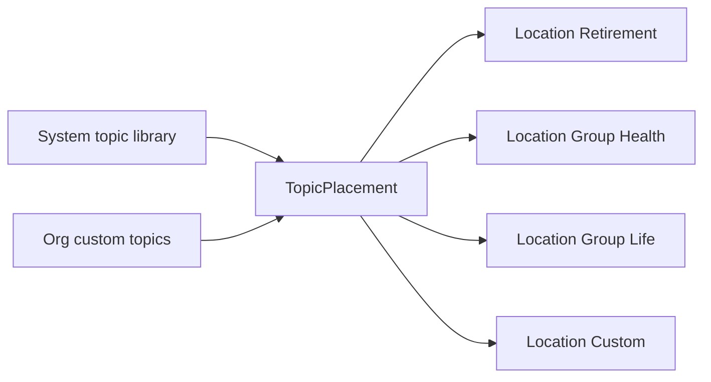
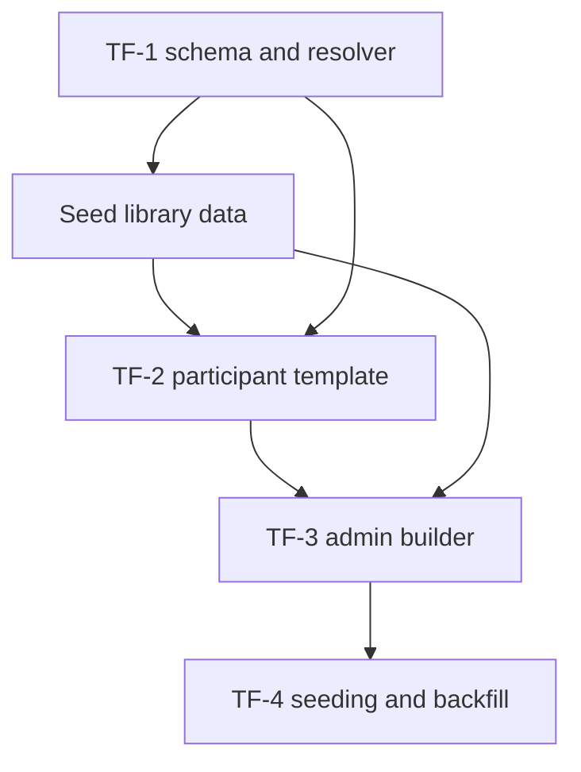

# Benefits Topic Framework — TF-1 → TF-4 Build Plan

Source: `Benefits_Topic_Framework_Handoff_FINAL.pdf` (§17 Tickets, build in order).
Path: **B · Evolve** the existing templates. No standalone topic pages, no slide-over sheets.
Scope of this plan: **TF-1, TF-2, TF-3, TF-4 only.** TF-5 → TF-13 are deliberately deferred.
**The Video section is closed** — Phase 1 is shipped and nothing further will be built there (§0).

---

## 0. Already shipped — do not rebuild

| Handoff item | Where it lives |
| --- | --- |
| Video section · Phase 1 (§ Video section, item 9 / TF-14) | [`benefits-video-section.tsx`](components/pages/client-portal/sections/benefits-video-section.tsx:1), rendered from each hub, `planVideoVisible` toggle on the Benefit row |
| How Can We Help You Today? topic grid, inline expansion, caret, primary 2/4 card | [`how-can-we-help-section.tsx`](components/pages/client-portal/sections/how-can-we-help-section.tsx:669) |
| Card style options (§9/page 42) — corner treatment carried by the typography theme and published as `--portal-radius`, with live preview | [`lib/typography-themes.ts`](lib/typography-themes.ts:36) and [`typography-section.tsx`](components/wizard/new-client-steps/sections/typography-section.tsx:269) |
| `[Benefit Category]` / `[Company Name]` / `[Advisor Name]` merge tokens | [`lib/help-card-defaults.ts`](lib/help-card-defaults.ts:115) |

Consequence for this plan: **no card-style work is planned.** The only obligation is that every new surface (Featured topic tiles, Quick Answers rows, the builder) consumes the existing `--portal-radius` / `portalRadiusValue()` treatment so a plan's chosen look keeps applying to them.

**The Video section is closed, not deferred.** Phase 1 is the final state of that section for this engagement. Explicitly *not* to be built: the Phase 2 layouts (Solo Feature, Featured Duo, Spotlight + Carousel, Carousel-only), the multi-video carousel with filter chips and page dots, the Video Library and its badges, the per-category headline/subhead defaults, the extra lightbox post-video CTA, and the three-way position menu. The existing show/hide toggle and the auto-hide-when-empty rule stay exactly as they are.

Nothing in TF-1 → TF-4 touches [`BenefitsVideoSection`](components/pages/client-portal/sections/benefits-video-section.tsx:1) or its Benefit fields (`planVideo`, `planVideoLabel`, `planVideoThumbnail`, `planVideoFallbackImage`, `planVideoVisible`). The section keeps rendering exactly as it does today on every hub, and the topic work sits alongside it rather than changing it.

---

## 1. Where the code stands today

| Concern | Current implementation | Gap vs handoff |
| --- | --- | --- |
| Topic content | Static catalog `HELP_CARD_CATALOG` in [`lib/help-card-defaults.ts`](lib/help-card-defaults.ts:21), 7 hard-coded cards shared by every category | No library, no per-plan placement, copy not editable |
| Placement | `Benefit.helpCards Json` holding `HelpCardLayoutEntry[]` — order, one `primary`, `enabled` flags | A card cannot move between Featured and Quick Answers; no groups |
| Row layout | [`lib/help-card-layout.ts`](lib/help-card-layout.ts:1) — 3 cards then 4 to a row, one 2-wide primary | Advisor cannot pick a row layout or add a 3rd row |
| FAQ | `Benefit.faqs Json` + `DEFAULT_FAQS` in [`lib/benefits-faq-defaults.ts`](lib/benefits-faq-defaults.ts:3), rendered as the navy two-column accordion in [`components/faq-section.tsx`](components/faq-section.tsx:182) | No grouping model, no search, no content blocks, defaults not editable |
| Participant page | [`how-can-we-help-section.tsx`](components/pages/client-portal/sections/how-can-we-help-section.tsx:669) — inline expansion, caret, Rollovers body hard-coded | Content is catalog-driven, not placement-driven |
| Hubs | four pages pass `cards={benefitData.helpCards}` — [`retirement`](app/(portal)/[id]/retirement/page.tsx:234), [`health-insurance`](app/(portal)/[id]/health-insurance/page.tsx:222), [`life-insurance`](app/(portal)/[id]/life-insurance/page.tsx:223), [`custom-benefit-name`](app/(portal)/[id]/[custom-benefit-name]/page.tsx:247) | No shared topic loader |
| Admin | `HelpCardLayoutEditor` (dnd-kit) inside the Step 2 editor panel, section `helpCards` ([`benefits-editor-panel.tsx`](components/wizard/benefits-steps/benefits-editor-panel.tsx:1304)) | One zone only, no library drawer, no group editing |
| Persistence | `PUT /api/clients/[id]/benefits/[category]` upserts the Benefit row and dual-writes `employeePortalPreview.benefits` | No topic endpoints |

Nothing in this slice deletes `Benefit.helpCards` or `Benefit.faqs`. The new tables are additive, so a rollback is a read-path switch, not a data restore.

---

## 2. Core model

- **Topic** — the content, written once. System scope ships with us; org scope is advisor-authored.
- **TopicPlacement** — plan-scoped. Holds `displayMode` (`featured` / `quick_answers` / `hidden`), `sortOrder`, optional `groupId`, and `overrides` (title, summary, body blocks, CTA).
- **AccordionGroup** — plan-scoped, per location, named and ordered. This is the group list Quick Answers renders.
- **Effective topic** = `Topic` merged with `placement.overrides`. Everything renders from the merged view.

Location enum is `retirement | group_health | group_life | custom`. **Employee Resources is not in this slice** (it is TF-6) but the enum reserves the value so no migration is needed later.

Mapping to today's strings is the one genuinely lossy seam: `Benefit.category` is free text — `"Retirement"`, `"Group Health"`, `"Group Life"`, and `"Company / Plan Sponsor"` for the fourth hub, which the advisor may rename per plan ([`displayCategoryName`](lib/benefit-custom-name.ts:1)). A `lib/topic-locations.ts` helper owns that mapping in both directions, and anything unrecognised resolves to `custom`.

**Account Access is not a topic in this slice.** It stays a special card built from Benefit fields exactly as it is now, because the Card module that generalises it is TF-9. Only the six ordinary topics plus Quick Answers become placements.

---

## 3. Ticket breakdown

### TF-1 · Topic + Placement foundation (Must Have, backend only)

- New Prisma enums `TopicScope`, `TopicStatus`, `TopicDisplayMode`, `TopicLocation`.
- New models `Topic`, `TopicPlacement`, `AccordionGroup`; `Client` gains the two back-relations. Migration `20261027120000_add_topic_framework`, following the existing `YYYYMMDDHHMMSS_snake_name` convention.
- `Topic.slug` is globally unique by namespacing: `sys.rollovers-distributions` for system topics, `org.<organizationId>.<slug>` for custom ones — avoids a nullable-column unique constraint.
- `lib/topics/effective-topic.ts` — pure merge of topic + overrides, unit-tested.
- `lib/topics/resolve-location.ts` — reads placements for `clientId + location`, orders them, splits into featured order and grouped quick answers, drops `hidden`.
- `lib/topics/seed-plan-topics.ts` — idempotent seeding (upsert on the `clientId + topicId + location` unique) called from the Benefit create path and lazily on first read for plans created before this ships.
- Plan scoping enforced in the query layer, not the caller.

**Accept:** two plans each seeded with Retirement; editing a placement on plan A leaves plan B untouched. A `hidden` placement never appears in any resolver output.

### TF-2 · Participant category page template (Must Have)

- Extend the EXISTING `GET /api/clients/[id]/benefits/[category]` with a `topics` block (`{ source, featured, groups, hiddenCount }`, already merged and ordered) instead of adding a second route. Reasons: its auth is already the audited one (anonymous portal via the plan slug, or a session checked against `create_benefits`), and every hub already makes that request — a new endpoint would duplicate the permission logic and add a second waterfall fetch. Load the topics only when asked (`?withTopics=1`) until a plan's read source is `placements`, so legacy plans pay nothing.
- New `components/pages/client-portal/sections/quick-answers-section.tsx` — grouped two-column accordion in today's navy style, search over title + answer + tags, one answer open at a time, a rich answer spanning both columns, phone full-screen answer view with a back arrow, sticky CTA in the answer view.
- Refactor [`how-can-we-help-section.tsx`](components/pages/client-portal/sections/how-can-we-help-section.tsx:669) to take resolved featured topics as a prop instead of looking up the catalog, keeping the caret, inline expansion, row engine and Account Access card untouched.
- The four hub pages load the new endpoint and pass the result down; when it returns nothing the section hides, and the legacy `helpCards` path remains the fallback so no live plan goes blank.
- Deep links: `#<topic-slug>` opens that topic's panel on mount; `&option=<id>` preselects a Rollovers option. Back closes the panel on phone.
- Empty sections render nothing — no header, no padding.
- New tiles and accordion rows take the portal's `--portal-radius`, so the shipped card style options keep applying.

**Accept:** the Retirement page matches the wireframe for the Air Fayre data; a hidden topic does not render; the layout works at 375px and 1920px; opening a second topic closes the first.

### TF-3 · Admin topic builder (Must Have)

- A new **Topics** section inside the existing Step 2 editor panel, next to `helpCards` — three zones (Featured / Quick Answers grouped / Hidden) with dnd-kit drag between them, already a dependency of [`help-card-layout-editor.tsx`](components/wizard/benefits-steps/help-card-layout-editor.tsx:1).
- Per-row dropdown as the keyboard-accessible alternative to dragging; Featured cap warning at 3 rows; "which card moves down?" prompt when full.
- Editor drawer per row: title, summary, icon/image from the default library, content blocks, CTA label + action type + destination, tags.
- Library drawer: search, filter by location / tag / unused, drag into a zone, "Used in" hint on hover.
- Edit-scope prompt on a system topic — "this plan only" writes `overrides`; "everywhere" is offered only for org custom topics.
- Persistence endpoints: `POST /api/clients/[id]/topics/placements` for bulk reorder, `PATCH /api/clients/[id]/topics/placements/[placementId]`, `PUT /api/clients/[id]/topics/groups`, `GET /api/clients/[id]/topics/library`.
- Preview jumps to the participant page at that location; every write invalidates `client` and `benefitRows` caches so the portal shows the change immediately.

**Accept:** promote "Roth vs. Pre-Tax" to Featured and demote "Rollovers" to Quick Answers with no rebuild; the change survives refresh and a logout/login.

### TF-4 · Default library + all four categories (Must Have)

- Library seed data for the §15 titles, split per category: Retirement (Financial Planning, Rollovers & Distributions, Update My Beneficiaries ↔, Plan Materials + the five Quick Answers groups), Group Health, Group Life, plus keyword starter sets for Custom (Wellness, EAP, Voluntary Benefits, Financial Wellness).
- `lib/topics/library-keywords.ts` — suggests a starter set from the advisor's custom category name; a blank start is always allowed.
- Seeding runs when a category is created and via `scripts/topics/backfill-topic-placements.ts` for existing plans.
- Legacy import inside that same script: each `helpCards` id maps to its library slug, each `faqs` item becomes an org-scoped topic in a default "Questions" group so no live copy disappears, and `DEFAULT_FAQS` becomes the source of the default group contents.
- Canonical order stays Retirement → Group Health → Group Life → Custom. Nothing here counts Employee Resources as a fifth category.

**Accept:** a new plan with Retirement + Group Health + Group Life shows the default Featured and Quick Answers topics on each page in canonical order; the backfilled Air Fayre plan renders what it renders today.

---

## 4. Order and dependencies

TF-1 must land first. The library data from TF-4 is needed *before* TF-2 can render anything real, which is why it is built early even though it is ticketed last.

---

## 5. Risks and decisions

1. **Live pilot plans.** The Air Fayre demo already has `helpCards` and `faqs` data. The read path keeps the legacy fallback until the backfill script has been run and compared on that plan; only then is the fallback removed.
2. **Account Access.** Not a placement in this slice. It continues to render from `Benefit.insurancePlanId`, `insuranceLoginUrl` and `providerContact` through the existing card.
3. **Category strings.** Advisor-renamed Custom hubs map to `custom`, not to a new location. Employee Resources must not be inferred from a category name.
4. **Permissions.** New endpoints reuse `create_benefits` view/edit via `resolveClient`, so a Viewer cannot reorder topics.
5. **Dual-write.** The Benefit row still writes `employeePortalPreview.benefits`; the topic endpoints must not bypass that or portal completeness counts will drift.
6. **Feature flag.** A plan-level switch decides placements vs. legacy JSON, so the slice can ship dark and be turned on per pilot plan.
7. **Out of scope.** Row layout presets (2/4 + 1/4 + 1/4, 4 × 1/4, a 3rd row) belong to TF-9; Action Hub panels TF-5; Employee Resources TF-6; search TF-7; Life Events TF-8; templates TF-10; conversion CTAs TF-11; Navigator TF-12; annual tokens TF-13.
8. **Video section — permanently excluded.** Phase 1 is shipped and accepted; every Phase 2 item in the handoff stays unbuilt. This is not a "later ticket" and must not be picked up as part of this framework, so no ticket in TF-1 → TF-13 should be read as implying video work.

---

## 6. Verification

- `pnpm test:benefits`, `pnpm test:portal-hubs`, `pnpm test:create-benefit`, `pnpm test:edit-benefit`.
- Unit tests for the location mapping, the effective-topic merge, the resolver, seeding and the read-source switch (all in place with TF-1); a `topics` case added to [`portal-get.test.ts`](app/api/clients/[id]/benefits/[category]/__tests__/portal-get.test.ts:6) for TF-2.
- Manual QA on a seeded plan at 375, 768, 1280 and 1920 on all four hubs.
