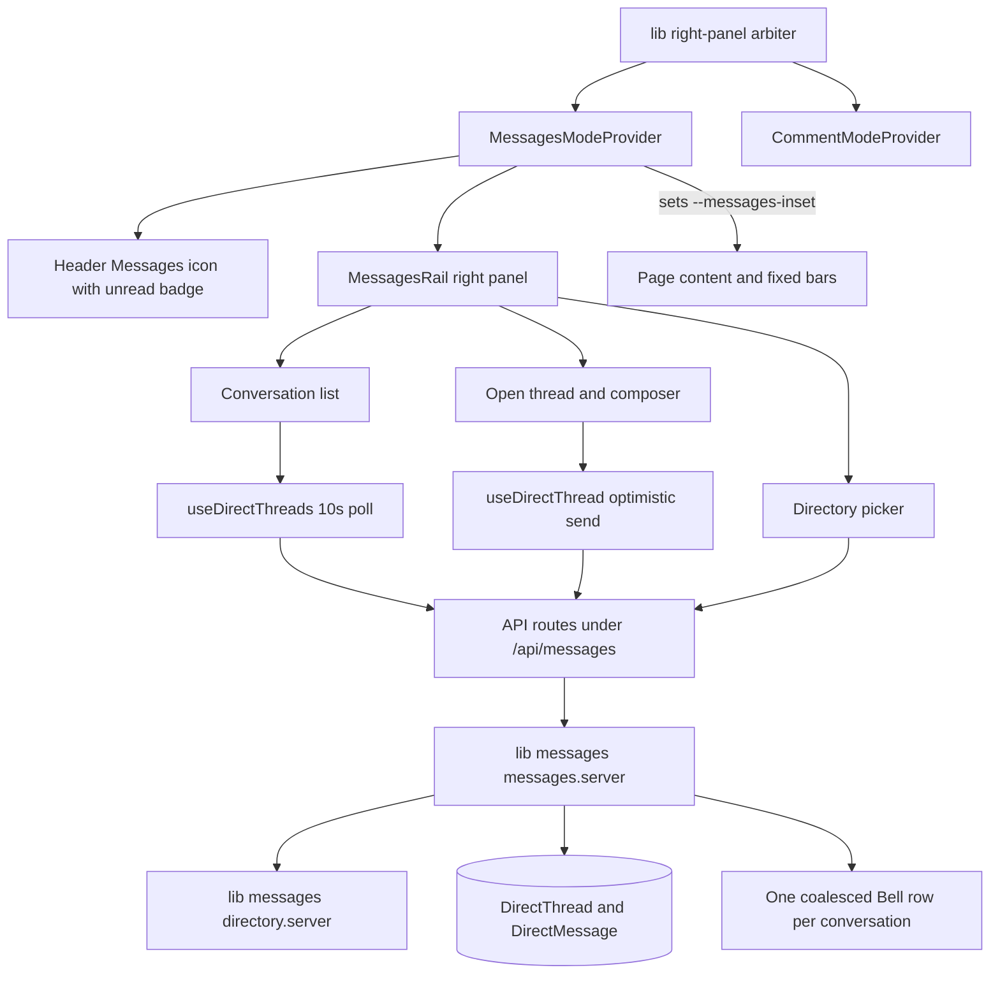

# Direct Messages (dashboard)

## Goal

Let two members of an organization hold a private 1:1 conversation from anywhere in the
dashboard: a Messages icon in the header opens a right-hand rail with the reader's conversation
list and the open thread. No new nav entry, no dedicated route, and no plan required — a DM is
between two people, not between two people and a plan.

Sibling feature: **Comments** (`plans/plan-benefit-comments.md`, shipped, documented in
`docs/teammates-module.md` §9i). This plan deliberately mirrors its architecture and reuses its
primitives, and the two rails are mutually exclusive.

## Confirmed decisions

| # | Decision | Choice |
|---|----------|--------|
| 1 | Shell | **Header Messages icon + right-hand rail**, mirroring the comments rail. Global on every dashboard page. `--messages-inset` beside `--comments-inset`, with one arbiter so opening one closes the other. No nav entry, no route. |
| 2 | Directory | **Org-wide for everyone.** The Owner, every live Team Member, and every Collaborator who shares at least one plan with the viewer — the `listMentionableUsers` candidate set minus the plan/category filter. Two Collaborators on a shared plan may message each other. |
| 3 | Behaviour | **Match Comments, then tighten.** 10s SWR poll for the list and the open thread; attachments and the emoji picker reused behind a DM key prefix and a participation guard; **no edit**; **author-only soft delete, no admin moderation**; unread counts from a per-participant **read watermark**; **one coalesced Bell row per conversation**, never one per message. |

## Architecture overview



## Data model (Prisma)

Two models. Participants are **`User` rows, not `TeammateProfile` rows** — the same precedent
comments set, because a DM is between two logins and every member has one. The profile stays the
*display* record (name, headshot, job title, seat type), resolved the way
`GET /api/profile/header` already resolves it.

```prisma
model DirectThread {
  id             String @id @default(cuid())
  organizationId String

  // The two participants, as User ids, stored in a canonical order so a pair has one thread.
  userAId String
  userBId String

  // Per-participant read watermark. NULL means they have never opened the thread, which is
  // also the state that makes every message unread.
  aReadAt DateTime?
  bReadAt DateTime?

  lastMessageAt       DateTime @default(now())
  lastMessageByUserId String?

  createdAt DateTime @default(now())
  updatedAt DateTime @updatedAt

  messages DirectMessage[]

  // One thread per pair per organization — so "open a DM" is an upsert, never a duplicate.
  @@unique([organizationId, userAId, userBId])
  @@index([userAId, lastMessageAt])
  @@index([userBId, lastMessageAt])
}

model DirectMessage {
  id           String       @id @default(cuid())
  threadId     String
  thread       DirectThread @relation(fields: [threadId], references: [id], onDelete: Cascade)

  authorUserId String
  // Empty when the message carries only files, exactly as a comment may.
  body         String
  // Same record shape as a comment attachment; a different R2 prefix and guard.
  attachments  Json?
  deletedAt    DateTime?

  createdAt DateTime @default(now())

  @@index([threadId, createdAt])
}
```

Five things worth stating, because each is a decision rather than a detail:

- **`userAId`/`userBId` are canonicalised** (`userAId < userBId`) and covered by a compound unique
  with `organizationId`. This is the DM equivalent of the comments' `(clientId, benefitCategory)`
  key: starting a conversation is an upsert, and two people can never end up with two threads.

  **The canonical order has to be ENFORCED in the database, not just followed by the writer.**
  A unique index on `(organizationId, userAId, userBId)` does not stop a swapped insert — `(org, B,
  A)` is a different tuple, and PostgreSQL accepts it happily, leaving one conversation per
  participant rather than one per pair. That was measured during phase 1, not assumed: the probe
  inserted a swapped duplicate and the database allowed it. So the order is pinned by a CHECK
  constraint (`20261013182800_direct_thread_pair_order`), which Prisma's schema language cannot
  express and which therefore lives in SQL only — the same arrangement as the partial unique index
  on `Client.slug`.
- **`organizationId` is part of the key.** One login can back seats in several organizations
  (T1 Part B item 5), and the directory is the session's organization, so the same pair in two
  organizations is two conversations — not one thread with a confused scope.
- **Read state is one watermark per participant, not a row per message.** Unread is then a single
  `count(createdAt > myWatermark)` instead of a join, and "mark read" is one idle update. It also
  gives the rail its "New messages" divider for free.
- **No `clientId`, deliberately.** A thread must survive a plan being renamed, re-scoped or
  deleted, and no DM read may depend on plan access.
- **Cascade on account deletion.** `DirectMessage` cascades from `DirectThread`; the thread itself
  is removed by the account-deletion path, so a deleted login takes its conversations with it.
  Helpers to extend: `lib/delete-user-plans-and-scoped-data.ts` and the organization-deletion
  sweep (the same two the comments threads touch).

## The access model — one gate

`resolveDirectAccess` in `lib/messages/messages.server.ts` is the only place that answers "may this
person read or write this conversation". Routes translate; they never decide.

| # | Rule | Refusal |
|---|------|---------|
| 1 | The caller must be a member of the session's organization: the Owner, or a live seat with a login | `not_a_member` 403 |
| 2 | For an existing thread the caller must be **A or B** — and there is **no admin override** | `not_a_participant` 403 |
| 3 | Opening a new thread requires the other person to be *directoryable* by the caller | `not_in_directory` 403 |
| 4 | A thread with yourself is refused | `self_thread` 400 |

Rule 2 is the privacy decision, and it is the one that differs from comments most sharply:
comments are moderated by Owner/Admin (`assertCanModerate`), while a DM is never readable or
deletable by a third party — including the organization's owner. A message's author may withdraw
their own message (`deletedAt`, body emptied, rendered as a placeholder); nobody else may.

Rule 3 uses the **same predicate** as the directory listing, so the picker and the guard cannot
disagree — the failure mode that the mention-candidate work already had to close (a suggestion
that the API then refuses). `isDirectoryable(viewer, candidate)`:

- both are internal (Owner or Team Member) → allowed;
- the viewer is internal → any **live** seat with a login, Team Member or Collaborator;
- the viewer is a Collaborator → the Owner, every Team Member, and any Collaborator who shares at
  least one of the viewer's accessible plans (via `listAccessiblePlanIds` + their assignments);
- a deactivated seat → excluded, matching the roster;
- a seat with no `loginUserId` → excluded, because there is nobody to deliver to. The picker still
  shows them, greyed with "Invite pending", so the reason is visible rather than mysterious.

## Notification model — one row per conversation

A DM is chatty; the Bell is not. `createNotification` is therefore not called per message.
`coalesceDirectNotification` writes **one unread row per (recipient, thread)**:

- if an unread `direct_message` row already exists for that recipient and thread, it is
  **updated** — title becomes "New messages from Dana", body becomes the newest message's first
  ~120 characters, `createdAt` is refreshed so it floats to the top — instead of inserting;
- otherwise a row is created, with `href: "/?messages={threadId}"`, because there is no route to
  link to and the provider reads that param to open the rail on the thread;
- opening the thread marks the row read, alongside the read watermark.

Five messages from one person therefore cost one Bell row, and the plan and team notifications are
never buried. The row is addressed to the recipient only, so a preview is not a leak — but a DM row
addressed to anyone else must never be written, and the verification script asserts that.

## The rail — UX anatomy

`MESSAGES_RAIL_WIDTH = "24rem"` (wider than the comments rail's 22rem: a chat line is longer than a
comment card, and the composer needs room). Fixed right, under the header, `z-40`, the same box the
comments rail occupies.

**Two views in one panel**, with a back affordance rather than two panels:

| View | Contents |
|---|---|
| Conversation list | Avatar, name, their seat label (reuse the role vocabulary from `getViewerRoleLabel`), newest-message preview, relative time, an unread pill per row. Newest activity first. |
| Open thread | Day separators; consecutive messages grouped under one avatar; the reader's own messages emphasised; a "New messages" divider at the read watermark; the raised composer at the bottom; a back control to the list. |
| Directory picker | Search + the same list, split into "Team" and "Collaborators", with "Invite pending" rows greyed and non-selectable. Reached from the list header. |

Details that carry the feature:

- **Header icon** sits in the action cluster beside the Comments toggle, the Bell and the theme
  switch. A **numeric unread badge** (total unread messages, capped at "9+") rather than a dot,
  because the number is the reason to open the panel. Icon deliberately distinct from the
  comments `MessageSquare` so the two controls do not read as one.
- **Mutual exclusion is structural, not cooperative.** `lib/right-panel.ts` holds
  `requestRightPanel("messages" | "comments" | null)` plus a subscription. Each provider claims the
  column before opening and listens for the other's claim; the loser closes. Relying on each
  provider to remember to close the other is exactly how two panels end up stacked.
- **One layout variable each**, so a fixed bottom bar clears whichever is open:
  `calc(var(--editor-inset, 0px))` on the left, `max(var(--comments-inset, 0px), var(--messages-inset, 0px))`
  on the right.
- **Composer** reuses the comments machinery (`comment-composer.tsx` patterns, `emoji-picker.tsx`,
  the attachment viewer) with Enter to send, Shift+Enter for a newline, and the same
  `MAX_COMMENT_LENGTH` cap so there is one limit in the product.
- **Empty states** are explicit: no conversations yet ("Start one from the directory"); a
  Collaborator with no shared plan ("You can message the advisor who invited you"); an empty
  thread.
- **Accessibility**: the rail is `role="complementary"`, focus moves into it on open, Escape
  closes, and new messages announce via `aria-live` **only** in the open thread.
- **Deliberately not in v1**: message editing, seen/delivered receipts, typing indicators, group
  threads, reactions, search, email or push delivery, block/mute.

## Files

| Piece | File | Job |
|---|---|---|
| Shared contract (pure) | `lib/messages/types.ts` | Thread/message/participant shapes, limits, the notification type, the DM attachment key helpers |
| Server: gate, validation, reads, writes | `lib/messages/messages.server.ts` | `resolveDirectAccess`, body/anchor validation, list/thread reads, send, withdraw, the notification coalescer |
| Directory | `lib/messages/directory.server.ts` | `isDirectoryable` + `listDirectDirectory` — the one predicate the picker and the gate share |
| HTTP | `app/api/messages/threads/route.ts`, `.../threads/[threadId]/route.ts`, `.../threads/[threadId]/messages/route.ts`, `.../messages/[messageId]/route.ts`, `.../directory/route.ts`, `.../attachments/route.ts` | Translate only |
| Client data | `hooks/useDirectThreads.ts`, `hooks/useDirectThread.ts` | The 10s polls, the optimistic send with rollback, mark-read on open |
| Panel state | `components/messages/messages-mode-provider.tsx`, `messages-toggle.tsx` | Registers the panel globally, owns open/closed, exposes the unread count |
| The rail | `components/messages/messages-rail.tsx`, `conversation-list.tsx`, `thread-view.tsx`, `directory-picker.tsx` | The two views and the picker |
| Layout + arbitration | `lib/messages/messages-layout.ts`, `lib/right-panel.ts` | `--messages-inset` and single ownership of the right column |
| Attachment guard | `lib/messages/direct-attachment.server.ts`, `/api/r2/object` | A DM key prefix authorized by **thread participation**, not plan access |

## Attachment path (why it is its own piece)

A comment's key is `org/{owner}/plans/{clientId}/comments/…` and `/api/r2/object` authorizes the
read against the caller's **plan assignment**. A DM has no plan, so reusing that prefix would
either deny every legitimately-shared file or leak one. DM attachments get
`org/{organizationId}/messages/{threadId}/…` and a guard that resolves the caller's participation
in that thread — the same `resolveDirectAccess`, called from the object route before any signed URL
is issued.

## Phase 1 findings (worth carrying forward)

- **The canonical pair needed a CHECK.** The plan originally claimed the compound unique was enough;
  a five-line probe disproved it in one run. The lesson generalises: a convention that the
  correctness of a query depends on belongs in the constraint set, because the second writer is
  always the one that forgets.
- **A `catch` that does not read the error is not a test.** That same probe first reported the
  swapped insert as "refused" while the constraint did not yet exist — the insert had failed for an
  unrelated reason and `catch { refused = true }` counted it. It now requires the failure to be
  identified: `P2002` for the unique index, and for the CHECK the constraint's own name out of the
  error message, because Prisma leaves a CHECK violation as an UNMAPPED driver error (no P-code).
  Phase 13's verification script is where this assertion really belongs.
- **The CLI, not the database, is the unreliable half.** `prisma migrate deploy` could not reach the
  host from this development machine while the app on the same machine was connected and serving
  pages: the CLI's engine resolves the endpoint itself, and its failure reads as "the database is
  down" when it is not. Two migrations were applied instead through the app's own connection by a
  throwaway script that also wrote the `_prisma_migrations` rows, so the CLI would not later try to
  re-apply them — and that script validated its checksum scheme against a migration the CLI had
  applied before writing anything. The technique is reproducible in minutes if the CLI misbehaves
  again; the `DIRECT_URL` vs `DATABASE_URL` question was a red herring throughout.
- **The scripts' client had no retry while the app's did.** `lib/prisma.ts` replays transient
  connection failures (`P1001`/`P1002`/`P1017`); `createPrisma()` in `scripts/teammates/shared.ts`
  did not, so one dropped connection killed a verify run while the app rode the same blip out
  invisibly. That asymmetry — not the endpoint — is what made a healthy database look broken.
  `createPrisma` now retries those codes and only those: a constraint failure is an answer, and
  replaying it would hide it.

## Phases

**Shipped.** The work ran as six phases (below); the map onto the plan's own numbering is noted
where they differ. `npm run messages:verify` is green at **45/45**, `tsc` and `eslint` are clean,
and the feature is documented in `docs/teammates-module.md` §2 and §9j.

1. ✅ **Data and server** (phases 1–3). Models + three migrations, `messages.server.ts`,
   `directory.server.ts`, the deletion helpers, the notification coalescer, the seven API routes,
   and the verification suite.
2. ✅ **Panel shell** (phase 4). `right-panel.ts`, `messages-layout.ts`, provider, header toggle
   with the unread badge, empty rail, list read with the 10s poll.
3. ✅ **The conversation loop** (phase 4). List → thread, mark-read on open, optimistic send with
   rollback, the "New messages" divider, author-only withdraw.
4. ✅ **Directory and open-or-create** (phase 5). The picker, the grouping, greyed "Invite pending"
   rows, the `SquarePen` "New message" affordance, the upsert that starts a thread.
5. ✅ **Attachments** (phase 5). The key prefix, the upload route, the participation guard on the
   object route, the viewer reuse, staged chips in the composer.
6. ✅ **Notifications, polish, verification, docs.** The coalesced Bell row; a `$extends` retry
   wrapper for the verify scripts (see the findings above); `scripts/messages/verify-messages.ts`;
   the `docs/teammates-module.md` entries.
7. ✅ **Polish — the promises v1 skipped.** "Load earlier" paging (the `?before=` cursor the routes
   already accepted, wired into the hook and the rail, with older pages held apart from the polled
   page so a poll cannot wipe history); the panel's keyboard contract (Escape closes, focus moves in
   on open, `aria-live` in the open thread only); consecutive-message avatar grouping; the
   Collaborator's tailored empty state; and four paging assertions in the suite (41 → 45).

## Verification (`scripts/messages/verify-messages.ts`, mirroring `verify-comments`)

| Assertion | Why it matters |
|---|---|
| A third member is refused a thread they are not in | The privacy stance |
| **An Owner/Admin is refused another pair's thread** | The sharpest difference from comments |
| Two Collaborators sharing a plan can open a thread | Decision 2's whole point |
| A Collaborator cannot open a thread with a Collaborator on an unrelated plan | The directory predicate |
| A deactivated seat is refused, and is absent from the directory | Matches the roster |
| A seat with no login is absent from the directory but listed as pending | Why the picker greys it |
| One thread per pair, even with the arguments swapped | The canonical ordering |
| A thread with yourself is refused | Rule 4 |
| Five messages produce **one** Bell row, and opening the thread marks it read | The coalescer |
| The unread count ignores the reader's own messages | The watermark |
| Unread is zero after mark-read, and non-zero for a message sent after the watermark | Both directions of the watermark |
| Withdrawing a message empties it and leaves a placeholder; another member cannot withdraw it | Author-only |
| An empty body with no attachments is refused; exactly the limit is accepted | The boundary, as `verify-comments` pins it |
| A non-participant cannot fetch a DM attachment | The object route's guard |
| Deleting either login removes the thread and its messages | The cascade |

## Edge cases

- **Deactivated seat** — excluded from the directory, still a participant in existing threads, so
  history stays readable.
- **Removed login** — the account-deletion path removes the thread; the other side's list drops it.
- **Two shared organizations** — the same pair has one thread per organization, by the compound
  unique; the rail only ever shows the session organization's threads.
- **Long thread** — the thread read returns the newest 50 with a "load earlier"; the list is
  newest-activity-first and paged.
- **Anchor to a plan** — not in v1. If it is ever wanted, it is a chip on the message, never a
  key on the thread, so a thread can never become dependent on plan access.
- **A profile with no login** can never be a participant, whatever the picker shows.

## Open questions (defaults proposed; say the word to change any)

1. **Email when the recipient is offline?** Proposed: no — in-app only, the Bell row plus the badge.
2. **A "About: <plan>" chip** so a DM can carry plan context? Proposed: no in v1.
3. **Retention.** Proposed: keep indefinitely, with the account-deletion cascade; no purge job.
4. **Block/mute.** Proposed: none — the directory rule already prevents an unreachable stranger
   from appearing, and a block list is a feature with its own consent questions.
5. **Rail width.** Proposed: 24rem. The comments rail is 22rem; a chat line and the composer want
   more room, and the two panels are never open together.
