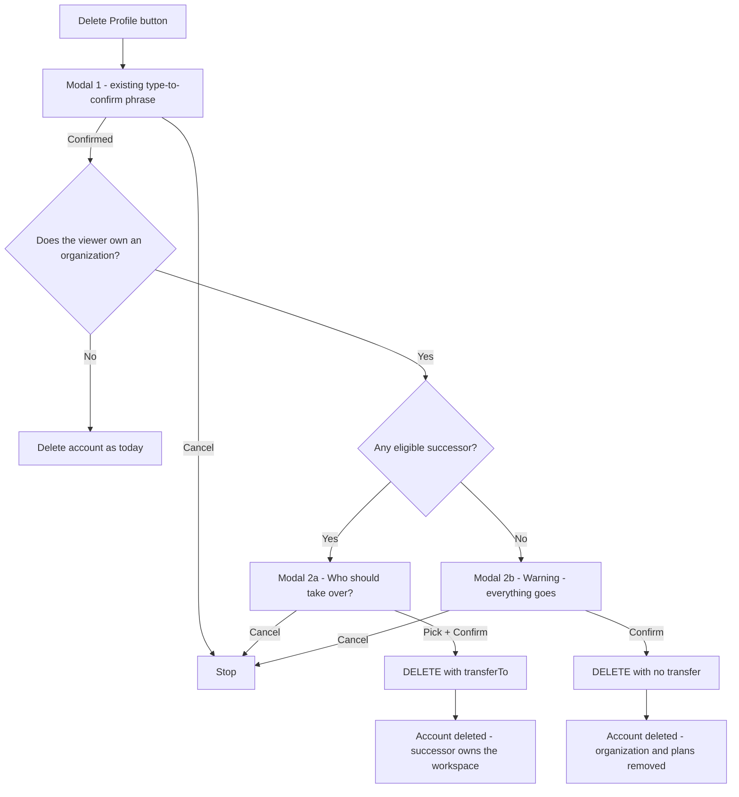

# Owner self-deletion — hand the organization over, do not nuke it

Status: **IMPLEMENTED.** `npm run teammates:verify-ownership` → 52/52 assertions passed;
`npx tsc --noEmit` and `eslint` clean; migration `20261015164500_organization_storage_anchor`
applied. Documented as §9l of docs/teammates-module.md.

### What differed from this plan

Found by testing the first implementation, and fixed in the same sweep:

- **The destructive branch now has to be ASKED FOR.** This plan put the guard in the UI, and the
  endpoint had a second caller all along: the onboarding wizard's "Cancel signup" deleted an Owner's
  whole organization behind a dialog that mentioned only "your account". `?confirmOrganization=true`
  (or `?transferTo=`) is now required, so a caller that showed nothing is refused with a 409 rather
  than deleting silently — and the next caller inherits the protection.
- **The empty-organization shortcut was WRONG and is gone.** This plan had an empty organization skip
  dialog 2 entirely. But an empty organization is exactly what a new owner has, so the first person
  to test the feature saw it delete silently — indistinguishable from the bug it replaced. An owner
  is now always warned, and dialog 2b words itself around an empty organization instead.
- **`getViewerAccess` no longer logs `User not found`** when a session outlives its account. Deleting
  your profile signs you out, but the redirect takes a moment and a second tab keeps polling; every
  one of those requests logged a teammate-layer error for a perfectly normal state.
- **`resolveObjectAccess` needed an owner check this plan did not anticipate.** A handover removes
  the successor's own `TeammateProfile` (the owner holds no seat), so the seat lookup at the end of
  that function would have refused the organization's own logo to the very person who now owns it.
  Ownership is now checked before the seat.
- **The successor is notified from inside the writer**, not from the delete route: a future
  standalone "Transfer ownership" action should not have to remember to announce itself.
- **The legacy `Plan` model hands over** — D4 closed against this plan's own recommendation, because
  `/api/plans/create-plan`, `create-plan-with-images` and `sync-static-video` still write it.
- **The verify suite does not build fixtures for `MarketingFlyer`, `Webinar`, `Meeting`,
  `MeetingCustomType` or `FutureContact`.** They are the same `updateMany` call as `Plan`, and
  inventing a valid fixture for each would mean guessing required columns the suite cannot check. It
  is stated in the suite's header so the gap is visible rather than implied.
- **One assertion was wrong first time round**: it expected `markProfilesSelfDeletedByLogin` to
  notify, when the route is what notifies. The suite now asserts the two steps separately, which
  documents that flagging alone has no side effects.

## 1. What happens today

`Settings → Profile → Danger Zone → Delete Profile` opens one AlertDialog with a type-to-confirm
phrase (`[settings/page.tsx](app/(dashboard)/settings/page.tsx:1592)`) and calls
`DELETE /api/profile/delete`, which does this in order:

| # | Step | What it destroys |
| --- | --- | --- |
| 0 | `marketingAsset.deleteMany` | the advisor's flyers/assets |
| 1 | [`deletePlansAndScopedDataForUser()`](lib/delete-user-plans-and-scoped-data.ts:4) | **every plan** (`Client` by `userId`), documents, benefits, meetings, marketing flyers, webinars, tasks, wizard drafts |
| 2–3 | wizard sessions, tasks, meeting types, future contacts, headshots | personal workspace data |
| 4 | [`deleteOrganizationForOwner()`](lib/teammates/organization-cleanup.server.ts:85) | **the Organization row + every TeammateProfile, PlanAssignment, TeammateCompany, TeammateAuditEvent and DirectThread in it** |
| 4b | `markProfilesSelfDeletedByLogin()` | profiles the same login holds in *other* organizations (flagged, not deleted) — unchanged by this plan |
| 5 | `user.delete` | the account |

So when the person who clicks it is an **Owner with teammates**, the teammates' access, the plans
they were invited to, and the organization itself all disappear — with a dialog that only ever talks
about "your profile". Nothing in the modal so much as mentions the organization or the people in it.

## 2. Two invariants this collides with

These are load-bearing and neither is obvious from the deletion code, so they drive the design.

### 2.1 `Organization.ownerUserId` and `Client.userId` must agree

A plan is anchored twice: legacy `Client.userId` and additive `Client.organizationId`. Several
paths *derive the organization from the plan's owner*:

- [`invites.server.ts`](lib/teammates/invites.server.ts:151) — `getOrCreateOrganizationForUser(client.userId)` must equal the session organization, or the collaborator invite is refused.
- [`getOrganizationIdForClient()`](lib/organization.ts:741) — resolves a plan's org from `client.userId`.
- [`presign-upload`](app/api/r2/presign-upload/route.ts:80) — `findFirst({ id: clientId, userId: orgId })`, so a stale `Client.userId` means **every document and branding upload for that plan 404s**.
- [`isPlanOwner()`](lib/teammates/access.server.ts:159) — the legacy `Client.userId` anchor.

**Consequence:** a handover that moves `Organization.ownerUserId` without also moving `Client.userId`
leaves plans that no route can upload to. The re-anchor is not cosmetic; it is required for the
handover to be coherent at all. It also means `DELETE` step 1 must no longer treat those plans as the
departing owner's — which it will not, once they are anchored to the successor.

### 2.2 One organization per owner, and `findFirst` assumes it

`Organization.ownerUserId` has **no unique constraint** and the schema comment says *"One per advisor
User today (ownerUserId), created at signup or by backfill"*. Every signup creates one
([`auth-options.ts`](lib/auth-options.ts:269)), including a teammate's — so a successor already owns
an **empty** organization of their own, and lookups are `findFirst({ where: { ownerUserId } })` with
no ordering. After a handover that user would own two organizations and
`getOrCreateOrganizationForUser` could return either one.

**Consequence:** the handover must also retire the successor's own empty organization, or the
invariant silently breaks for exactly the person we just promoted.

### 2.3 …and a third, about files

R2 keys are `org/{segment}/…` where **the segment is a user id**, and the two cases behave
differently:

- **Plan-scoped keys** (`…/plans/{clientId}/…`) are authorized by
  [`resolveObjectAccess()`](lib/teammates/access.server.ts:743) through `resolvePlanAccess` on the
  **plan id alone** — the segment is never read. These survive any handover untouched.
- **Org-level keys** (`org/{segment}/uploads/{subPath}/…` — advisor headshot, advisor logo) resolve
  the segment with `findFirst({ where: { ownerUserId: orgSegment } })`
  ([line 796](lib/teammates/access.server.ts:796)). After a handover nothing matches the old segment
  and **those images 403 for everyone**, with no fallback.

Comment attachments are minted from **`Client.userId`**
([route](app/api/clients/[id]/comments/attachments/route.ts:147)), so they follow the re-anchor
automatically — but every object already written stays under the old segment.

## 3. Recommended design

### 3.1 The flow

Three surfaces, one endpoint:

- **Modal 1** — unchanged today (`DELETE_PROFILE_PHRASE` gate). Its copy does need one line of honesty:
  "…and everything in your organization" appears only on the destructive branch, so the first modal
  should not promise it either way.
- **Modal 2a — picker.** Who should take over `<Organization name>`? Radio list (the same pattern
  `AssignTaskDialog` already uses for "Assign To"), each row a name + email + role, plus one line
  stating what they inherit. Blocked until someone is selected. Cancel is the only escape.
- **Modal 2b — the warning.** Reached only when *no* eligible successor exists. Names the real
  numbers: the organization, **N plans, M teammates, K collaborators**, their access, their files.
  Different confirm label ("Delete my organization and profile"), so the two modes can never be
  confused in a screenshot.

An empty organization (0 plans, 0 teammates, 0 collaborators) skips modal 2 entirely — there is
nothing to warn about and `deleteOrganizationForOwner` is a no-op with nothing in it.

### 3.2 What a handover transfers

| Belongs to the organization → moves | Personal to the departing user → deleted |
| --- | --- |
| `Organization` row (name, branding, `seatsIncluded`, disclosures state) | their login |
| every `Client` in it — `userId` → successor, `organizationId` filled if null | wizard sessions and their child tables |
| documents, benefits, meetings-by-client, analytics — follow their client by relation | `Task` rows — `Task.userId` is the **assignee**, so moving them would drop the ex-owner's to-do list onto the successor |
| legacy `Plan` rows (retirement / video plans) — see D4 | `Headshot` and `MarketingAsset` rows |
| marketing flyers, webinars, meetings and their custom types, future contacts | |
| teammate layer — profiles, assignments, companies, audit events (already org-scoped, untouched) | |
| their own profiles in *other* organizations — unchanged, still flagged and notified (§9k) | |

The successor is promoted to Owner, which by this module's model means they **hold no seat**: the
owner is synthesized from `Organization.ownerUserId`, and a Team Member profile with the Owner
preset is exactly the duplicate `scripts/repair/remove-owner-duplicate-seat.ts` exists to clean up.
So the handover should remove the successor's own `TeammateProfile` and its assignments, in the same
breath, with an audit event. That releases one seat and lists them once, not twice.

### 3.3 Re-anchor first, then let the cascade delete only what is personal

The deletion cascade in `deletePlansAndScopedDataForUser` is keyed on `userId` — `Client`, `Plan`,
`Document` by client, `Benefit` by client, `MarketingFlyer`, `Webinar`, `Meeting` (both anchors),
`MeetingCustomType`, `FutureContact`, `Task`, `Headshot`. That is the useful property here, not the
problem: **whatever is re-anchored before the cascade runs is automatically spared**, with no second
list of exceptions to keep in sync and no edit to the cascade itself.

So the transfer re-anchors, from the departing user to the successor, exactly these:

| Model | Why it is the organization's content |
| --- | --- |
| `Client` | the plans, and everything cascading from them by relation |
| `Plan` | retirement / video plans — still written by `/api/plans/create-plan`, `create-plan-with-images` and `sync-static-video`, so **not** dead legacy |
| `MarketingFlyer` | flyers built for a plan |
| `Webinar` | the organization's webinar content |
| `Meeting` + `MeetingCustomType` | client meetings are continuity, not personal notes — and a moved meeting must keep a custom type its new owner can resolve |
| `FutureContact` | the prospect list |

Everything else stays with the departing account, and the untouched cascade deletes it. `Task` is
deliberately on the wrong side of that line: `Task.userId` is *who the work is assigned to*, so
moving it would hand the successor the ex-owner's dashboard.

## 4. Implementation steps

1. **Schema — the storage anchor.** Add `Organization.storageAnchorUserId String?` (nullable, no
   backfill needed) and `storageAnchorUserId` to the `Organization` model. It records the user id
   whose R2 segment existing org-level objects were written under. Then teach
   [`resolveObjectAccess()`](lib/teammates/access.server.ts:778) to resolve a segment against
   `ownerUserId` **or** `storageAnchorUserId`, so pre-handover assets keep resolving and post-handover
   uploads resolve too. This is the forward-only fix for residual migration debt item 2, applied at
   the one place a handover makes it bite.
2. **Eligibility — one function, one predicate.** `listOwnershipSuccessors({ organizationId, excludingUserId })`
   in a new `lib/teammates/ownership.server.ts`: live Team Member profiles in the organization with a
   `loginUserId` that still resolves to a `User`, not deactivated, not self-deleted, and not the
   departing owner. Collaborators are excluded by design — an owner is not a seat, and handing the
   workspace to an outside party is a different product decision (see D3). Return name, email,
   headshot and preset role so the picker needs no second call.
3. **Impact read — one endpoint for both modals.** `GET /api/profile/delete-impact` → `{ organizationName, plans, teamMembers, collaborators, successors: [...] }`.
   Powers the picker list *and* the warning's numbers, and lets the UI decide which modal 2 to open
   without guessing.
4. **The handover writer.** `transferOrganizationOwnership({ organizationId, fromUserId, toProfileId, actorUserId })`
   in `lib/teammates/ownership.server.ts`, in this order, all inside `prisma.$transaction` where the
   writes are independent:
   1. verify the target is eligible (re-read, never trust the posted id);
   2. verify `fromUserId` still owns the organization;
   3. **Re-anchor the organization's content** (§3.3), every one an `updateMany` from `fromUserId` to
      the successor's user id, and every one BEFORE anything destructive runs:
      1. `Client` — `userId` → successor, `organizationId` → the organization, for every client where
         `organizationId = organization.id` **or** `userId = fromUserId`;
      2. `Plan`, `MarketingFlyer`, `Webinar`, `FutureContact`;
      3. `Meeting` and `MeetingCustomType`, as a pair, so a moved meeting keeps its type;
      4. the deletion cascade is not edited at all — it simply stops matching these rows;
   4. copy the organization's identity onto the successor's `User` row (`organizationName`,
      `organizationEmail`, `organizationType`, `branding`) so
      [`syncOrganizationIdentity()`](lib/organization.ts:579) keeps agreeing afterwards instead of
      re-mirroring the organization from the successor's personal setup on their next save;
   5. `Organization.update` — `ownerUserId` → successor, `storageAnchorUserId` ??= departing owner;
   6. remove the successor's own `TeammateProfile` + assignments (they are the owner now);
   7. retire the successor's other organizations **if they have no plans and no profiles** — the
      signup shell from §2.2. Refuse rather than guess if one has content;
   8. `syncOrganizationIdentity(successorUserId)`;
   9. audit event `organization_ownership_transferred` with both user ids and the moved counts.
5. **Wire the deletion route.** `DELETE /api/profile/delete?transferTo={profileId}`: resolve the
   viewer's owned organization; if they own one **and** a `transferTo` was supplied, run step 4
   *first* and **fail the whole request with 400 if it fails** — the one path that must not fall
   through to the destructive writes. If they own one and no `transferTo` was supplied, proceed as
   today but include the organization counts in the response so the success screen can be honest.
   Also accept the empty-organization case as a plain deletion.
6. **UI — the two modals**, in `settings/page.tsx` next to the existing dialog (Radix portals them, so
   tree position is locality only). The existing confirm button stops calling the endpoint directly
   and instead fetches the impact read, then routes: successors → picker, none → warning, nothing
   owned → straight delete. Extract the picker as `components/settings/ownership-successor-dialog.tsx`
   so it reads like the rest of the module's dialogs.
7. **Notification to the successor (optional, recommended).** Reuse `createNotification` with a new
   `ORGANIZATION_OWNERSHIP_TYPE` — "You are now the Owner of `<Organization>`" — deep-linked at
   `/settings`. A promotion nobody is told about is a promotion nobody notices.
8. **Docs** — a `§9l. Owner self-deletion — handover, not demolition` section: the two invariants, the
   transfer order, the storage anchor and why the successor's empty organization must go. Cross-link
   it from §9k and from residual migration debt item 2.
9. **Verification** — extend `scripts/teammates/verify-t3.ts` (or add `verify-ownership-transfer.ts`)
   with assertions that are cheap to state and expensive to guess:
   - a handover moves `Organization.ownerUserId` **and** every `Client.userId` in the organization;
   - `getOrganizationIdForClient(planId) === organizationId` afterwards;
   - `getOrCreateOrganizationForUser(successorId) === organizationId` (the §2.2 invariant);
   - the successor ends up with **no** `TeammateProfile` and exactly one owned organization;
   - `resolveObjectAccess` still allows a pre-handover `org/{oldOwnerId}/uploads/…` key for a live
     teammate, and allows a post-handover new upload;
   - a non-eligible `transferTo` (a collaborator, a seat with no login, the owner themselves) is
     refused and **nothing is deleted**;
   - the departing owner's profiles in other organizations are still flagged, and the Owner/Admin
     notification from §9k still fires.
   Plus the manual pass: run the four branches (picker, cancel, warning, empty org) against a seeded
   two-member organization, then sign in as the successor and confirm the plans, branding, comments
   and DM directory all still work and the files still render.

## 5. Decisions

D1, D2 and D5 are **closed by the user**; D3, D4 and D6 carry a recommendation that the plan is
written to.

| # | Question | Answer |
| --- | --- | --- |
| **D1** | Does "defer to a new owner" hand over the **whole workspace** (plans, documents, branding, teammate layer) or only the **organization shell** (teammates + branding, plans deleted)? | ✅ **Closed — whole workspace.** A shell with no plans is an empty room, and it is why §2.1 is unavoidable. |
| **D2** | Consent to a new `Organization.storageAnchorUserId` column so pre-existing files keep resolving? | ✅ **Closed — yes to the column.** Pre-existing org-level objects keep resolving and nothing is re-keyed. |
| **D3** | Who may be chosen? | **Live Team Members with a working login, not deactivated, not self-deleted.** Collaborators are excluded (external parties) and so is anyone with no login — the picker should say "only people who have signed in can take over", because an invited-but-never-accepted seat cannot. A dual-role account with plans of its own is excluded rather than merged. |
| **D4** | The legacy `Plan` model has no `organizationId` and is anchored only by `userId`. Hand it over too, or treat it as personal? | ✅ **Closed — it hands over.** It is not dead code: `/api/plans/create-plan`, `create-plan-with-images`, `sync-static-video` and the video routes still write and read it, so its rows are real content. Re-anchored with the rest of §3.3. |
| **D5** | In the picker, is there an escape hatch to "delete everything anyway" when successors exist? | ✅ **Closed — no escape hatch.** Cancel is the only way out; an owner who wants the organization gone removes their teammates first. |
| **D6** | Should modal 2b re-run the type-to-confirm phrase, or just a distinct confirm button? | **Distinct button, no second phrase.** The phrase already gated modal 1; asking twice trains people to type without reading, which is the exact failure mode the phrase exists to prevent. |

## 6. Risks and traps

- **Transfer before destroy, and fail hard.** The transfer is the only part of the deletion request
  that must NOT be best-effort. Today's route swallows failures around the flagging step; this one
  must return 400 and delete nothing.
- **Two owners mid-flight.** Between step 4.5 and 4.6 the successor owns the organization while still
  holding a seat. Order matters: remove the profile after the ownership write, in the same request.
- **`User.organizationId` for the successor.** Already points at this organization for a
  teammate-only account, but assert it rather than assume it — a `findFirst` ambiguity here is the
  same landmine as §2.2.
- **Branding drift.** Skipping step 4.4 does not fail loudly; the organization quietly re-brands
  itself as the successor on their next profile save. It needs to be in the transfer, not in a
  follow-up.
- **The successor's own organization with content.** A dual-role account (a teammate who also runs
  their own workspace with plans) must be **excluded from the picker**, not handled by merging two
  organizations — which is out of scope and should be stated as such.
- **`Organization.ownerUserId` has no unique constraint** — the promotion is an `update`, not a
  guess, and every `findFirst({ ownerUserId })` in the codebase is a reason to be strict about §2.2.
- **Repair scripts.** `scripts/repair/delete-user-account.ts` and `purge-orphaned-user-data.ts` take
  the same destructive path for support cases; they should gain the same optional transfer, or be
  documented as deliberately not doing so.

## 7. Files

| File | Change |
| --- | --- |
| [`prisma/schema.prisma`](prisma/schema.prisma:1464) | `Organization.storageAnchorUserId` + a migration |
| `lib/teammates/ownership.server.ts` | **new** — `listOwnershipSuccessors`, `transferOrganizationOwnership`, `describeDeletionImpact` |
| `app/api/profile/delete-impact/route.ts` | **new** — the read both modals need |
| [`app/api/profile/delete/route.ts`](app/api/profile/delete/route.ts:15) | `transferTo` handling, transfer-before-destroy, fail-hard |
| [`lib/teammates/access.server.ts`](lib/teammates/access.server.ts:778) | resolve the anchor segment as well as `ownerUserId` |
| [`lib/teammates/organization-cleanup.server.ts`](lib/teammates/organization-cleanup.server.ts:85) | unchanged, but now reached only when there is no handover |
| [`app/(dashboard)/settings/page.tsx`](app/(dashboard)/settings/page.tsx:1592) | route through the impact read; modal 2b |
| `components/settings/ownership-successor-dialog.tsx` | **new** — modal 2a |
| `scripts/teammates/verify-ownership-transfer.ts` | **new** — the assertions in §4.9 |
| [`docs/teammates-module.md`](docs/teammates-module.md) | new §9l + cross-links |

## 8. Explicitly out of scope

- Merging two organizations (a dual-role successor is excluded instead).
- Re-keying existing R2 objects — solved forward-only by the storage anchor.
- Transferring ownership to a Collaborator, or to a seat with no login.
- A standalone "Transfer ownership" action outside the deletion flow. The writer in §4.4 is
  deliberately built as a reusable function so that action becomes a small UI ticket later, but the
  first cut is the deletion flow the user asked for.
