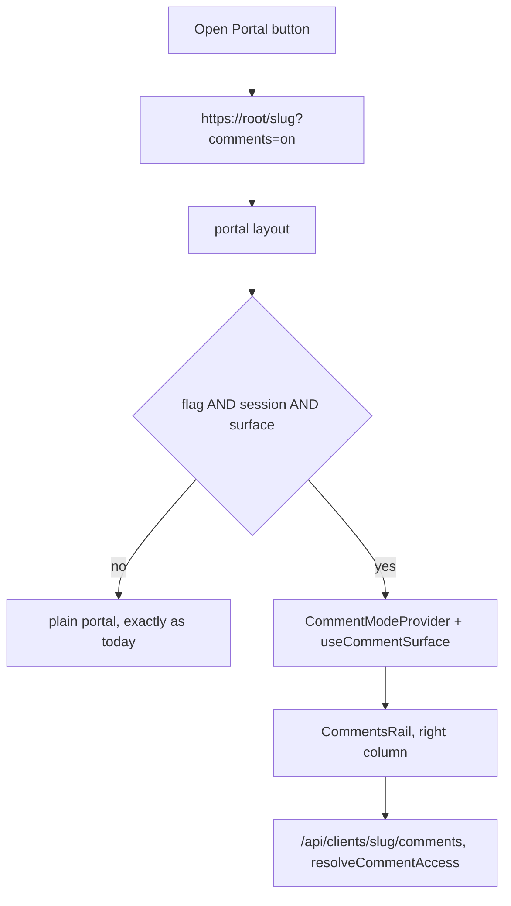

# The Portal Comments UI

> **The Portal Comments UI** = the Comments panel as it appears on the participant portal. The name is
> the product's, and it is the term [`docs/teammates-module.md`](../docs/teammates-module.md) §9i uses.
>
> Status: **implemented.**
>
> Decision taken (§9, option 1): the flag only — the buttons turn the rail on, and a portal URL
> shared with an employee stays a plain portal. The session + flag mechanism in §2 was confirmed over
> a signed token.
>
> Deviations, and additions made on request after the phases:
>
> - §6: the flag's helpers live in `lib/comments/portal-surface.ts`, not `lib/marketing/hub-url.ts`
>   (see the note in §6 for the reason).
> - A **floating Comments button** (bottom-right, the header's `MessageSquare`, parked at the rail's
>   left edge while it is open), because the portal has no header action cluster and closing the rail
>   would otherwise leave no way back.
> - An **open/close animation** on the rail. This needed the panel to outlive the mode for one
>   transition, which is why `CommentsRail` now holds it mounted for `RAIL_TRANSITION_MS` — and why
>   those hooks sit above its early return.
> - One consequence fixed with it: the profile card's Message button now requires a mounted Messages
>   rail as well as `canMessage`, so the portal cannot offer a dead control (§7).
>
> Verified: `tsc --noEmit` and `eslint` clean; `npm run comments:verify` green at **109** assertions,
> seven of them new for the surface mapping and the flag.

## 1. The ask

The five "Open Portal" buttons (Create Plan, Edit Plan, Create Benefits, Edit Benefit, and the
plan picker) currently open the participant portal in a new tab with no way to comment on what is
being looked at. They should open it **with the Comments rail already on the right**, so an advisor
can read the plan as a participant does and comment on it in the same view. Permissions must not
change: a Collaborator still sees only what their assignment allows, and still cannot comment where
their scope does not reach.

## 2. The decision: a flag read against the session, NOT a token

The instinct is to mint a signed token into the URL. That would be a mistake here, and the reason is
worth writing down.

- **The portal is already same-origin with the dashboard.** `getBenefitsHubOpenPortalUrl` builds
  `https://plantel.pro/{slug}` in production, `https://dev.plantel.pro/{slug}` in dev, and
  `window.location.origin/{slug}` locally. The dashboard is served from the same host, so **the
  session cookie is sent with the portal request** — the portal layout already calls `useSession()`
  and reads `session.user.organizationName`.
- A token would therefore be a **second authorization path** for the same request: something to
  mint, sign, expire, revoke and leak, running in parallel with the session that already exists. The
  codebase has spent real effort collapsing pairs of predicates into one (the directory, the
  mentionable list, the assignable list, the identity resolver); adding a second door to the same
  room is the opposite move.
- Authorization must stay in **one place**: [`resolveCommentAccess`](../lib/comments/comments.server.ts)
  is the single gate every comment read and write already goes through. A token that granted comment
  access would sit *beside* that gate rather than behind it — a token good for plan A could be
  replayed at plan B's URL, and nothing in the existing gate would have an opinion.

**So: the URL carries a preference, and the session carries the authority.**

- The buttons append `?comments=on` (see §6).
- The portal mounts the rail only when **all** of these hold: the flag is present, a session exists,
  and the path resolves to a comment surface (§4).
- Everything after that is the existing engine. The rail's reads and writes hit the same routes, go
  through the same `resolveCommentAccess`, and fail the same way. An **anonymous** employee is
  unaffected: no session, no rail, no flag honoured — and the portal page itself is untouched.

The `?comments=on` spelling is deliberate. `?comment=<threadId>` is already a *thread* deep link
(the provider reads it), so a bare `?comments=<id>` would be a trap. `on` also matches the word the
mode already uses (`CommentMode`, and the `comments:mode` localStorage value).

## 3. Why this is mostly a mounting problem

The rail is not a new feature; it is the existing panel that needs an ancestor and a surface:



The dashboard mounts this today inside `DesktopOnlyGate` in
[`layout-client.tsx`](../components/layout/layout-client.tsx) — `CommentModeProvider` above,
`CommentsRail` below, and `--comments-inset` reserving the column. The portal needs the same three
things and nothing else.

## 4. Which surface each portal route registers

`useCommentSurface` takes a **plan id or slug**, a `targetType` and — for a benefit — the **real
category**, not the portal's route segment. The two differ: `/health-insurance` is `Group Health`.
`getBenefitPortalSegment` only goes category to segment, so the inverse is new.

The portal layout already has everything needed to answer this: `params.id` (the slug),
`pathname`, and `customHubSlug` (it computes that today for the Custom hub).

| Portal path | Surface registered |
| --- | --- |
| `/{slug}` | `plan` — the landing page the Plan comments attach to |
| `/{slug}/retirement` | `benefit`, `Retirement` |
| `/{slug}/health-insurance` | `benefit`, `Group Health` |
| `/{slug}/life-insurance` | `benefit`, `Group Life` |
| `/{slug}/{customHubSlug}` or `/{slug}/wellness-programs` | `benefit`, `Other` |
| anything else | none — no surface, no rail |

That falls out as one pure function, `portalCommentsSurface({ pathname, planSlug, customHubSlug })`,
in a new [`lib/comments/portal-surface.ts`](../lib/comments/portal-surface.ts). Pure and separately
testable on purpose: the mapping is the part most likely to drift from
`getBenefitPortalSegment`, and a test can pin them against each other.

`resolveCommentAccess` resolves **slugs** (`planIdOrSlug`), so the surface can pass `params.id`
directly — no extra lookup, and the rail's own URLs are the ones the dashboard already uses.

## 5. Permissions, unchanged

No new rule is introduced, which is the point. The surface registered on the portal is the same one
the dashboard registers for the same page, so the same gate decides:

- **Owner / Admin / Editor / Viewer** — the plan surface and every benefit surface, as they have on
  the equivalent dashboard page.
- **Collaborator with a category scope** — the plan landing page and the benefit pages they hold.
  They may read and comment on the Plan surface (existing rule: a plan thread carries no category,
  so plan-level View is enough) and on their own categories. A benefit page for a category **outside
  their scope** registers that category and is refused by `resolveCommentAccess`, exactly as the
  dashboard refuses it today. That is the user's "permissions still exist" requirement, satisfied by
  not adding anything.
- **Anonymous employee** — no session, so the rail is never mounted, and the comment APIs would
  refuse anyway.

The rail is *not* silently hidden for a signed-in advisor who lacks access — the dashboard's
behaviour is to open the panel and say why, and the portal should match it rather than invent a
second convention.

## 6. The buttons

All five call sites build their URL from
[`getBenefitsHubOpenPortalUrl()`](../lib/marketing/hub-url.ts), but **one of them appends a segment
afterwards**:

```
components/pages/benefits/benefit-edit-page.tsx
  const url = `${getBenefitsHubOpenPortalUrl(slugOrId)}${segment ? `/${segment}` : ""}`;
```

So the flag cannot live inside the builder — `...?comments=on/health-insurance` would be built. The
flag is composed **last**, from small dependency-free exports:

- `COMMENTS_RAIL_PARAM = "comments"`, `COMMENTS_RAIL_VALUE = "on"`;
- `withCommentsRail(url)` — appends `?comments=on`, or `&comments=on` when a query already exists,
  keeps any `#hash` last, and is idempotent;
- `wantsCommentsRail(search)` — the reader, so the portal compares for the exact value instead of
  guessing at it.

**Deviation from this plan's first draft.** These live in
[`lib/comments/portal-surface.ts`](../lib/comments/portal-surface.ts), not in
[`lib/marketing/hub-url.ts`](../lib/marketing/hub-url.ts) as originally written. Reason: the flag has
a WRITER (the dashboard buttons) and a READER (the portal), and splitting one flag's spelling across
two modules is how a `?comments=on` becomes a `?comment=on` in one of them. `portal-surface.ts` is
the module both sides must already agree on for the surface mapping, so it is where the flag belongs.
`hub-url.ts` keeps doing what it does — building portal URLs — and gains no comments knowledge.

Every call site becomes `withCommentsRail(<the URL it already builds>)`, which is a one-line change
that reads as "open it with the rail". The same helper is what the portal reads back, so the writer
and the reader cannot disagree about the spelling.

## 7. Mounting it without wrecking the portal

- **A provider + rail wrapper**, `components/comments/portal-comments-rail.tsx`, wraps the portal
  layout's tree. It owns the flag check, the session check, the media-query check, the surface
  registration and the `<CommentsRail />`.
- **`--comments-inset` must be honoured by the portal's own chrome.** `useCommentsLayout` sets it on
  the document root; the portal's fixed header, its page content and its footer must subtract it, or
  the rail covers the right of the page — the exact class of bug the Edit Benefit bar had.
- **Desktop only.** The portal is what employees open on a phone. The rail is mounted above the
  desktop breakpoint only (the existing `useMediaQuery` helps), and the inset is not reserved below
  it, so a phone gets today's portal untouched.
- **Messages is not on the portal**, and that has one consequence to fix: the profile card's Message
  button calls `useOptionalMessagesMode()` and would render a button whose handoff goes nowhere. The
  button must require a mounted messages provider as well as `canMessage`, or the portal would offer
  a dead control. This is a one-line guard in
  [`user-profile-dialog.tsx`](../components/comments/user-profile-dialog.tsx) and it is a bug
  wherever the card is used without a Messages rail.

## 8. Phases

1. **Pure pieces.** `lib/comments/portal-surface.ts` and the `withCommentsRail` /
   `COMMENTS_RAIL_*` exports in `lib/marketing/hub-url.ts`. No UI.
2. **The buttons.** All five call sites compose `withCommentsRail(...)` last.
3. **The portal side.** `portal-comments-rail.tsx`, wrapped into
   [`app/(portal)/[id]/layout.tsx`](../app/(portal)/[id]/layout.tsx), with `--comments-inset`
   reserved on the header, the content and the footer.
4. **The guard.** The profile card's Message button requires a messages provider.
5. **Verification and docs.**

## 9. The decision to make

Everything above assumes the rail appears **only when the flag is present** — the buttons turn it on,
and a participant-facing portal URL shared with an employee stays exactly as it is today. The
alternative is for the portal to offer the rail to any signed-in advisor (with the usual toggle), so
an advisor who lands on a portal link from anywhere can comment without the link having carried the
flag.

## 10. Verification

- `portalCommentsSurface` gets a section in [`scripts/comments/verify-comments.ts`](../scripts/comments/verify-comments.ts),
  asserted **against `getBenefitPortalSegment`** so the two cannot drift: every category the portal
  can address must map back to the same category key.
- `withCommentsRail` is asserted for the four shapes it must survive: no query, an existing query, a
  trailing hash, and the benefit-editor form built from builder-plus-segment.
- The existing suite already proves the gate (a Collaborator refused outside their category, a plan
  thread allowed with plan-level View), so the portal rides on assertions that exist rather than
  restating them.
- Manual: open each of the five buttons and confirm the rail appears on the right of the correct
  surface; confirm an incognito window on the same URL gets the plain portal; confirm a
  Collaborator's out-of-scope benefit page says why rather than failing silently.

## 11. Explicitly out of scope

- No schema change, no migration, no token table.
- No Messages rail on the portal.
- No change to `middleware.ts`: portal paths stay ungated, and the rail's authority is the API's
  session check, not a route guard.
