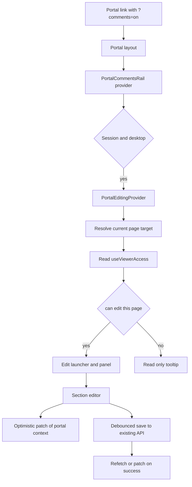

# Portal Inline Editing Panel

## Objective

When a portal link carries `?comments=on` and the visitor is a signed-in advisor, the portal gains an **Editing Panel** — the same pattern as Create/Edit Client and Create/Edit Benefits — so the current page can be edited in place and the portal updates without leaving the page.

Editing is **role-gated per page** using the existing permission grid. The flag is a preference, never authority: every save still goes through the existing API permission checks.

## Permission map

| Portal page | Route | What the panel edits | Permission |
|---|---|---|---|
| Home | `/[slug]` | Hero, welcome banner, mission, benefit visibility, branding, typography, disclaimers | `plan_details_branding: edit` |
| Benefit hub | `/[slug]/retirement`, `/health-insurance`, `/life-insurance`, `/[custom-benefit]` | Header CTA, welcome banner, typography, branding, messaging, plan video, help cards, quick answers, key contact card style | `create_benefits: edit` |
| Documents | Document sections inside a benefit hub (and Employee Resources) | Upload, reorder, category, visibility, delete | `documents: edit` |
| My Benefits Team | `/[slug]/my-benefits-team` | Contact cards, visibility toggles, CTA buttons, contact form topics | `key_contacts: edit` |
| News & Events | `/[slug]/news-events` | Portal notices, pop-ups/news posts, CTA text/link, publish window | `marketing: edit` |
| Videos | Video sections inside a benefit hub and Employee Resources | Plan video source, hero video, employee-resource videos | `video: edit` |

Notes:
- Webinar replays are created by the marketing surface today (`/api/webinars` is gated on `marketing: edit`), so News & Events stays `marketing`.
- Owner and Team Member continue to short-circuit; a Collaborator must be assigned to the plan **and** hold `edit` on that function.
- A page the viewer cannot edit still opens the panel in a read-only state with a clear “View only” explanation, or the launcher is disabled with a tooltip. No write control is rendered.

## Architecture

### 1. Page target resolver

New `lib/portal-editing.ts`:

- `type PortalEditPage = "home" | "benefit" | "team" | "documents" | "news" | "videos"`
- `resolvePortalEditTarget({ pathname, planSlug, customHubSlug })` returns:
  - the page key,
  - the permission function and required level,
  - the benefit category when the route is a hub,
  - the document placement when the route is a documents surface.
- Reuses the same segment mapping as [`portal-surface.ts`](lib/comments/portal-surface.ts:47), so comments and editing never disagree about which page is open.

### 2. Portal editing provider

New `components/portal-editing/portal-editing-provider.tsx`:

- Mounted inside `PortalCommentsRail` when the portal is armed.
- Reads the current target, `useViewerAccess`, `clientData`, and the portal `refetch`.
- Exposes `usePortalEditing()` with:
  - `target`, `canEdit`, `canEditPage(page)`,
  - `isOpen`, `openPanel`, `closePanel`,
  - `draft`, `patchDraft`, `saveState`, `saveError`,
  - `patchPortalData`, `refetchPortal`.
- Adds `patchClientData` to [`client-portal-context.tsx`](contexts/client-portal-context.tsx:57) so an editor draft can repaint the live page before the save round-trip completes.

### 3. Panel shell and layout

- New `components/portal-editing/portal-editing-panel.tsx` using the existing [`EditorPanelWrapper`](components/wizard/new-client-steps/sections/components/editor-panel-wrapper.tsx:52) in `fixed` mode, sliding from the left.
- Add a floating pencil launcher to the right-hand cluster: **Edit page → Comments → Ask a question**.
- Reserve a left column with `--portal-editor-inset` and scale/offset the portal content the same way [`PortalCommentsZoom`](components/comments/portal-comments-zoom.tsx:39) handles the Comments rail. The comments rail stays on the right, so both panels can be open at once.
- Reuse `PREVIEW_EDITOR_LAYOUT_EVENT` only if the portal ever gains dashboard chrome; otherwise the portal keeps its own CSS variable and does not widen the dashboard sidebar.
- Desktop only for the first release, matching the Comments rail. Mobile keeps the normal read-only portal.

### 4. Save and live update contract

- Every section edits a local draft, which is merged over `clientData` for immediate repaint.
- Saves are debounced (roughly 600 ms) and use the **existing** endpoint for that surface:
  - Home: `PUT /api/clients/[id]`
  - Benefit hub: `PUT /api/clients/[id]/benefits/[category]` / `saveBenefit`
  - Team: `PUT /api/clients/[id]` with `keyContacts`
  - Documents: existing documents endpoints
  - News & Events: `/api/marketing/assets`
  - Videos: plan video and employee-resource video endpoints
- On success: `refetchPortal()` or a targeted SWR mutate.
- On failure: revert the optimistic patch, toast the API error, keep the panel open.
- A single in-flight save per page; a newer edit cancels the pending debounce and queues one follow-up.

## Per-page editor work

### Home

- Extract the reusable sections from [`edit-plan-preview-section.tsx`](components/wizard/new-client-steps/sections/edit-plan-preview-section.tsx:298) into a `PlanHomeEditor` that accepts `clientData` and `onPatch` instead of reading `useNewClientWizardStore` directly.
- Sections: Hero background and overlay, welcome statement, mission statement, company logo, brand images, typography, disclaimers.
- Save through the plan PUT route; tighten that route so home fields require `plan_details_branding: edit` rather than accepting `create_benefits`.

### Benefit hubs

- Introduce an `EditorStoreAdapter` prop on [`BenefitsEditorPanel`](components/wizard/benefits-steps/benefits-editor-panel.tsx:142): `{ stepData, saveStepData, saveAsDraft, onSaveSection }`.
- Default to `useBenefitsWizardStore` for the wizard and Edit Benefit; the portal supplies an adapter hydrated from `GET /api/clients/[id]/benefits/[category]?forPortal=1&withTopics=1`.
- Sections map 1:1 to the existing panel: Portal Header Button, Typography, Branding, Benefit Messaging, Video Source, How Can We Help, Quick Answers, Have Questions.
- Save through `saveBenefit`; revalidate the hub’s SWR key and call `refetchPortal()`.

### My Benefits Team

- Extract the contact list editor from [`edit-client/[id]/page.tsx`](app/(dashboard)/edit-client/[id]/page.tsx:1711) into a shared `KeyContactsEditor` with props for `contacts`, `onChange`, `planId`, and `categories`.
- The portal editor reuses [`BenefitContactDialog`](components/wizard/benefits-steps/benefit-contact-dialog.tsx:288) for add/edit.
- Writes the plan’s `keyContacts` blob; the portal’s `clientData` and the seat overlay already resolve the cards.
- Server route must require `key_contacts: edit` for `keyContacts` writes instead of only accepting `create_benefits` or `plan_details_branding`.

### Documents

- Reuse [`DocumentListTab`](components/pages/documents/tabs/document-list-tab.tsx:1) and the upload/preview components already used by Edit Client and Edit Benefit.
- The panel section appears inside the benefit hub editor and Employee Resources, gated on `documents: edit`.
- After upload/delete/reorder, dispatch `plan-documents-persisted` so the portal context refetches the document rows.

### News & Events

- Reuse [`MarketingAssetModal`](components/pages/marketing/marketing-asset-modal.tsx:288) with the plan id, limited to `portal-notice`, `pop-up`, and `news-post`.
- The panel lists the plan’s assets and opens the modal for create/edit; publish-state changes refresh `/api/marketing/assets/public`.
- Gated on `marketing: edit`.

### Videos

- Reuse the `Video Source` section from the benefit editor for the hub’s plan video.
- Reuse the Employee Resources video editor for that location.
- Gated on `video: edit`; the plan-video and employee-resource video write routes must check `video: edit` at the API layer.

## Security and role enforcement

Client-side gating only hides controls. Each save endpoint must be audited and, where needed, tightened:

| Write | Current gate | Required gate |
|---|---|---|
| Plan home fields | `create_benefits` or `plan_details_branding` edit | `plan_details_branding` edit |
| Plan `keyContacts` | `create_benefits` or `plan_details_branding` edit | `key_contacts` edit |
| Benefit row | `create_benefits` edit | already correct |
| Documents | verify per route | `documents` edit |
| Marketing assets | `marketing` edit | already correct |
| Videos | verify per route | `video` edit |
| Webinars | `marketing` edit | keep `marketing` |

Collaborators remain scoped by assignment and category scope; the existing `resolvePlanAccess` path is the one gate. `?comments=on` never grants access on its own.

## Tests

- Unit: `resolvePortalEditTarget` for every route, custom hub slug, and unknown path.
- Unit: permission matrix for owner, Team Member, Collaborator with edit, Collaborator with view-only, unauthenticated.
- Component: launcher visibility; panel opens/closes; read-only state; comments and editor open together.
- Component: each page editor renders from portal data and calls the right save handler.
- API: permission refusal tests for plan home, key contacts, documents, video.
- E2E: owner edits home and a benefit hub from `?comments=on`; a Collaborator with `create_benefits: edit` can edit only the hub; a viewer sees no write controls; no flag means no editor.

## Rollout

Ship behind the existing `?comments=on` gate. Phase the work so each page is independently reviewable:

1. Shared resolver, provider, panel shell, launcher, layout, and tests.
2. Home page.
3. Benefit hub pages.
4. My Benefits Team.
5. Documents.
6. News & Events.
7. Videos.
8. Permission hardening and end-to-end pass.

## Risks

- **Editor coupling** is the main cost: the wizard stores are the current state manager. The adapter refactor should come before the benefit hub step, not after.
- **Live repaint vs. saved truth**: optimistic patches must be scoped to the draft and reverted on failure so the portal never shows a value the API rejected.
- **Layout collisions**: the Comments rail, the Editing Panel, the header, and the floating chat button all compete for the viewport. The CSS variable contract and tests must cover all combinations.
- **Permission drift**: a page can look editable while an endpoint still uses a broader or narrower gate. The audit table above is a required deliverable, not a suggestion.
