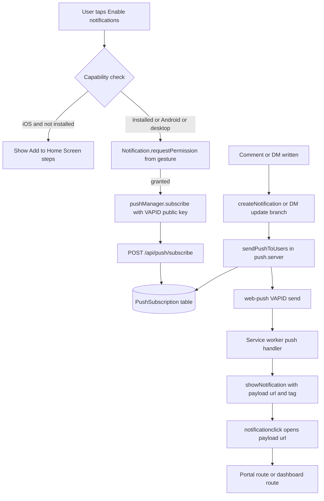
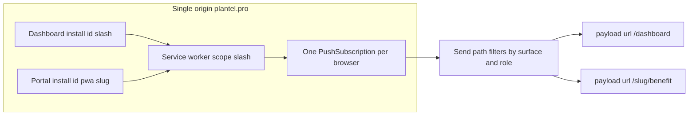

.# Web Push Notifications — Implementation Plan

## Goal

Deliver OS-level push notifications for comments and direct messages to both surfaces:

- **Portal PWA** (`/{slug}`, installable, participant-facing)
- **Dashboard** (advisor/teammate-facing, desktop-only today)

Push is an **enhancement**, never the source of truth. The in-app bell poll
([`hooks/useNotifications.ts`](../hooks/useNotifications.ts)) stays and remains the correctness path,
because web push is best-effort on every platform.

---

## Research conclusions this plan is built on

1. **Portal PWA push is possible**, with a hard iOS gate: iOS/iPadOS 16.4+ **only** when the site is
   added to the Home Screen. iOS ≤ 16.3 and every third-party iOS browser cannot receive web push at
   all. Android (Chrome/Edge/Samsung/Firefox) works installed **and** in a tab.
2. **Dashboard and portal share one push channel.** Same origin
   ([`lib/marketing/host.ts`](../lib/marketing/host.ts) → `getAppOrigin()`), one service worker at
   scope `/`, therefore one permission grant and one `PushSubscription`. Separate *content*,
   *audience* and *click target* are fully achievable; a separate OS-level app identity is not.
3. **Per-plan install identity does not create per-plan subscriptions.** The manifest sets
   `id: /pwa/{slug}` but `scope: "/"`; a `PushSubscription` is keyed by origin + SW registration, so
   two installed plan portals on one phone share one subscription. Notifications must be addressed by
   `userId` and carry their own destination URL.
4. **The notification rows already exist for both target features.**
   - DMs: `notifyDirectMessage` → [`lib/messages/messages.server.ts`](../lib/messages/messages.server.ts)
   - Comments: `notifyEvent` fan-out → [`lib/comments/comments.server.ts`](../lib/comments/comments.server.ts)
   - Shared writer: `createNotification` → [`lib/notifications/notifications.server.ts`](../lib/notifications/notifications.server.ts)
5. **Only signed-in people can be pushed to.** Portal participants qualify only when a session exists
   (the comments rail mounts only then); anonymous portal visitors cannot be addressed.

---

## Constraints and gotchas to design around

| Constraint | Consequence |
|---|---|
| iOS permission prompt must come from a **user gesture** | Opt-in is a button, never on load |
| iOS requires Home Screen install first | Opt-in UI is gated on standalone display, reusing `isStandaloneDisplay` from [`lib/pwa/install-prompt.ts`](../lib/pwa/install-prompt.ts) |
| SW is registered **only** inside the portal install banner ([`components/pages/client-portal/sections/portal-install-app.tsx`](../components/pages/client-portal/sections/portal-install-app.tsx)) | Registration must move to a surface-neutral mount, or the dashboard has no worker at all |
| The SW is a deliberate cache-free pass-through ([`public/sw.js`](../public/sw.js)) | Adding `push` and `notificationclick` is safe — those events never touch the fetch path |
| `PushSubscription.endpoint` is the device identity | Unique index + upsert; rebind `userId` when a different user signs in on that browser |
| DM notify path has an **update-existing-unread-row** branch that bypasses `createNotification` | Hooking `createNotification` alone would miss repeat DMs. Push must also fire from that branch |
| Stored `href` values are dashboard-shaped (`/?messages=`, `/edit-benefit/…?comment=`) | A portal-installed participant must not be sent to a dashboard route. Needs a portal href resolver |
| VAPID keys are bound to every subscription | Key rotation invalidates all rows — treat as a migration |
| `web-push` is Node-only | Sender must run on the Node runtime, not Edge |
| No long-lived process on Vercel | Immediate events send inline; scheduled digests need a cron route |

---

## Architecture

### One channel, two audiences

---

## Phase 0 — Configuration

| Variable | Who reads it | Purpose |
|---|---|---|
| `VAPID_PUBLIC_KEY` | server sender | Public half of the signing key. `NEXT_PUBLIC_VAPID_PUBLIC_KEY` is the fallback. |
| `NEXT_PUBLIC_VAPID_PUBLIC_KEY` | browser | Passed to `pushManager.subscribe` as `applicationServerKey`. |
| `VAPID_PRIVATE_KEY` | server sender | Signs every send. Never exposed to the client. |
| `VAPID_SUBJECT` | server sender | A `mailto:` or origin URL; defaults to `mailto:support@plantel.pro`. |

- Generate one pair per environment with `npx web-push generate-vapid-keys`.
- **The pair is permanent per environment.** A subscription is bound to it, so rotating the keys
  invalidates every stored row: a rotation means clearing `PushSubscription` and asking every reader
  to opt in again. Treat it as a migration, not a config change.
- Unset keys are a DISABLED state, not an error: the sender warns once per process and returns, so
  the app keeps writing notifications and sending messages normally.
- The portal deep-link policy is settled — dashboard links are REWRITTEN to portal routes for
  portal-surface subscriptions (see [`lib/push/portal-href.ts`](../lib/push/portal-href.ts)).

## Phase 1 — Service worker and registration foundation

- Add `push` and `notificationclick` listeners to [`public/sw.js`](../public/sw.js). Leave the `fetch`
  listener exactly as it is and keep the header comment accurate about what the worker now does.
  - `push`: parse `event.data.json()`, `showNotification(title, { body, icon, badge, tag, data })`,
    `event.waitUntil(...)`.
  - `notificationclick`: `clients.matchAll`, focus an existing client and navigate it to
    `data.url`, otherwise `clients.openWindow(data.url)`; always `notification.close()`.
- Extract SW registration out of `PortalInstallApp` into a small client component mounted once in the
  root layout so both the portal and the dashboard get a worker. The root layout already branches on
  host for the invite gate, so the marketing site can be excluded the same way.
- Add `lib/pwa/push.ts`: capability + platform detection (`isPushSupported`, `isIOS`,
  `needsInstallForPush`), the VAPID public key read, `subscribeToPush()` and
  `unsubscribeFromPush()` helpers. Reuse `isStandaloneDisplay`.

## Phase 2 — Subscription storage and API

- New Prisma model `PushSubscription`:
  - `endpoint` (unique), `p256dh`, `auth`
  - `userId` with cascade delete, matching the `Notification` relation style
  - `surface` (`portal` | `dashboard`), `planId` nullable, for audience filtering
  - `preferences` (JSON) for per-type opt-outs
  - `userAgent`, `createdAt`, `lastSuccessAt`, `failureCount`
- Migration under `prisma/migrations`, remembering `build` runs `prisma migrate deploy` first.
- Routes:
  - `POST /api/push/subscribe` — session-scoped via the same org-session helper the notifications
    routes use; upsert on `endpoint`; always rebind `userId` to the current session.
  - `DELETE /api/push/subscribe` — remove by `endpoint` (only the caller's own row).
  - `GET /api/push/subscribe` — whether this browser endpoint is registered, for UI state.
- Never return `p256dh`, `auth` or `endpoint` to other users; the endpoint is a bearer capability.

## Phase 3 — Opt-in surfaces

- **Portal**: a dismissible opt-in card/button inside the portal shell, not in the install banner.
  - Only render where it can actually succeed: standalone on iOS; supported browser on Android and
    desktop.
  - iOS-not-installed state shows the existing Add to Home Screen instructions rather than a dead
    button.
  - Remember dismissal per plan, mirroring the `portal:install-app-dismissed:` convention.
  - Handle `denied` and `default` distinctly — after denial, only browser settings can undo it, so
    the copy must say so.
- **Dashboard**: a Notifications surface in Settings. Settings uses a tab bar
  (`profile` / `branding` / `organization` / `members` / `billing`); add either a card in Profile or
  a dedicated tab, showing permission state, a device list count, and per-type toggles
  (comments, direct messages, account events).
- Both surfaces share one client hook, e.g. `usePushNotifications`, so the state machine
  (unsupported / install-required / default / granted / denied / subscribed) is written once.

## Phase 4 — Sending

- `lib/push/push.server.ts`:
  - `sendPushToUsers({ userIds, payload, surface?, type? })`
  - Loads matching subscriptions, skips opted-out types, sends with `web-push` using the env VAPID
    pair, sets `TTL`, `urgency`, and a `topic` used for collapsing.
  - On `404`/`410`: delete the row. On other errors: increment `failureCount`, never throw.
  - Must be fully best-effort and awaited at most via a swallowed catch, matching how
    `notifyDirectMessage` and `notifyEvent` already treat notification failures.
- Payload contract: `{ title, body, url, tag, topic, type, id }`.
  - DM: `topic` = thread id so a burst collapses into one tray entry.
  - Comment: `topic` = thread id; `tag` = thread id so a newer reply replaces the older notification.
- Hook points — three, because the writer is not one door:
  1. Comment fan-out in [`lib/comments/comments.server.ts`](../lib/comments/comments.server.ts)
     (`notifyEvent`), alongside each `createNotification`.
  2. DM new-row branch in [`lib/messages/messages.server.ts`](../lib/messages/messages.server.ts).
  3. DM **update-existing-row** branch in the same file — this is the one a `createNotification`-only
     hook would silently miss.
- Destination resolution: a helper maps a dashboard-shaped `href` to the portal equivalent when the
  target subscription is `surface = portal`, using `Client.slug` plus the category mapping that
  already exists in [`lib/comments/portal-surface.ts`](../lib/comments/portal-surface.ts). Without
  this, a participant tapping a push lands in the advisor dashboard.

## Phase 5 — Verification, tests and docs

- Follow the repo's per-suite test convention: `config/vitest/vitest.push.config.mts`,
  `scripts/tests/run-push-tests.mjs`, and matching `package.json` scripts.
- Unit tests:
  - capability detection and the opt-in state machine (iOS vs Android vs desktop)
  - subscribe route upsert, rebind and auth scoping
  - `sendPushToUsers`: opt-out filtering, `410` deletion, `failureCount`, malformed endpoint
  - SW handlers: payload parse, collapse fields, `notificationclick` focus vs open
  - portal href resolution from a dashboard href
- `scripts/push/verify-push.ts`, mirroring `scripts/messages/verify-messages.ts`, to check the table,
  orphaned subscriptions and endpoint uniqueness in a real database.
- Docs: `docs/testing/push-tests.md` following the existing `docs/testing/*` style, plus a short
  operator note covering VAPID generation, rotation and how to inspect a stuck endpoint.

## Phase 6 — Optional follow-ups (explicitly out of the first cut)

- Cron-driven digests for derived reminders (meetings, expiring documents), which are recomputed on
  every bell fetch today and therefore have no row to trigger a push from.
- Badge API counts (`navigator.setAppBadge`) on supported platforms.
- Re-engagement opt-in prompts after N visits, per platform policy.

---

## Open decisions

1. **Portal deep-link policy.** Each new comment/DM notification currently stores a dashboard `href`.
   Options: rewrite to the portal route for portal-surface subscriptions (better UX, more mapping
   code), or send participants to the dashboard route they already have a link to (zero new mapping,
   confusing on a phone). Recommendation: rewrite.
2. **Scope of the first release.** Comments + DMs only, or also account/organization events that
   already have notification rows (team-member accepted, ownership transfer)?
3. **Digest vs immediate for the portal.** Immediate per message with `topic` collapse is simplest;
   a batched digest is friendlier for participants but needs the cron route in Phase 6.
4. **Surface isolation.** Stay on one origin (recommended for the first release, keeps portal
   comments session-sharing intact) or split the dashboard onto its own host later for independent
   OS-level opt-out.
